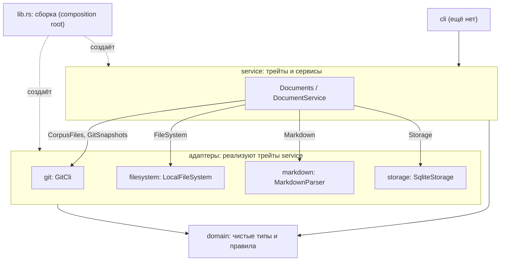

# Карта подсистем

Обзор для человека: кто за что отвечает и кто кого вызывает. Точные контракты — в doc-комментариях трейтов `src/service/mod.rs`, проектные решения — в [architecture](zkit/letopis/architecture.md) и [contracts](zkit/letopis/contracts/). Карта описывает код на `main`; при изменении границ её нужно обновлять.

## Что делает система

letopis — локальная память AI-агентов. Агенты правят размеченные Markdown-документы, letopis проверяет их и строит из них производный кэш: узлы знания, рёбра (ссылки), полнотекстовый и векторный поиск. Кэш можно пересоздать из документов.

Сейчас реализован путь «документы → кэш»: `Documents::refresh`. CLI, embeddings и поисковые запросы ещё не реализованы.

## Гексагональная архитектура

Система построена как hexagonal (ports and adapters). В коде термины «порт» и «адаптер» не используются в именах (правило `AGENTS.md`), но роли такие:

| Роль | Где в коде |
| --- | --- |
| Ядро: домен и прикладная логика | `domain`, `DocumentService` в `service` |
| Входной (driving) порт: что система предлагает снаружи | трейт `Documents`; сюда будет вызывать `cli` |
| Выходные (driven) порты: что ядру нужно от внешнего мира | `CorpusFiles`, `GitSnapshots`, `FileSystem`, `Markdown`, `Storage` |
| Выходные адаптеры: технологии за портами | `git`, `filesystem`, `markdown`, `storage` |
| Входной адаптер | `cli` (ещё нет) |
| Сборка | `lib.rs`: единственное место, где адаптеры подставляются в сервисы |

Зависимости направлены внутрь: адаптеры и `cli` знают о трейтах и домене, ядро не знает ни об одной технологии (Git, SQLite, файловой системе). Поэтому `DocumentService` в тестах работает с подменами, а технологию можно заменить, не трогая логику.

## Слои и зависимости

Правило: `service` знает только трейты, адаптеры друг друга не вызывают, всю связку делает `lib.rs`.

## Подсистемы

| Модуль | Роль | Главные типы | Интерфейс (трейт в `service`) |
| --- | --- | --- | --- |
| `domain` | Чистые значения и правила, без I/O | `KnowledgeId`, `RepoPath`, `Sha256`, `TreeOid`, `Edge`, `Element` | — |
| `service` | Контракты и прикладная логика | `DocumentService`, `RefreshOutcome`, ошибки | определяет все трейты |
| `git` | Список файлов корпуса, неизменяемые снимки деревьев | `GitCli` | `CorpusFiles`, `GitSnapshots` |
| `filesystem` | Безопасное чтение файлов внутри корня, блокировка индекса | `LocalFileSystem` | `FileSystem` |
| `markdown` | Разбор файла в элементы и рёбра, диагностика | `MarkdownParser` | `Markdown` |
| `storage` | SQLite-кэш: узлы, рёбра, FTS, векторы, состояние файлов | `SqliteStorage` | `Storage`, `StorageRead`, `CacheWrite`, `VectorWrite` |

## Трейты service

- **`Documents`**: единственная публичная операция `refresh()`, обновить кэш по изменённым документам.
- **`CorpusFiles`**: какие Markdown-файлы входят в корпус (из Git, включая удалённые).
- **`FileSystem`**: `stat_file`, `read_file` (с проверкой, что файл не менялся во время чтения), `lock_index`, время.
- **`Markdown`**: `parse_file`, чистый разбор без публикации.
- **`GitSnapshots`**: `create_tree`, `read_blob`, `pin`: неизменяемые снимки, защищённые от Git GC.
- **`Storage`** выдаёт три ограниченные «возможности»: `StorageRead` (чтение на зафиксированной ревизии), `CacheWrite` (атомарная публикация) и `VectorWrite` (запись векторов). Любая ошибка внутри записи блокирует `commit`.

## Сценарий `refresh()`

1. Прочитать из кэша состояние известных файлов (`StorageRead::list_files`).
2. Определить изменения: кандидаты из `CorpusFiles`, затем `stat` каждого. Если размер, mtime и inode те же и запись не «свежая» (racy window 1 с), файл не читается. Иначе читается и сравнивается хеш.
3. Нет изменений → вернуть `published: false` без блокировок.
4. Взять блокировку индекса (`lock_index`) и повторить шаги 1–3, чтобы исключить гонку с другим процессом.
5. Для каждого изменённого файла: прочитать байты, разобрать `Markdown::parse_file`, подготовить проекцию (узлы, рёбра, текст для FTS). Невалидный файл фиксируется как невалидный, а не роняет весь запуск.
6. Применить всё в одной транзакции `CacheWrite` и сделать `commit`: ревизия кэша растёт ровно на единицу. Если документы изменились во время работы, возвращается ошибка «documents changed during refresh».

## Где что искать

| Вопрос | Файл |
| --- | --- |
| Как собираются подсистемы | `src/lib.rs` (`open_documents`) |
| Все интерфейсы и их контракты | `src/service/mod.rs` |
| Оркестрация refresh | `src/service/document.rs` |
| Превращение файла в записи кэша | `src/service/projection.rs` |
| Типы данных между слоями | `src/service/model.rs`, `src/domain/` |
| SQL, схема, векторы | `src/storage/` (`schema.rs`, `vectors.rs`) |
| Формат документа и ссылок | `docs/zkit/letopis/contracts/X-4-markdown.md` |
| Как проверять работу агента | `AGENTS.md`, раздел Verification |
