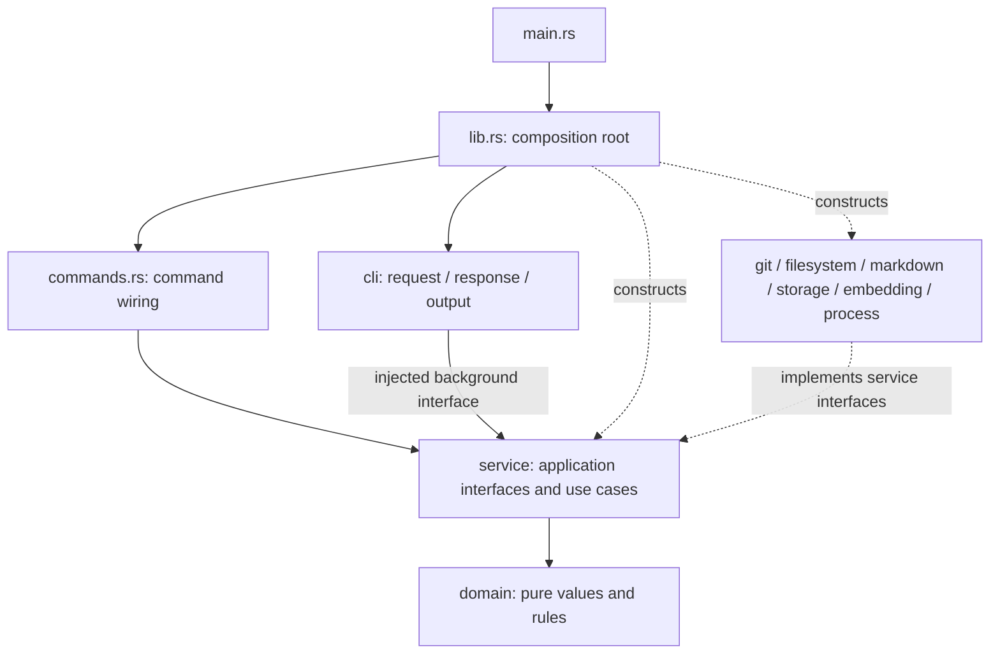

# Карта подсистем

Обзор для человека: кто за что отвечает и кто кого вызывает. Точные контракты — в doc-комментариях трейтов `src/service/mod.rs`, проектные решения — в [architecture](zkit/letopis/architecture.md#program-structure) и [contracts](zkit/letopis/contracts/). Карта описывает текущую структуру реализации; исторические спецификации и evidence сохраняют имена своего captured revision.

## Что делает система

letopis — локальная память AI-агентов. Агенты правят размеченные Markdown-документы, letopis проверяет их и строит производный кэш: узлы знания, рёбра, полнотекстовый и векторный поиск. Кэш можно пересоздать из документов.

Реализованы refresh/reindex, check, inspect, search, traverse, status, config и init. Синхронные foreground-команды используют прикладные сервисы; embedding runtime выполняет query inference и отдельный отсоединённый `embed --drain`. Успешные check/inspect/search/traverse/reindex могут запросить фоновый drain через общий шаг `cli::finish_foreground`.

## Гексагональная архитектура

| Роль | Где в коде |
| --- | --- |
| Чистые данные и правила | `src/domain/`, без I/O и инфраструктурных зависимостей |
| Прикладные сценарии | Конкретные `*Service` в отдельных плоских файлах `src/service/` |
| Принадлежащие приложению интерфейсы | Все trait declarations непосредственно в `src/service/mod.rs` |
| Общие значения и ошибки сервисов | `src/service/types.rs` и `src/service/error.rs` |
| Технологические реализации интерфейсов | `git`, `filesystem`, `markdown`, `storage`, `embedding`, `process` |
| Вход/выход CLI | `cli/input.rs`, `help.rs`, `response.rs`, `output.rs` |
| Выбор и выполнение команды | `commands.rs`: typed `Request`, окружение, вызов конструкторов и сервиса, завершение ответа |
| Сборка компонентов | `lib.rs`: реальные constructor calls, `wire_*`/`open_*`; `main.rs` — тонкая точка входа |

Сервисы зависят от домена и application-owned интерфейсов; конкретные реализации связывает composition root. Технологические компоненты не оркестрируют друг друга. `cli` не создаёт сервисы/адаптеры и не читает окружение; общий foreground/background шаг вызывает внедрённый сервис.

Стрелка implementations → service означает зависимость от интерфейсов, а не вызов application use cases инфраструктурой.

## Подсистемы

| Модуль | Ответственность | Главные реализации / интерфейсы |
| --- | --- | --- |
| `domain` | Знания, адреса, hash/identity, чистые правила и данные графа | `KnowledgeId`, `RepoPath`, `Sha256`, `TreeOid`, `Graph` |
| `service` | Refresh, команды, graph/provenance, embedding orchestration | `DocumentRefreshService`, `CheckService`, `InspectionService`, `SearchService`, `TraversalService`, `StatusService`, `EmbeddingService`, `BackgroundRunnerService` |
| `git` | Repository/worktree/index/ignore, raw пути, objects/trees/refs | `GitRepository`: `GitWorktreeListing`, `GitSnapshots`, `SnapshotVerifier`; локальная gix, без Git subprocess |
| `filesystem` | Generic files/directories/paths/bytes/identities/symlinks/locks | Один `LocalFileSystem`: `FileReader`, `FileWriter`, `FileLocker`; guards владеют реальными ресурсами |
| `markdown` | Чистый X-4 разбор в знания, рёбра и текстовые/hash projections | `MarkdownParser`: `MarkdownCodec::file_parse` |
| `storage` | SQL/schema/connections, согласованные reads и атомарные writes | Независимые `CacheStorage`/`CacheDatabase` и `VectorStorage`/`VectorDatabase` |
| `embedding` | Provider/model/vector/HTTP протоколы | Один `HttpProviders`: `EmbeddingProvider`, два независимых HTTP pools; private protocol functions, транспорт и общая валидация в `provider.rs` |
| `process` | Generic process launch, stdin, signals, clock | `DetachedProcess`: `ProcessLauncher`; `ProcessInput`, `SigintListener`, `SystemClock` |
| `cli` | Аргументы/JSON, help, typed results, foreground completion и вывод | `Request`, `CommandResponse`, `finish_foreground` |

Операции инфраструктуры используют имена entity–action–filter из контекста компонента, например `worktree_paths_get_by_ignore_mode_and_patterns`, `tree_retain_by_oid`, `file_get_by_path`, `file_parse`, `process_spawn`. Application use cases сохраняют имена по ответственности. Полные правила и исключения — в [AGENTS.md](../AGENTS.md).

## Контракты и владельцы правил

- `Refresher`: `refresh`, `refresh_verified`, `reindex` у `DocumentRefreshService`. `Checker`, `Inspector`, `Searcher`, `Traverser`, `StatusReader`, `ConfigReader`, `Initializer` имеют реализации своих сценариев.
- `GitWorktreeListing::worktree_paths_get_by_ignore_mode_and_patterns` возвращает NUL-delimited raw indexed и non-ignored untracked paths, включая удалённые tracked. Application `CandidateSelection` в `service/utils.rs` выбирает Markdown/private-root policy для refresh и inspect. Git не интерпретирует Markdown и document errors.
- `FileReader`/`FileWriter`/`FileLocker` дают generic file operations и typed `FileError`. Имена `config.json`, `cache.db`, `vectors.db` и coordination paths выбирают потребители/composition. Файловая система сохраняет confinement, no-follow, identity/replacement и alias checks; SQLite connections, schemas и attachments принадлежат storage.
- `GitSnapshots`: `tree_create`, `blob_write`, `tree_assemble`, `blob_get_by_tree_oid_and_path`. `tree_retain_by_oid` проверяет root/ref без полного обхода; `tree_pin_by_oid` каждый раз проверяет полную closure. `.git` защищает Git; composition передаёт generic excluded roots для `.letopis`, в том числе прямому `open_git_snapshots` API.
- `CacheDatabase`/`VectorDatabase`: zero-argument `with_read_tx`/`with_write_tx`; cache также имеет `with_status_read_tx`. Операции используют внедрённого владельца. Same-instance nested scopes присоединяются, только outer scope завершает transaction; caught nested error/failed write делает его rollback-only. Разные owners и две базы не образуют общей transaction. Provider HTTP остаётся вне service-owned write scopes.
- `StatusService` выбирает Disabled/Unavailable/Ready, интерпретирует identity и вычисляет backlog/failed. Storage возвращает observations и сохраняет SQL aggregation, decoding и integrity checks. Observation-only cache не создаёт отсутствующее хранилище.
- `Embedder`/`EmbeddingExecutor` используют один embedding service для config, query vectors, readiness и drain. `BackgroundRunner` проверяет readiness и lock, освобождает probe перед launch; прямой drain делегирует executor. Composition задаёт executable, `embed --drain` и cwd; generic `ProcessLauncher::process_spawn` не знает прикладной команды. Launch failure превращается в безопасное warning.

## Сценарий `refresh()`

1. В cache read scope получить revision, source roots и известные файлы (`files_get`). Git перечисляет raw пути; `CandidateSelection` фильтрует расширения и `.git`/`.letopis` как bytes. Для структурно безопасных raw-путей final symlinks пропускаются через no-follow filesystem observation до UTF-8/`RepoPath` validation. Unsafe parents, replacement и I/O остаются ошибками; stable nonregular leaves исключаются. Удалённые tracked остаются кандидатами, подтверждённый missing учитывается как удаление.
2. Сравнить metadata с cache observation. Неизменный non-racy stat позволяет не читать тело; racy window — одна секунда. Иначе захватить bytes и сравнить hash.
3. Routine refresh может вернуть `PublicationState::Unchanged` до index lock, если revision уже опубликована, delta пуста и нет source roots для retention. Verified refresh и reindex проверяют closure под lock даже при нулевой delta.
4. Взять `.letopis/index.lock`, повторно определить изменения, захватить и разобрать изменённые файлы через `MarkdownCodec::file_parse`. Невалидный файл сохраняет последнюю валидную проекцию и текущую ошибку.
5. Подготовить effective source roots и выполнить нужную root/closure verification до cache write scope. В `with_write_tx` применить file/node/edge/FTS изменения, повторить необходимые file/candidate observations и завершить одну публикацию. Revision растёт один раз на outer commit; при обнаруженной гонке или ошибке частичная публикация не сохраняется.

## Где что искать

| Вопрос | Файл |
| --- | --- |
| Сборка / constructors | `src/lib.rs`: `wire_document_refresher`, `wire_checker`, `wire_searcher`, `wire_traverser`, `wire_inspector`, `wire_embedding_executor`, `wire_background_runner`, `open_storage`, `open_status_storage` |
| Вход, маршрутизация и JSON | `src/main.rs`, `src/commands.rs`, `src/cli/` |
| Интерфейсы и service data/errors | `src/service/mod.rs`, `src/service/types.rs`, `src/service/error.rs` |
| Refresh и projection | `src/service/document_refresher.rs`, включая inline projection/basis helpers |
| Raw Git paths / application selection | `src/git/repository.rs`, `src/service/utils.rs` |
| Generic file/path checks / database opening policy | `src/filesystem/local.rs`; `src/lib.rs` |
| Check / inspect / search / traverse / status | `src/service/check.rs`, `inspection.rs`, `search.rs`, `traversal.rs`, `status.rs` |
| Embedding и drain | `src/service/embedding.rs`, `src/service/background_runner.rs`, `src/embedding/`, `src/process/` |
| SQL/schema/connections/transactions | `src/storage/cache.sql`, `vectors.sql`, `connection.rs`, `cache.rs`, `vector.rs`, `transaction.rs` |
| Формат документа и ссылок | [X-4 Markdown](zkit/letopis/contracts/X-4-markdown.md) |
| Проверки агента | [AGENTS.md](../AGENTS.md), раздел Verification |
