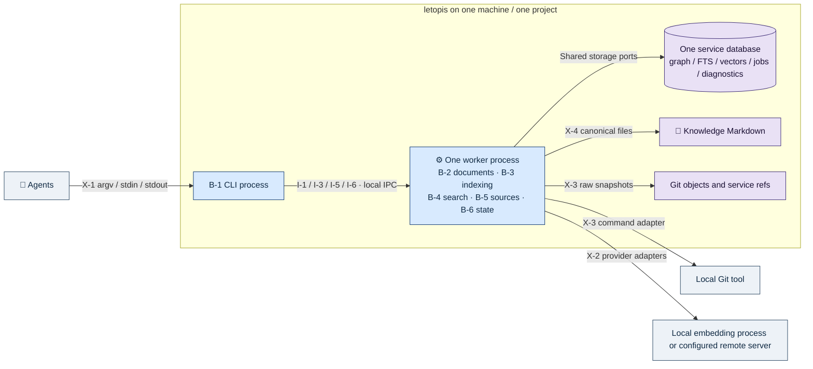
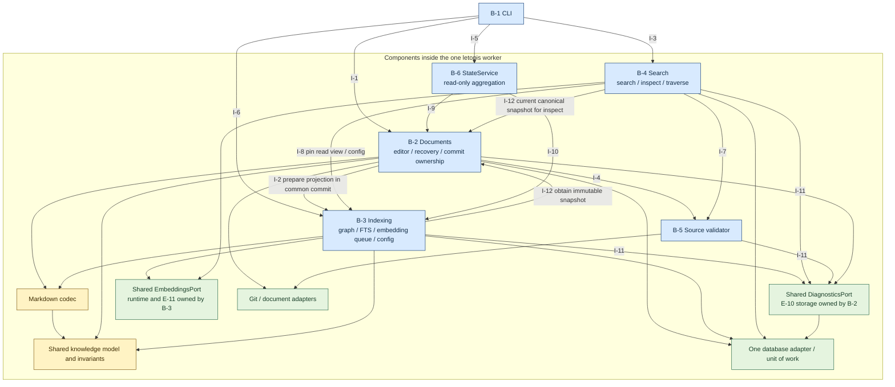

# letopis — архитектура

> **Links:** [concept](concept.md) · [requirements](requirements.md) · [resource-math](resource-math.md) · [contracts](contracts.md) · [data](data.md) · [decisions](decisions.md)
> **Status:** agreed · **Date:** 2026-10-20 · **Based on:** requirements.md (2026-10-20), resource-math.md (2026-10-20), contracts.md (2026-10-20), data.md (2026-10-20)
> **Counts:** 6 B · 12 I · 6 S · 9 key decisions

## Changes since previous version
2026-10-20: По [D-90](decisions.md#D-90) уточнены существующие I-2/I-9/I-12 и сценарии публикации/диагностики/inspect; части, владельцы и topology не меняются. Resource gates используют populated-vector и backlog fixtures.
2026-10-19: по [D-78](decisions.md#D-78) в существующую конфигурацию добавлен обязательный max_retries (целое ≥ 0), отдельно от provider parameters. Это число дополнительных попыток после первой. Полная замена конфигурации сохраняется; особая операция обновления retry-политики не вводится. Механика уточнена по [D-79](decisions.md#D-79), принятые границы [D-76](decisions.md#D-76)/D-77 сохранены. Новых ресурсных замеров нет.
2026-10-19: [D-77](decisions.md#D-77) уточняет чтение Agent → Docs: live-пути доступны без межфайловой согласованности; для согласованного чтения нескольких документов используется один Git tree snapshot, доступный через I-12/inspect. Новых частей или интерфейсов нет. Диаграммы не меняются.

2026-10-19: сохранены шесть согласованных частей и их ID, DDD/hexagonal, единый worker и границы записи/поиска. Модель сверена с data E-1…E-12, ресурсным итогом и [D-65](decisions.md#D-65)…[D-73](decisions.md#D-73). Добавлены владельцы диагностики, окружения embedding-адаптера и состояния reindex, C4 уровни 1–3, внутренние взаимодействия и сценарии отказов. Два инженерных выбора автора [D-74](decisions.md#D-74)/D-75 явно обозначены assumed с проверками; новых продуктовых вопросов/замеров нет. Прежние предложения, уже заменённые [D-7](decisions.md#D-7)/D-14/D-65/D-66, не считаются действующими альтернативами.

## 1. Summary

letopis — локальное приложение с CLI и одним автоматически запускаемым рабочим процессом на проект. В worker находятся управление документами, индексирование, поиск, проверка источников и StateService; общие доменные правила отделены от Markdown, Git, базы и провайдера портами. Документы/Git — источник содержимого; единая служебная база хранит производный поиск и необходимое долговечное состояние. Успешная правка фиксирует документы, граф/FTS и задания; embeddings вычисляет один фоновый исполнитель, поиск допускает FTS. Основной риск — согласовать файловый/Git/DB commit и восстановление при конкурентной работе, не превысив общий ресурсный бюджет; физический протокол и измерения ещё впереди.

## 2. Drivers

| Driver | Source | Why it shapes the structure |
|---|---|---|
| Полная проверенная правка и откат, включая потерю питания | FR-6…FR-15, NFR-1 | Один владелец координации сохранения/восстановления, общий валидатор и единая граница служебной фиксации |
| Общая память до десяти агентов без затирания правок | FR-8, FR-9, NFR-2 | Один worker проекта; base_hash и доменные инварианты проверяются перед фиксацией, подготовка не удерживает долгий лок |
| Самодостаточные знания, история и происхождение | FR-4, FR-17…FR-20, FR-34, FR-35 | Markdown-кодек, Git-порт и сервис проверки источников; source-идентичности отдельно от пересоздаваемого индекса |
| Полезный поиск независимо от модели | FR-13, FR-21…FR-30, NFR-7 | Согласованное чтение графа/FTS, актуальные векторы, независимая очередь и общий embedding-порт |
| Локальность и небольшой бюджет | NFR-4…NFR-6, C-6…C-8 | Один worker и одна служебная база; модель и данные не загружаются полностью по числу агентов |
| Простота эксплуатации через агента | FR-32, FR-33, FR-36, C-1 | Внешний CLI/JSON, StateService и единая диагностика, без второго публичного API или журнала ответов |

Порядок качества для структурных компромиссов: целостность и сохранность; правильность происхождения/поиска; локальность и ограниченные ресурсы; отзывчивость; простота сопровождения. Это инженерная интерпретация уже принятых Must и отказа от временного обрезания, не смена приоритетов требований. Переход с корректности на скорость не допускается.

Размерность: 100 000 узлов знаний, условные 100 000 source, 500 000 рёбер; до 10 агентов; мгновенный ориентир до 10 search/с, временное массовое наполнение отдельно от обычной работы. Общая исходная цель — 1 ГБ приложения вместе с локальной моделью на устройстве 4 ГБ. Около секунды — цель прогретого поиска, не timeout. Очередь может накапливаться; срока опустошения нет. E-10: ожидаемые 100 диагностик/сутки и 146 МБ payload/год при предположении 4000 байт. Это не квоты и не доказанные пределы. Численные L-n в resource-math пока не установлены: 0 L не означает fits.

## 3. Key decisions

| Decision | Chosen | Main alternative | Why | Serves |
|---|---|---|---|---|
| [D-2](decisions.md#D-2), [D-19](decisions.md#D-19) | Markdown/Git для содержимого; служебные проекции отдельно | Канонический текст в БД | Самодостаточный корпус и чтение известных снимков | FR-3, FR-18, FR-34 |
| [D-7](decisions.md#D-7), [D-71](decisions.md#D-71) | Граф/FTS/jobs при фиксации; embeddings асинхронно | Ждать модель для успеха записи/reindex | Отказ модели не лишает графа/FTS | FR-13, FR-22, FR-27 |
| [D-8](decisions.md#D-8), [D-9](decisions.md#D-9) | Краткоживущий журнал и откат; нет бессрочного кэша ответов | Считать хеш правки навсегда исполненным | Правильны повторные A→B после B→A и восстановление | FR-14…FR-16 |
| [D-17](decisions.md#D-17) | Долговечная заменяемая работа узла и один исполнитель | Отдельный брокер/очередь процессов | Достаточно для общей локальной БД | FR-29, FR-30 |
| [D-22](decisions.md#D-22) | Rust, единая SQLite, rusqlite, FTS5 contentless-delete, native vec1 | Исследованные Go-драйверы/расширения | Уже выбрано пользователем; исследования R-1/R-2 не повторяются | C-8, NFR-4, NFR-5 |
| [D-24](decisions.md#D-24) | DDD/hexagonal и один worker проекта | Процесс/сервис на каждую часть | Общий домен без распределённых коммитов | C-7, NFR-2 |
| [D-65](decisions.md#D-65), [D-66](decisions.md#D-66) | Нативный Ollama без усечения и совместимый API других серверов | Только совместимый endpoint | Сохранён запрет молчаливого усечения | FR-22, C-6 |
| [D-74](decisions.md#D-74) | Assumed: локальный Unix socket CLI↔worker | Loopback TCP либо worker на каждую команду | Не вводим TCP-порт/публичный API; общий worker переживает команду | C-1, NFR-2, NFR-5 |
| [D-75](decisions.md#D-75) | Assumed: общий DiagnosticsPort; хранение E-10 под B-2 | Отдельный сервис или новый журнал StateService | Единое хранение без смены авторства ошибок и обязанности StateService | FR-32, FR-33 |

### Technology and constraints

| Concern | Choice | Decision | Resource / price check |
|---|---|---|---|
| Runtime и процессы | Rust; краткоживущие CLI и один worker на проект | [D-22](decisions.md#D-22), [D-24](decisions.md#D-24) | Нет тарифа на worker; RAM/CPU локальной машины учитываются совместно, не объявлены бесплатным ресурсом |
| Служебное хранение/поиск | SQLite через rusqlite; WAL/FULL, macOS fullfsync; FTS5 и native vec1 | [D-22](decisions.md#D-22) | R-1/R-2/R-6 — ограниченные пробы. 1 ГБ RAM и полный search ещё не подтверждены; версии и vec1 flat/cos не фиксируются по пробе |
| Очередь/история | Служебная база для заданий, Git для bytes/refs | [D-17](decisions.md#D-17), [D-19](decisions.md#D-19) | Без брокера и SQL-копии текста; Git/refs/WAL/backup добавляют диск к частичным суммам |
| Embeddings | Общий порт с адаптерами Ollama и совместимого API | [D-13](decisions.md#D-13), [D-65](decisions.md#D-65)…[D-68](decisions.md#D-68) | Выбор модели/сервера явный. Локальная модель входит в бюджет; цены/квоты произвольного remote не оценены |
| Локальное IPC | Файловый Unix socket; конкретная библиотека/async runtime не выбираются | [D-74](decisions.md#D-74) | Проверена возможность в std::os::unix::net; длина адреса, startup/cancel и ресурсы требуют A-AR1 |

Ни цена удалённого сервера, ни достаточность локального CPU/GPU не следуют из этой таблицы. Драйвер/расширение уже выбраны; здесь не добавляются ORM, брокер, HTTP-сервер или библиотека concurrency.

## 4. Parts

| ID | Part | Responsibility | Owns | Faces | Limits | Build / adopt / buy | Serves |
|---|---|---|---|---|---|---|---|
| B-1 | CLI-адаптер и вход worker | Передать команду общему процессу, оформить JSON и обеспечить bootstrap проекта | Соединение/вызов CLI, обнаружение/запуск worker; bootstrap-часть M-4 | X-1 | До 10 клиентов; нет численного L-n | build | FR-31, FR-36, NFR-1, NFR-2, NFR-5, C-1 |
| B-2 | Управление документами | Подготовить/проверить правку, получить Git-снимки, координировать commit/восстановление и общее хранение диагностики | E-1, E-2, E-8, E-9, E-10; M-3 правки и M-4 сохранения | X-3, X-4 | Общая RAM [D-35](decisions.md#D-35); E-10 по A-10/A-11, не лимит | build | FR-1…FR-20, FR-25, FR-28, FR-32…FR-35, NFR-1, NFR-2, NFR-4, NFR-5 |
| B-3 | Индексирование | Подготовить/опубликовать граф/FTS, согласовать конфигурацию и выполнить актуальные embeddings | E-3, E-4, E-5, E-6, E-7, E-11, E-12; M-2, M-3 reindex, M-4 заданий | X-2 | A-1…A-5, очередь ≤ числа знаний; общая RAM [D-35](decisions.md#D-35) | build | FR-13, FR-17, FR-20, FR-22, FR-27…FR-32, NFR-4, NFR-5, NFR-6, C-6 |
| B-4 | Поиск | Search/inspect/traverse по закреплённому состоянию с нужными фильтрами и flags | M-1 и временное состояние запроса; не владеет индексом | X-2 через общий порт; X-1 через B-1 | Цель прогретой секунды без обрезания; общий бюджет | build | FR-21…FR-26, FR-31, NFR-3, NFR-5, NFR-7, NFR-8 |
| B-5 | Валидатор источников | Проверить новое основание и определить обнаруженную актуальность адресованных байтов | Только результат текущей проверки/чтения; без нового реестра/кэша | X-3 | Работа по адресованным файлам/диапазонам; общего L нет | build | FR-17…FR-20, FR-23, FR-24, NFR-5 |
| B-6 | StateService | Собрать ревизию, прогресс, локи и диагностику из владельцев | Только временный ответ; долговечного журнала нет | X-1 через B-1 | Диагностика по A-10/A-11, без новых лимитов ответа | build | FR-32, FR-33, NFR-5 |

Это роли, не шесть сервисов. E-10 имеет одного владельца хранения — B-2; B-3/B-4/B-5 определяют причины и статус своих ошибок и пишут через общий порт, а не через новую команду редактора. StateService ничего не сохраняет и не становится владельцем ошибок. Декларация DiagnosticsPort общая, реализация — тот же инфраструктурный адаптер БД; код индексирования не импортирует конкретный редактор или драйвер.

E-11 логически принадлежит runtime embedding-адаптера B-3, а не SQL-конфигурации: значение остаётся в окружении/памяти worker и используется общим портом B-3/B-4. Внешний provider владеет своей памятью, которая учитывается в бюджете локального режима. Владение группами M-n уточнено по отдельным частям состояния, а не означает их дублирование.

В bounded context «Знания» один смысл вершин/метавершин/рёбер/includes; агрегат «Метаграф проекта» — граница проверки инвариантов, а не требование загрузить всё в RAM. Markdown-кодек отделён от чистых доменных правил, оба пути apply/reindex используют те же правила. Порты объявляются из потребностей приложения; Git/БД/provider — адаптеры. Единая физическая БД не позволяет части обходить инварианты владельца.

## 5. C4 diagrams

### Level 1 — System context

Система, пользователи и внешние зависимости; агент читает адресованные документы сам. Прямые канонические правки выполняются через CLI. Git — локальный инструмент, не новый сервер. Ссылка на веб-страницу не означает её загрузку.

### Level 2 — Containers

Два вида исполняемых контейнеров: CLI и один worker; рядом локальные хранилища и отдельно настроенный provider. B-2…B-6 подписаны внутри worker только для трассировки: отдельными контейнерами они не являются. Внутренние I-n показаны на Level 3, а не превращаются в межпроцессные связи. Брокер и дополнительный daemon для индексирования не вводятся.

### Level 3 — Components of the worker

Детализация нужна для двух рисков: общей фиксации B-2/B-3 и позднего результата embeddings при новой правке/конфигурации. Редактор знаний и Восстановитель документов — прикладные сервисы B-2; Координатор индексации — B-3. Общие порты/адаптеры на рисунке не новые B-n или процессы. Стрелки означают вызовы/порты, а не обязательные импорты приложений друг в друга.

Запрошенный четвёртый уровень C4 сохраняется в плане: он будет содержать важные типы/интерфейсы после определения их контрактов на этапе mechanics. На текущем этапе вымышленные классы/struct и внутренние JSON-схемы не добавляются.

## 6. Interfaces

| ID | From → to | What passes and why | Style | Delivery semantics | Serves |
|---|---|---|---|---|---|
| I-1 | B-1 → B-2 | Подготовить/check/apply, дождаться восстановления; очистить завершённые ошибки через владельца | sync через общий IPC | Проверки текущих хешей и всей группы; нет кэша успеха/авторетрая неопределённой записи | FR-3…FR-16, FR-33 |
| I-2 | B-2 → B-3 | Подготовить проекции/задания согласованного снимка и затронутых элементов | sync + durable queue | Граф/FTS/jobs участвуют в общей финальной фиксации B-2; модель вне неё | FR-13, FR-27…FR-30 |
| I-3 | B-1 → B-4 | Выполнить search/inspect/traverse с параметрами | sync через IPC | Search/traverse — индексный read view; inspect узлов/source/рёбер — канонический снимок через I-12; возврат ссылок без содержимого; отмена своего запроса | FR-21…FR-26, FR-31 |
| I-4 | B-2 → B-5 | Проверить snapshot и все итоговые привязки нового основания | sync | Адресованные bytes/тип Git-объекта; конфликт отклоняет всю правку | FR-17…FR-20, FR-24 |
| I-5 | B-1 → B-6 | Получить status/errors | sync через IPC | Чтение без очистки и отдельного журнала; details.active различает текущие и завершённые сообщения | FR-32, FR-33 |
| I-6 | B-1 → B-3 | Начать/присоединиться к reindex, отменить его или заменить конфигурацию | sync через IPC; работа worker | Reindex ждёт публикацию graph/FTS/jobs, не векторы; config целиком | FR-22, FR-27…FR-32 |
| I-7 | B-4 → B-5 | Определить обнаруженную актуальность и соответствие фильтру ревизии | sync | Те же адресованные bytes/общий source_snapshot; flags не подтверждают истинность знания | FR-20, FR-23, FR-24 |
| I-8 | B-4 → B-3 | Закрепить read view индекса и его конфигурацию через read-only порт | sync | Граф/FTS/векторы/конфигурация из согласованного состояния; без вызова очереди | FR-21, FR-22, FR-26, NFR-7 |
| I-9 | B-6 → B-2 | Прочитать состояние записи/локов и общее хранилище ошибок | sync | Владельцы причин определяют active/completed; чтение не удаляет | FR-32, FR-33 |
| I-10 | B-6 → B-3 | Прочитать ревизию, progress reindex и счётчик jobs | sync | Queued включает выполнение/ретрай, failed отдельно в ошибках; процент текущего этапа | FR-30, FR-32 |
| I-11 | B-3 / B-4 / B-5 → B-2 | Сохранить/актуализировать безопасную диагностику через общий DiagnosticsPort | sync storage port | Одна E-10, без копии патча/секрета; согласовано с исходом своей операции | FR-30, FR-32, FR-33 |
| I-12 | B-3 / B-4 → B-2 | Получить завершённый неизменяемый снимок: область корпуса для reindex; текущее каноническое состояние и явно запрошенные source для inspect | sync read-only document port | Один общий Git-снимок, source без текущих ссылок включается по запросу; не устаревшие метаданные поискового индекса | FR-25, FR-27, FR-28, FR-34 |

I-2 и I-12 относятся к разным фазам: подготовка проекции по уже переданному снимку не запрашивает новый снимок и не вызывает редактор/commit повторно. Только координация reindex сначала получает снимок по I-12, затем использует общий путь подготовки. Направления logical interfaces не создают цикл исполнения I-2→I-12. В apply адаптеры проекций и диагностики участвуют в переданной общей единице фиксации; не делают вложенный самостоятельный commit. При самостоятельном reindex B-3 одной транзакцией публикует граф/FTS, необходимые долговечные jobs и служебные изменения source-идентичностей, сохраняя прежние URI/UUID/created_at. Канонические файлы не меняются; применимость результата к текущему состоянию проверяется. Старый снимок не заменяет более новую завершённую правку; точная проверка/ретрай — mechanics.

Inspect отличается от search/traverse: B-4 запрашивает у B-2 через I-12 текущее каноническое состояние всех выбранных ID и один общий Git-снимок. Явно выбранный зарегистрированный source допускается без текущих external-ссылок; доступный адресованный файл включается в снимок. Постоянные source URI/UUID берутся из сохранного реестра E-3, но текущие hash/file_hash/координаты знаний не подменяются старым индексом. Хеш файла вычисляется из байтов этого снимка, один раз на уникальный файл внутри вызова; постоянный кэш не добавляется. Непроверенный устаревший индекс не становится основанием inspect. Это read-only порт документов, не отдельная команда snapshot.

Внешние формы — X-1…X-4, не повторяются внутренним JSON-протоколом здесь. На IPC worker исполняет один полученный вызов; потеря соединения не разрешает автоматически повторить мутацию. Агент проверяет итог через inspect, затем готовит обычную правку. Нет постоянного operation_id, replay-log успешных ответов, второй очереди запросов или нового публичного флага.

B-1 организует bootstrap/восстановление/обнаружение внешних Git-изменений перед соответствующей командой; восстановление блокирует поиск и новые правки. Наблюдение происходит при CLI, не watcher. Для собственного apply обновляется затронутая область, не весь корпус. B-5 обеспечивает текущие причины и сравнение исторических байтов так, чтобы фильтры работали до итогового лимита; место вычисления/кэширования и конкретный алгоритм — mechanics. Пустые flags означают отсутствие обнаруженных причин, не доказанное качество факта.

Поиск вызывает общий texts→vectors порт напрямую с закреплённой конфигурацией, не ставит query в очередь документов и не ждёт её обработки. Ошибка query embedding сохраняет обычный FTS-успех и отдельную диагностику. До config вычислений нет. При новой конфигурации несовместимые векторы/очередь заменяются атомарно, старые вычисления не публикуются. Конфигурация, используемая текущим запросом, не подменяется глобальным runtime посередине запроса.

## 7. Key scenarios

| ID | Scenario | Steps | Outcome against requirements | Gaps found |
|---|---|---|---|---|
| S-1 | Поиск по новой задаче без модели или при отказе query embedding | B-1 обеспечивает готовность через I-1/I-6; I-3→B-4; I-8 фиксирует чтение; I-7 проверяет причины; общий embedding-порт; ошибка через I-11 | Обычный FTS-результат со ссылками/ревизией/flags, без текста. Никакой скрытой модели/усечения результата | Полная задержка/качество — P-1/P-2; структура поддерживает FR-21…FR-24 |
| S-2 | Два агента правят знания и связи | I-1→B-2 проверяет текущие хеши; I-4→B-5; общий кодек/домен; журнал перед файлами; I-2→B-3 подготавливает graph/FTS/jobs в общей фиксации | Один конфликт/ошибка отменяет всю группу; успешный ответ означает готовый FTS. Нельзя проверять только старый поисковый индекс | Защита совместных includes-инвариантов и физическая фиксация — A-AR3/P-3; долгое удержание лока не принимается |
| S-3 | Потеря питания до/после финальной фиксации | B-1→I-1; B-2 использует E-8/E-2 для отката; фиксирует диагностику E-10 и удаление журнала согласованно; I-9→B-6 | До завершения — прежние файлы/состояние, после — успешный результат сохраняется; потеря ответа не вызывает replay | Наличие Git/DB не доказательство fsync/rollback; A-AR3/P-3 перечислят crash-точки |
| S-4 | Новая правка/config во время вычисления старого embedding | S-2 обновляет E-3/E-4/E-7; B-3 вычисляет вне write-транзакции; перед публикацией проверяет актуальный seq/состояние | Старый результат не заменяет новый вектор и не удаляет новую работу; failed/ретраи переживают рестарт; один исполнитель | Алгоритм замены/публикации и cancellation model — mechanics/P-2.4 |
| S-5 | Внешний Git изменил корпус/источник, новая разметка некорректна | B-1→I-1/I-6; I-12 получает снимок; B-3/общий домен проверяют; B-5 определяет source_changed/not_found; ошибка через I-11 | Последний корректный индекс остаётся доступен с диагностикой/актуальностью; новое основание не выдаётся как подтверждённое; своя правка не проходит по старому хешу | Git и незавершённые CLI-записи взаимно исключены по принятой границе; механизм — A-AR3 |
| S-6 | Отмена поиска/reindex при параллельной работе | I-3 отменяет свой запрос B-4; I-6 отменяет перестройку B-3; B-6 читает I-9/I-10 | До публикации сохраняется старое состояние; после публикации граф не откатывается; чужие независимые вызовы не отменяются | Маршрутизация SIGINT/отключения IPC и точная отмена — A-AR1/P-2.4; принудительное уничтожение не обещает JSON |

Это структурные walk-through, не результаты выполнения. Сценарии могут нарушиться при неверном startup, stale-result, порядке транзакций или обходе инвариантов; проверки поэтому остаются явными задачами, а не пометкой «проходит». Отдельный пользовательский Git-коммит по-прежнему не является шагом каждого apply.

## 8. Cross-cutting concerns

**Долговечность:** B-2 координирует Markdown/Git/базу, B-3 подготавливает производные изменения в той же прикладной фиксации. Commit расширения/FTS и удаление записи восстановления не заменяются несогласованными отдельными коммитами. Диагностика отката переживает очистку журнала. Защищённая фаза короткая; новый ответ не может назвать частичную правку успешной.

**Секреты и локальность:** B-3 владеет жизнью embedding-адаптера/окружения, но не копирует ключ в SQL или Markdown. B-4 получает возможность вызова, не сериализует секрет. Данные уходят только явно выбранному серверу; отправка raw текста модели не превращает поиск в API возврата текста. Загрузка веб-источников, ACL агентов и несколько worktrees вне v1. Права локального IPC защищают границу процесса, не вводят продуктовую систему ролей.

**Наблюдаемость:** B-2 предоставляет общий порт E-10; владельцы операций определяют смысл и active/completed. B-6 собирает представление; errors --clear применяется к завершённым сообщениям через B-2, status только читает. 100 сообщений/сутки — sizing, не подавление остальных ошибок. Прогресс reindex и jobs различаются; ноль queued не означает полное покрытие векторами. Никакой второй истории ошибок/полных патчей нет.

**Ресурсы:** один экземпляр worker и общий embedding runtime предотвращают выбор «одна модель на агента». Это ещё не гарантирует совместный RAM бюджет. Источники читаются по адресованным байтам, reindex не диктует полной RAM-копии корпуса. Снимок читателя живёт до конца запроса; бессрочные поколения поискового индекса не хранятся. Измеренные R-4/R-6 по отдельности не складываются в доказанный полный бюджет.

**Поставка/эксплуатация:** Git и настроенный provider — внешние зависимости. Letopis автоматически запускает свой worker; автоматическая установка модели, запуск Ollama, фоновый watcher, idle TTL и новая команда lifecycle не следуют из этого выбора. Версии, упаковка расширения и thread/async/pool — mechanics/roadmap. Прикладной навык объясняет поиск, сохранение, конфликты, потерю ответа и получение source_snapshot средствами Git.

## 9. Traceability

| Requirement | Covered by |
|---|---|
| FR-1…FR-16 | B-2, I-1, I-2, [D-2](decisions.md#D-2), [D-5](decisions.md#D-5), [D-7](decisions.md#D-7), [D-8](decisions.md#D-8), [D-9](decisions.md#D-9) |
| FR-17…FR-20 | B-2, B-3, B-5, I-4, I-7, [D-10](decisions.md#D-10), [D-11](decisions.md#D-11) |
| FR-21…FR-26 | B-4, B-5, I-3, I-7, I-8, I-12, [D-12](decisions.md#D-12), [D-14](decisions.md#D-14), [D-15](decisions.md#D-15) |
| FR-27…FR-31 | B-3, I-2, I-6, I-12, [D-16](decisions.md#D-16), [D-17](decisions.md#D-17), [D-71](decisions.md#D-71) |
| FR-32, FR-33 | B-2, B-3, B-6, I-5, I-9, I-10, I-11, [D-18](decisions.md#D-18), [D-75](decisions.md#D-75) |
| FR-34, FR-35 | B-2, I-1, I-12, [D-19](decisions.md#D-19), [D-20](decisions.md#D-20) |
| FR-36 | B-1, [D-1](decisions.md#D-1): поставка/проверка навыка использования CLI |
| NFR-1, NFR-2 | B-1, B-2, I-1, [D-8](decisions.md#D-8), [D-21](decisions.md#D-21), [D-24](decisions.md#D-24); A-AR1/A-AR3 |
| NFR-3 | B-4, I-3, I-8, [D-50](decisions.md#D-50); полный прогретый поиск — P-2 |
| NFR-4 | B-2, B-3, I-2, [D-13](decisions.md#D-13), [D-22](decisions.md#D-22); общие ресурсы — A-AR4/P-2 |
| NFR-6 | B-3, [D-13](decisions.md#D-13), [D-65](decisions.md#D-65), [D-66](decisions.md#D-66); offline validation P-2 |
| NFR-5 | B-1…B-6, [D-21](decisions.md#D-21), [D-74](decisions.md#D-74); сквозные macOS/Linux проверки |
| NFR-7 | B-4, I-8, [D-7](decisions.md#D-7); чтение одного состояния |
| NFR-8 | [D-25](decisions.md#D-25), [D-26](decisions.md#D-26), [D-33](decisions.md#D-33): P-1/roadmap; качество результатов B-4 оценивается, выигрыш не заявлен |
| C-1…C-8 | B-1…B-6, [D-2](decisions.md#D-2), [D-13](decisions.md#D-13), [D-21](decisions.md#D-21), [D-22](decisions.md#D-22), [D-23](decisions.md#D-23), [D-24](decisions.md#D-24) |

Все X-n имеют границу в таблице частей; все E-n — одного владельца. Численные resource L-n отсутствуют, поэтому не перечислены вымышленные лимиты. Опорные A-n/NFR перенесены как общие drivers, не как отдельные обещания каждой части.

## 10. Reconciliation with earlier steps

Продуктовые границы, схемы CLI/provider/Markdown, классы данных, числа resource_model и сроки хранения не меняются. Нормативная часть architecture заменяет старый миграционный wrapper, где resource-math отсутствовал, source adapters не были выбраны и встречалось отдельное асинхронное сохранение graph/FTS. Сохранены принятые роли «Редактор знаний», «Восстановитель документов», «Координатор индексации», «Валидатор источников» и StateService.

E-10 storage owner B-2 не присваивает смысл ошибок других подсистем. E-11 — runtime ключа существующего порта, E-12 — уже согласованный координатор. Новых таблиц/сервисов нет. В requirements уточнена только устаревшая фраза о невыбранном локальном provider по [D-65](decisions.md#D-65)/D-66; acceptance локального режима не ослаблен. Даты Based on синхронизируются без смены входных соглашений.

В старых подробных материалах остаются исторические формулировки: выбор revision источника по HEAD/snapshot заменён [D-14](decisions.md#D-14), «история в финальной SQL-транзакции» не означает SQL-историю оснований. Эти места отмечены для сверки на этапе mechanics; действуют [D-11](decisions.md#D-11)/D-14 и текущее data. Их наличие не разрешает добавить history-table. Исследовательские измерения и reference не переписываются.

## 11. Risks, assumptions and open questions

| ID | Architectural assumption / risk | Carries | Validation |
|---|---|---|---|
| A-AR1 | Assumed [D-74](decisions.md#D-74): локальный socket и bootstrap обеспечат один worker и отмену своего запроса | NFR-2, NFR-5, FR-31 | Mechanics: проверка гонки десяти запусков, stale endpoint, длинного Git-root, переподключения/потери ответа, SIGINT и изоляции проектов на macOS/Linux. Endpoint не обязан лежать по длинному пути репозитория; правило короткого runtime-адреса ещё проектируется |
| A-AR2 | Assumed [D-75](decisions.md#D-75): общий storage port сохранит диагностику и правильный clear без смены авторства | FR-32, FR-33 | Mechanics/P-3: проверка error append одновременно с clear, активной причины, рестарта/отката; хранение диагностики + очистка журнала восстановления должны согласоваться, без удаления новой активной ошибки |
| A-AR3 | Файлы/Git/база и доменные инварианты выдержат конкурентный доступ/потерю питания | FR-6…FR-15, NFR-1, NFR-2 | Mechanics MC-2/MC-3 и P-3: модель interleavings и аварийные точки до/после финального commit, repeated recovery, внешнего Git; нельзя заменить тест словами WAL/FULL |
| A-AR4 | Общая память/диск и прогретый поиск уложатся в цель | NFR-3, NFR-4, NFR-6 | P-2: полный состав включая provider, readers, WAL/refs, очереди/ошибки и конечный корпус; R-4/R-6 недостаточно, сейчас замеры не запускаются |
| A-AR5 | Поиск с актуальными фильтрами и FTS fallback даст пользу агенту | FR-20…FR-26, NFR-8 | P-1/P-2: реальные цепочки задач и корректность; проверка changed/not_found, bytes-в-source_revisions и фильтров до лимита, без выдуманных показателей recall |

**Интервью architecture R1:** инвентаризация до вопросов завершена, обязательных новых продуктовых развилок нет: T=0, закрыто 0/0, в очереди 0. Два технических решения автора отмечены assumed, не «принято пользователем». Их альтернативы/границы и проверки записаны в [D-74](decisions.md#D-74)/D-75. Разбиение шести частей, язык/БД/очередь/провайдеры и StateService повторно не спрашиваются.

## 12. Deferred

→ mechanics: точные внутренние форматы I-1…I-12, bootstrap/IPC/сигналы, startup races, порядок Git/файлов/БД, локи и параллелизм защищённых записей, state machines и executable models; выбранный transport не доказывает этот протокол.

→ mechanics: C4 Level 4 для значимых domain types/ports, подробные ключи/DDL, режим vec1, соединения/потоки/async, batching, retry delays, алгоритмы фильтрации/обхода/ранжирования и освобождения буферов.

→ resilience: backup Git/БД, потеря source-идентичностей при утрате БД, границы IPC/секретов, политика копий remote и drills/RPO/RTO. Локальная IPC-проверка не вводит ACL агентов.

→ roadmap: P-1/P-2/P-3, A-AR1…A-AR5, платформенная поставка и проверка навыка; никаких новых измерений или инфраструктуры сейчас.

## 13. Consistency check

2026-10-19: структурные проверки и независимое ревью завершены; [отчёт architecture](checks/architecture/architecture-review-2026-10-19.md) и [результаты](checks/architecture/architecture-checks.json). Все Must покрыты, X-n обработаны, E-n имеют одного владельца; у assumed-решений есть именованные проверки, открытых продуктовых развилок нет. Две находки reviewer исправлены и подтверждены повторным чтением. Статус agreed относится к логическому дизайну, не к выполнению отложенных NFR. Старые architecture errors перечислены в [intake](checks/architecture/architecture-intake-checks-2026-10-19.json): диаграммы, владение E-10/E-11/E-12 и устаревшие даты. Механическая трассировка и Mermaid parsing не доказывают NFR и не заменяют независимую оценку смысла диаграмм. Runtime/измерений нет; логическая gate закрыта; runtime, ресурсы и аварийная надёжность проверяются на последующих этапах.

## Sources

- Проектные [requirements](requirements.md), [data](data.md), [contracts](contracts.md), [resource-math](resource-math.md) и [decisions](decisions.md); исследования [R-1](research/R-1-go-sqlite.md), [R-2](research/R-2-rust-sqlite.md), [R-4](research/R-4-ollama-local-probe.md), [R-6](research/R-6-sqlite-capacity-probe.md), [R-7](research/R-7-embedding-api-compatibility.md). Новых замеров нет.
- Первичные источники, прочитанные 2026-10-19: [Rust UnixListener](https://doc.rust-lang.org/std/os/unix/net/struct.UnixListener.html), [Rust UnixStream](https://doc.rust-lang.org/std/os/unix/net/struct.UnixStream.html). Они подтверждают наличие локального Unix socket API, не правильность нашего bootstrap.
- [C4 Container diagram](https://c4model.com/diagrams/container), [C4 Component diagram](https://c4model.com/diagrams/component): процесс/хранилище и внутренние компоненты показаны разными уровнями. Mermaid — средство изображения, не формальный C4 checker.
