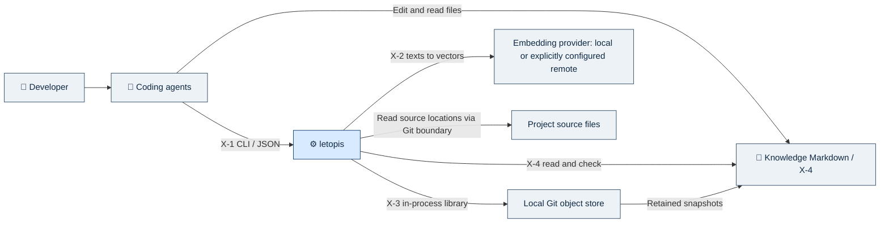
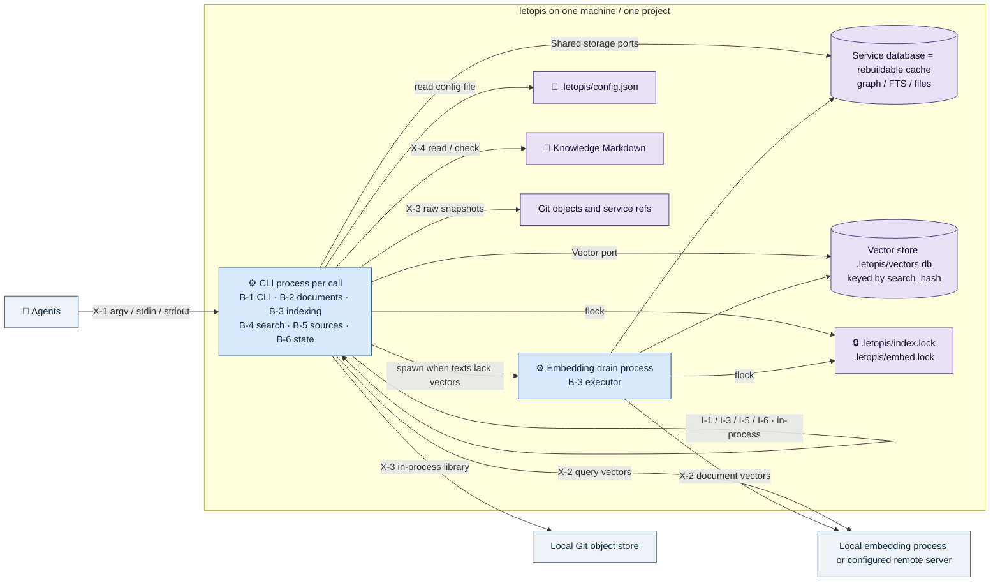
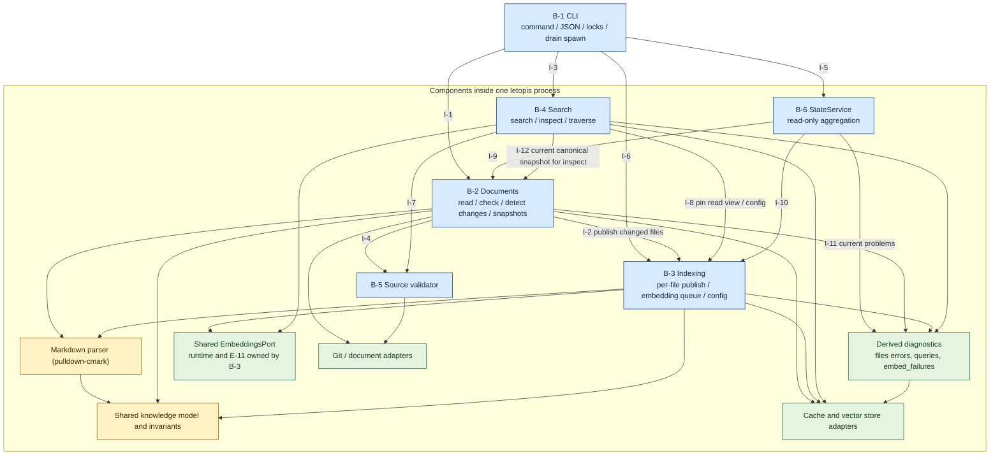

# letopis — архитектура

> **Links:** [concept](concept.md) · [requirements](requirements.md) · [resource-math](resource-math.md) · [contracts](contracts.md) · [data](data.md) · [decisions](decisions.md)
> **Status:** agreed · **Date:** 2026-10-22 · **Based on:** requirements.md (2026-10-21), resource-math.md (2026-10-21), contracts.md (2026-10-21), data.md (2026-10-21)
> **Counts:** 6 B · 12 I · 6 S · 10 key decisions

## Changes since previous version
2026-10-22 ([D-99](decisions.md#D-99)): физические модули названы по ответственности, без каталогов ports/adapters/contracts и суффиксов Port/Adapter у типов. Интерфейсы принадлежат service и доступны через mod.rs; каждая конкретная структура со своими impl находится в отдельном файле. Направление зависимостей, четыре внешние роли D-98 и границы транзакций не меняются. Это целевая структура; перенос существующего Rust-кода входит в план TK-9.

2026-10-29 ([D-104](decisions.md#D-104)): B-1 получает явный `init`; B-3 читает вложенную `embedding_model`; валидный disabled режим остаётся FTS-only и сохраняет векторы/попытки. Части, интерфейсы и topology не меняются; init использует существующие filesystem/storage boundaries и composition root.

2026-10-21 ([D-96](decisions.md#D-96)): таблица технологий дополнена полным стеком зависимостей (HTTP/TLS, Markdown, JSON/JCS/SHA-256, CLI/сигналы/процессы, поставка vec1, toolchain/платформы); убраны остатки до [D-95](decisions.md#D-95): I-12 только для inspect, I-11 вычисляет текущие проблемы, config.json только читается, E-12 нет, отмены по PID нет. Части, интерфейсы и их ID не меняются.
2026-10-20 ([D-95](decisions.md#D-95)): рёбра хранятся без признака активности, висячие ссылки и циклы находит запрос; очередь embeddings выводится из текстов без вектора (embed_failures вместо заданий с seq); диагностика — только текущие проблемы, без истории и errors --clear; config правится как файл; reindex только полный под index.lock, без отмены по PID; kind выводится. Обновлены ключевые решения, I-2/I-5/I-6/I-9/I-10/I-11, S-3/S-4/S-6, наблюдаемость и диаграммы L2/L3; части и их ID не меняются.

2026-10-20: По [D-93](decisions.md#D-93) агенты правят корпус напрямую: B-2 только читает/проверяет/обнаруживает изменения, публикация по файлу (I-1/I-2 переписаны), E-8 исключена, сценарии S-2/S-3/S-5/S-6 переписаны. По [D-94](decisions.md#D-94) постоянного worker нет: процесс на вызов, flock index/embed (E-9 у B-1), отсоединённый drain embeddings; C4 Level 2/3 перерисованы, IPC удалён, A-AR1 заменён. Части B-1…B-6 и интерфейсы I-1…I-12 сохраняют ID.
2026-10-20: По [D-92](decisions.md#D-92) векторы вынесены в `.letopis/vectors.db` (Level 2 обновлён); владелец — B-3, B-4 читает через тот же read-only порт. Части и интерфейсы не меняются.
2026-10-20: По [D-91](decisions.md#D-91) служебная база — пересоздаваемый кэш; source идентифицируется адресом. Конфигурация и запись восстановления — файлы `.letopis/`; на Level 2 добавлено хранилище этих файлов. Части B-1…B-6, интерфейсы и topology не меняются; B-2 по-прежнему владеет E-8 (теперь файл), B-3 — E-6 (теперь файл).
2026-10-20: По [D-90](decisions.md#D-90) уточнены существующие I-2/I-9/I-12 и сценарии публикации/диагностики/inspect; части, владельцы и topology не меняются. Resource gates используют populated-vector и backlog fixtures.
2026-10-19: по [D-78](decisions.md#D-78) в существующую конфигурацию добавлен обязательный max_retries (целое ≥ 0), отдельно от provider parameters. Это число дополнительных попыток после первой. Полная замена конфигурации сохраняется; особая операция обновления retry-политики не вводится. Механика уточнена по [D-79](decisions.md#D-79), принятые тогда границы (защищённая фаза, позже заменена [D-93](decisions.md#D-93)) и [D-77](decisions.md#D-77) сохранены. Новых ресурсных замеров нет.
2026-10-19: [D-77](decisions.md#D-77) уточняет чтение Agent → Docs: live-пути доступны без межфайловой согласованности; для согласованного чтения нескольких документов используется один Git tree snapshot, доступный через I-12/inspect. Новых частей или интерфейсов нет. Диаграммы не меняются.

2026-10-19: сохранены шесть согласованных частей и их ID, DDD/hexagonal, единый worker и границы записи/поиска. Модель сверена с data E-1…E-12, ресурсным итогом и [D-65](decisions.md#D-65)…[D-73](decisions.md#D-73). Добавлены владельцы диагностики, окружения embedding-адаптера и состояния reindex, C4 уровни 1–3, внутренние взаимодействия и сценарии отказов. Два инженерных выбора автора (IPC worker, позже заменён [D-94](decisions.md#D-94), и общий порт диагностики, позже заменён [D-95](decisions.md#D-95)) явно обозначены assumed с проверками; новых продуктовых вопросов/замеров нет. Прежние предложения, уже заменённые [D-7](decisions.md#D-7)/D-14/D-65/D-66, не считаются действующими альтернативами.

Уточнение 2026-10-31, issue #67: одна `GitRepository` и один владелец cleanup
на invocation; gix-типы остаются приватными в `src/git/`. Корневые/адресованные
проверки, `retain` и сильный `pin` сохраняют разные гарантии по [X-3](contracts/X-3-git.md).
Батчи provenance ограничены preflight/check/status; search/traverse сохраняют
последовательные live-наблюдения. Исторические receipts не переписываются.

## 1. Summary

letopis — локальное CLI-приложение без постоянного процесса ([D-94](decisions.md#D-94)): каждый вызов — отдельный процесс, а embeddings считает отсоединённый процесс `letopis embed --drain`, который завершается, когда не осталось текстов без вектора. Агенты правят размеченные Markdown-документы напрямую ([D-93](decisions.md#D-93)); letopis их читает, проверяет и индексирует. Каждый вызов search/traverse/inspect/check перед ответом обнаруживает изменённые файлы и публикует их валидные изменения в граф/FTS под `flock` на `.letopis/index.lock`. Документы/Git — источник содержимого; служебная база — пересоздаваемый кэш (граф/FTS/строки files), векторы — в `.letopis/vectors.db` по search_hash ([D-91](decisions.md#D-91), [D-92](decisions.md#D-92)). Общие доменные правила отделены портами от Markdown, Git, базы и провайдера. Основные риски — стоимость обнаружения изменений на каждом вызове, корректность публикации по файлу при параллельных процессах и общий ресурсный бюджет; измерения ещё впереди.

## 2. Drivers

| Driver | Source | Why it shapes the structure |
|---|---|---|
| Прямые правки агентов без порчи индекса | FR-3, FR-6, FR-11…FR-13, NFR-1 | letopis не пишет корпус; одна публикация за раз под flock; невалидный файл не блокирует остальные |
| Общая память до десяти агентов | FR-1, FR-2, NFR-2 | Читатели работают со снимками кэша без блокировок; публикацию сериализует один flock |
| Самодостаточные знания, история и происхождение | FR-4, FR-17…FR-20, FR-34, FR-35 | Markdown-кодек, Git-порт и сервис проверки источников; ID знания и source выводятся из файлов |
| Полезный поиск независимо от модели | FR-13, FR-21…FR-30, NFR-7 | Согласованное чтение графа/FTS, векторы по search_hash, независимый drain и общий embedding-порт |
| Локальность и небольшой бюджет | NFR-4…NFR-6, C-6…C-9 | Модель живёт в provider; процессы letopis её не загружают; одна база-кэш и один файл векторов |
| Простота эксплуатации через агента | FR-32, FR-33, FR-36, C-1 | Внешний CLI/JSON, StateService и единая диагностика, без IPC, второго API или журнала ответов |

Порядок качества для структурных компромиссов: целостность знаний и индекса; правильность происхождения/поиска; локальность и ограниченные ресурсы; отзывчивость; простота сопровождения. Переход с корректности на скорость не допускается.

Размерность: 100 000 узлов знаний, условные 100 000 source, 500 000 рёбер; до 10 агентов; мгновенный ориентир до 10 search/с, временное массовое наполнение отдельно от обычной работы. Общая исходная цель — 1 ГБ приложения вместе с локальной моделью на устройстве 4 ГБ. Около секунды — цель прогретого поиска, не timeout. Очередь может накапливаться; срока опустошения нет. E-10 — только текущие проблемы без истории ([D-95](decisions.md#D-95)): объём ограничен числом текущих файлов и текстов, а не временем. Это не квоты и не доказанные пределы. Численные L-n в resource-math пока не установлены: 0 L не означает fits.

## 3. Key decisions

| Decision | Chosen | Main alternative | Why | Serves |
|---|---|---|---|---|
| [D-2](decisions.md#D-2), [D-19](decisions.md#D-19) | Markdown/Git для содержимого; служебные проекции отдельно | Канонический текст в БД | Самодостаточный корпус и чтение известных снимков | FR-3, FR-18, FR-34 |
| [D-93](decisions.md#D-93) | Агенты правят файлы напрямую; ID — путь или путь#якорь; ошибки по файлу | Запись только через apply с атомарными группами и откатом | Убирает протокол записи, журнал и восстановление | FR-3, FR-4, FR-6, FR-11…FR-13 |
| [D-7](decisions.md#D-7), [D-71](decisions.md#D-71) | Граф/FTS публикуются до ответа; embeddings асинхронно | Ждать модель для ответа | Отказ модели не лишает графа/FTS | FR-13, FR-22, FR-27 |
| [D-91](decisions.md#D-91), [D-92](decisions.md#D-92) | БД — пересоздаваемый кэш; векторы в отдельном файле по search_hash | Невосстановимое состояние в БД | Ремонт = reindex, неизменные тексты не пересчитываются | FR-27, FR-29, C-9 |
| [D-95](decisions.md#D-95) | Очередь embeddings выводится запросом: тексты без вектора; попытки в embed_failures | Таблица заданий с seq, отдельный брокер | Поздний результат безвреден по search_hash, синхронизировать нечего | FR-29, FR-30 |
| [D-22](decisions.md#D-22) | Rust, SQLite, rusqlite, FTS5 contentless-delete, native vec1 | Исследованные Go-драйверы/расширения | Уже выбрано пользователем; R-1/R-2 не повторяются | C-4, NFR-4, NFR-5 |
| [D-24](decisions.md#D-24), [D-94](decisions.md#D-94) | DDD/hexagonal внутри процесса; без постоянного worker, flock и фоновый drain | Постоянный worker с Unix socket | Модель в provider, WAL обслуживает читателей; IPC не даёт выигрыша | C-7, NFR-2, NFR-5 |
| [D-65](decisions.md#D-65), [D-66](decisions.md#D-66) | Нативный Ollama без усечения и совместимый API других серверов | Только совместимый endpoint | Сохранён запрет молчаливого усечения | FR-22, C-6 |
| [D-95](decisions.md#D-95) | Диагностика — текущие проблемы, выводимые из files, запросов и embed_failures | Таблица ошибок с историей и очисткой | Нет жизненного цикла сообщений | FR-32, FR-33 |
| [D-96](decisions.md#D-96) | Синхронный Rust-стек: ureq, pulldown-cmark, serde, signal-hook, vec1 внутри бинарника | tokio/reqwest, загружаемое расширение vec1 | Короткие процессы с блокирующими SQLite/flock; async ничего не сокращает; один файл поставки | C-4, C-10, NFR-5 |

### Technology and constraints

| Concern | Choice | Decision | Resource / price check |
|---|---|---|---|
| Runtime и процессы | Rust; процесс на каждый вызов CLI и отсоединённый drain embeddings; синхронный std I/O без async runtime | [D-22](decisions.md#D-22), [D-94](decisions.md#D-94), [D-96](decisions.md#D-96) | Нет постоянного процесса; RAM/CPU вызовов и provider учитываются совместно |
| Toolchain и платформы | Rust 1.95.0, edition 2024 (MSRV = закреплённая версия); macOS и Linux (glibc), arm64 и x86_64; Windows и NFS не поддерживаются | [D-96](decisions.md#D-96) | Проверено на macOS/Linux ARM64 (TK-1…TK-4); x86_64 — assumed до TK-43 |
| Служебное хранение/поиск | SQLite через rusqlite `=0.40.2` с bundled SQLite; SeaQuery `=1.0.2` для обычных запросов ([D-100](decisions.md#D-100)); WAL/FULL, macOS fullfsync; FTS5; vec1 в `.letopis/vectors.db` (ATTACH) | [D-22](decisions.md#D-22), [D-92](decisions.md#D-92), [D-96](decisions.md#D-96) | R-1/R-2/R-6 — ограниченные пробы; vec1 в подключённом файле проверен TK-3 |
| Поставка vec1 | `ext/vec1` закреплённого коммита компилируется build.rs (`cc`) в бинарник и регистрируется `sqlite3_auto_extension`; `load_extension` выключен | [D-96](decisions.md#D-96) | Один файл поставки; статическая сборка проверяется TK-9/TK-43 (TK-1 проверил отдельный файл vec1) |
| Очередь/история | Очередь — запрос по кэшу и vectors.db; Git для bytes и refs только выданных inspect-снимков и source_snapshot (`refs/letopis/snapshots/*`) | [D-95](decisions.md#D-95), [D-19](decisions.md#D-19) | Без брокера, таблицы заданий и SQL-копии текста; tree на публикацию нет |
| Embeddings | Общий порт с адаптерами Ollama и совместимого API | [D-13](decisions.md#D-13), [D-65](decisions.md#D-65)…[D-68](decisions.md#D-68) | Локальная модель входит в бюджет; цены/квоты произвольного remote не оценены |
| Параллелизм drain | `threadpool =1.8.1`, четыре OS threads/необработанных задания; координатор один, короткая запись на результат | [D-107](decisions.md#D-107) | Измерения на управляемом provider — [#49](checks/issue-49/report.md); real-model throughput и whole-stack RAM отдельно |
| HTTP и TLS (X-2) | `ureq` 3, блокирующий: без редиректов и прокси из окружения, таймаут попытки 60 s; rustls + `rustls-platform-verifier` (системные сертификаты) | [D-96](decisions.md#D-96), [D-83](decisions.md#D-83) | [TK-6 PASS](checks/TK-6/report.md), macOS/Linux ARM64, синтетические endpoints; без tokio/reqwest; повторы считает letopis в embed_failures, production-интеграция — TK-13/TK-27/TK-41 |
| Markdown, JSON, хеши | `pulldown-cmark` (только разбор, байтовые диапазоны и `{#anchor}`); `serde`/`serde_json` со строгим вводом; `serde_json_canonicalizer` (JCS) для отпечатка config.json; `sha2` | [D-96](decisions.md#D-96) | Сериализатора Markdown нет: letopis не пишет корпус |
| Git (X-3) | Локальная `gix =0.90.0`, SHA-1/SHA-256, без subprocess/helpers/filters/network | [D-96](decisions.md#D-96), уточнение 2026-10-31 | Историческая CLI-граница TK-8 заменена; Git нужен авторам и fixture/oracle workflow |
| Координация процессов | `flock` на `.letopis/index.lock` и `.letopis/embed.lock` (std::fs::File::lock); argv разбирается std | [D-94](decisions.md#D-94), [D-96](decisions.md#D-96) | Блокировку держит ядро и снимает при завершении процесса; NFS не поддерживается |
| Процессы и сигналы | `libc::setsid` и 0/1/2 → /dev/null для drain; `signal-hook`: на SIGINT поток печатает единственный ответ ok:false/`cancelled` (once-guard на stdout) и завершает процесс с exit 1 в любой точке — SQL-шаг, ожидание flock, локальное чтение Git-объекта, HTTP | [D-96](decisions.md#D-96) | Незафиксированная транзакция откатывается как после сбоя (WAL, TK-2), flock снимает ядро, зафиксированная публикация остаётся; у drain обработчика нет: завершение по умолчанию, ответа нет, attempts сохранены. Доказательства: TK-2, TK-4 (смерть по сигналу), [TK-6](checks/TK-6/review.md) (HTTP и согласование cancelled с exit 1); TK-29 — все команды и остальные точки ожидания |

Ни цена удалённого сервера, ни достаточность локального CPU/GPU не следуют из этой таблицы. Здесь не добавляются async runtime, ORM, брокер, HTTP-сервер, IPC или библиотека concurrency ([D-96](decisions.md#D-96)).

## 4. Parts

| ID | Part | Responsibility | Owns | Faces | Limits | Build / adopt / buy | Serves |
|---|---|---|---|---|---|---|---|
| B-1 | CLI-процесс | Разобрать команду, оформить JSON, выполнить init, запустить drain embeddings при текстах без вектора, координировать блокировки | E-9; M-4 текущего процесса | X-1 | До 10 одновременных процессов; нет численного L-n | build | FR-31, FR-36, NFR-1, NFR-2, NFR-5, C-1, C-7 |
| B-2 | Документы | Читать и проверять корпус (check), обнаруживать изменённые файлы, получать и закреплять Git-снимки, хранить ошибки файлов в строках files | E-1 (только чтение), E-2, E-10; M-3 проверки | X-3, X-4 | Общая RAM [D-35](decisions.md#D-35); E-10 по A-10/A-11, не лимит | build | FR-1…FR-6, FR-11…FR-13, FR-25, FR-28, FR-32…FR-35, NFR-1, NFR-2, NFR-4, NFR-5 |
| B-3 | Индексирование | Подготовить/опубликовать граф/FTS по файлу, согласовать вложенную конфигурацию и disabled readiness, выполнить embeddings в drain | E-3, E-4, E-5, E-6, E-7, E-11; M-2, M-3 публикации | X-2 | A-1…A-5, очередь ≤ числа знаний; общая RAM [D-35](decisions.md#D-35) | build | FR-13, FR-17, FR-20, FR-22, FR-27…FR-32, NFR-4, NFR-5, NFR-6, C-6, C-9 |
| B-4 | Поиск | Search/inspect/traverse по закреплённому состоянию с нужными фильтрами и flags | M-1 и временное состояние запроса; не владеет индексом | X-2 через общий порт; X-1 через B-1 | Цель прогретой секунды без обрезания; общий бюджет | build | FR-21…FR-26, FR-31, NFR-3, NFR-5, NFR-7, NFR-8 |
| B-5 | Валидатор источников | Проверить основание знания и определить актуальность адресованных байтов | Только результат текущей проверки/чтения; без реестра/кэша | X-3 | Работа по адресованным файлам/диапазонам; общего L нет | build | FR-17…FR-20, FR-23, FR-24, NFR-5 |
| B-6 | StateService | Собрать ревизию, блокировки, отставание векторов и текущие проблемы | Только временный ответ; долговечного журнала нет | X-1 через B-1 | Диагностика по A-10/A-11, без новых лимитов ответа | build | FR-32, FR-33, NFR-5 |

Это роли модулей одного бинарника, не шесть сервисов: в каждом процессе CLI работают те из них, что нужны команде; drain-процесс использует B-3. Диагностика выводится из данных ([D-95](decisions.md#D-95)): ошибку файла пишет B-2 в строку files при публикации, ошибки embeddings — B-3 в embed_failures, висячие ссылки и циклы вычисляются запросом; общего порта с жизненным циклом нет. StateService ничего не сохраняет. E-11 логически принадлежит runtime embedding-адаптера B-3: значение остаётся в окружении процесса. Внешний provider владеет своей памятью, которая учитывается в бюджете локального режима.

В bounded context «Знания» один смысл вершин/метавершин/рёбер/includes; агрегат «Метаграф проекта» — граница проверки инвариантов, а не требование загрузить всё в RAM. Markdown-кодек отделён от чистых доменных правил, публикация и check используют те же правила. Services (внутренний слой) зависят от четырёх портов FileSystem, Storage, VersionControl, EmbeddingProvider, [D-98](decisions.md#D-98); порты объявляются из потребностей приложения; Git/БД/provider — адаптеры. Общие физические файлы (кэш + vectors.db) не позволяют части обходить инварианты владельца.

### Разделение реализации сервисов и адаптеров

KISS, DRY и YAGNI обязательны для всего Letopis: всех текущих и будущих задач, модулей, API, сущностей, сервисов, адаптеров, тестов и дизайн-документов. Практические правила простоты, владения ответственностью и выбора абстракций закреплены в [AGENTS.md](../../../AGENTS.md) и применяются вместе с DDD/hexagonal-границами ниже.

Обычные SQL-запросы внутри storage строятся через SeaQuery с типизированными именами таблиц/колонок и связанными параметрами, затем исполняются существующим rusqlite ([D-100](decisions.md#D-100)). Приватный query.rs преобразует значения с проверкой диапазонов; builder не выходит в domain/service. DDL и специализированные SQLite/FTS5/vec1 операции остаются явным SQL. Владение соединениями, snapshot/transaction-границы, engine/native build и композиция lib.rs не меняются.

Пользователь разрешил общий `src/utils.rs` и локальные `utils.rs` внутри отдельных модулей. Общий файл содержит действительно переиспользуемые вспомогательные функции, локальный — детали своего модуля; бизнес-правила сохраняются в domain/service, технологические реализации — в адаптерах. Вспомогательные модули имеют минимальную видимость: приватный `mod utils` локально, `pub(crate)` для элементов с реальными внутренними потребителями. Общие utilities не зависят от конкретных адаптеров, сервисов или точки сборки и не становятся способом обойти hexagonal-границы. Файлы появляются при наличии нужного кода, а не создаются пустыми заранее.

CLI-обработчики команд — отдельный входной слой (driving adapter), явно подтверждённый пользователем. Физически `cli/input.rs` разбирает argv/JSON в типизированный `Request`, `cli/help.rs` формирует текст help/version, `cli/response.rs` содержит типизированные результаты и общий шаг запуска фоновой работы после успеха, `cli/output.rs` формирует ответ и exit code. Пакет cli не обращается к сервисам и окружению. Сценарий и предметные проверки принадлежат сервису/домену. `commands.rs` выбирает команду по `Request`, собирает нужные сервисы конструкторами из lib.rs (composition root), вызывает входной интерфейс сервиса и передаёт результат общему formatter. main.rs передаёт управление собранному CLI. Эти файлы/структуры добавляются с реализацией CLI в TK-11, без заглушек в TK-8.

Дополнительное требование пользователя: идиоматический Rust. Владение и заимствования выражены явно; Clone/Arc/Mutex и динамическая диспетчеризация используются по реальной необходимости. Контракты компонентов задаются trait, конкретные реализации — struct/impl; generics или dyn Trait выбираются по потребности конкретной границы. Конечные варианты моделируются enum, ожидаемые ошибки — типизированным Result с сохранением причины внутри адаптера и безопасной диагностикой наружу. Видимость минимальна, публичные API документированы; Cargo fmt и Clippy с -D warnings обязательны. Модульная/hexagonal-структура реализуется средствами Rust, с небольшими понятными API и явной сборкой в lib.rs.

Пользователь подтвердил общий принцип: структура проекта модульная, с чёткими границами. У каждого модуля есть одна определённая ответственность и явный публичный контракт; внутренние helper-типы и детали реализации остаются закрытыми. Связи проходят через предусмотренные интерфейсы, без обхода чужого контракта через внутренние файлы/типы. При реализации и ревью проверяются реальные каталоги, видимость типов и направления импортов, а не только соответствие схемы названиям папок.

Уточнение пользователя 2026-10-22: Storage, Service, Git, Embedding и остальные ответственности разделены модулями и связаны явными интерфейсами. В Rust интерфейсы — `trait`, конкретные сервисы/адаптеры — `struct` с `impl` соответствующего trait.

В одном crate `domain/` содержит чистые сущности/правила; `service/` — прикладные интерфейсы и реализации сценариев. По [D-99](decisions.md#D-99) отдельного каталога contracts/ports нет: небольшие принадлежащие приложению traits (`Storage`, `GitSnapshots` и интерфейсы сервисов) объявляются в `service/mod.rs`. Когда интерфейсы вырастают, их определения можно выделить по ответственности в приватные файлы и явно реэкспортировать из mod.rs, сохранив короткий путь `service::Storage`.

Технологические реализации расположены в отдельных корневых модулях `storage/`, `git/`, `embedding/`, `markdown/` и `filesystem/`, без промежуточного каталога adapters. Их структуры реализуют принадлежащие service интерфейсы. Каждая конкретная реализация занимает собственный файл: `git/repository.rs` содержит `GitRepository` и его inherent/trait impl, `storage/sqlite.rs` — `SqliteStorage` и его impl. То же правило действует для конкретных сервисов и других реализаций. mod.rs задаёт интерфейс модуля, объявляет дочерние модули и явно реэкспортирует нужные имена; тела конкретных реализаций находятся в отдельных файлах. Имена типов описывают ответственность/технологию без суффиксов Port/Adapter. Вспомогательные модули сохраняют собственную ответственность; пустые будущие файлы не создаются.

CLI вызывает интерфейсы сервисов; сервисы получают нужные реализации через конструктор и не импортируют конкретные Git/SQLite/provider-типы. По явному уточнению пользователя composition root расположен в `src/lib.rs`: здесь создаются конкретные структуры и передаются конструкторам сервисов через их интерфейсы. `src/main.rs` остаётся тонким запуском CLI. Storage, Git и Embedding не вызывают друг друга напрямую. Бизнес-алгоритмы остаются в service, Git/SQL/HTTP — в соответствующих модулях; ни домен, ни сервисы не зависят от корневой сборки.

Эта раскладка нормативна для последующей реализации. Во время фиксации D-99 текущий Rust-код ещё использует имена из TK-8; его перенос и переименование включаются в TK-9. Исторические спецификации, планы и evidence TK-7/TK-8 сохраняют исходные пути своего снимка, а действующие инструкции и новые документы используют D-99.

Интерфейсы задаются потребностями сценариев и владением данными. По [D-98](decisions.md#D-98) Storage — один прикладной интерфейс к кэшу и vectors.db; write unit/read view остаются явными типизированными возможностями с собственным временем жизни и границами транзакций, а не произвольным SQL API. Публичные интерфейсы сервисов добавляются вместе с реализацией сценариев; пустые каталоги, forwarding-сервисы и набор будущих traits заранее не создаются. Существующий чистый Markdown-parser подключается через адаптер, когда у сервиса появляется соответствующая потребность. Это конкретизация уже принятой hexagonal-архитектуры, без новых процессов, wire-протоколов или Cargo crates.

#### TK-23 — данные Graph и алгоритм обхода

`domain::Graph` — независимые упорядоченные данные результата, без I/O или injected storage. `service::GraphService` реализует GraphTraversal/BFS и читает object-safe GraphRead; TraversalService владеет refresh/readiness/pin/selected-link observations, сохраняя только S/F generics для scoped Storage и FileSystem lock. Storage исполняет bounded keyset pages; lib.rs создаёт реальные collaborators, CLI вызывает Traverser. Нового процесса, runtime, forwarding layer или граф-кэша нет. BFS bound не распространяется на существующие publication/file/root/JSON buffers. [Физическая проверка, host/Linux native receipts и завершённые reviews](checks/TK-23/report.md).

#### Приёмка структуры в каждой задаче

Эти правила обязательны для изменяемого продуктового Rust-кода во всех TK и при последующих исправлениях. Ссылка на этот раздел находится в каждой карточке; единственный нормативный текст структуры остаётся здесь.

1. В отчёте назвать затронутые модули/файлы и их ответственность: domain, service/API/ports, конкретный адаптер, CLI-handler, utils или композиция в lib.rs. Каталоги и файлы должны отражать эти границы.
2. Проверить видимость и направления импортов: domain независим от сервисов/I/O; service зависит от домена/контрактов; адаптер реализует порт; CLI-handler вызывает интерфейс сервиса. Конкретные зависимости связывает lib.rs, main.rs остаётся тонким. Внутренние детали соседнего модуля не обходят его контракт.
3. Проверить идиоматичность Rust, нужные trait/struct/impl и владение данными; для изменяемого Rust-кода выполнить релевантные tests, fmt и Clippy. Исполнитель и reviewer проверяют архитектурные границы по фактическому коду; один успешный fmt/Clippy архитектуру не доказывает.
4. В evidence/отчёте кратко указать проверенные границы и команды. Если задача меняет только документы, протокол пилота, данные или изолированный proof harness, явно назвать область и отсутствие изменений продуктового Rust-кода; создавать для неё фиктивные domain/service/adapter модули не требуется. Если в ходе такой задачи продуктовый код всё же меняется, проверка применяется к этим изменениям.

Для ранее завершённых TK-1…TK-7 ссылка задаёт правило будущих изменений: она не объявляет новый ретроспективный аудит выполненным и не переотмечает исторические acceptance/evidence. Общие критерии оставшихся задач требуют отчёта о проверке применимых границ либо обоснования отсутствия изменений продуктового кода.

## 5. C4 diagrams

### Level 1 — System context

Агенты правят документы напрямую и читают адресованные фрагменты сами; letopis читает, проверяет и индексирует корпус. Git — локальный инструмент, не сервер. Ссылка на веб-страницу не означает её загрузку.

### Level 2 — Containers

Два вида процессов одного бинарника: процесс на каждый вызов CLI и отсоединённый drain embeddings. Постоянного worker нет ([D-94](decisions.md#D-94)). B-1…B-6 подписаны для трассировки: это модули, а не контейнеры. Внутренние I-n — вызовы внутри процесса.

### Level 3 — Components inside a letopis process

Детализация нужна для двух рисков: публикации изменённых файлов параллельными процессами и позднего результата embeddings. Общие порты/адаптеры на рисунке — не новые B-n или процессы. Стрелки означают вызовы/порты.

Запрошенный четвёртый уровень C4 сохраняется в плане: значимые типы/интерфейсы описаны в mechanics; вымышленные классы здесь не добавляются.

## 6. Interfaces

| ID | From → to | What passes and why | Style | Delivery semantics | Serves |
|---|---|---|---|---|---|
| I-1 | B-1 → B-2 | Check корпуса/путей; обнаружить изменённые файлы перед командой чтения | sync, in-process | Файлы не меняются; результат — диагностика по файлу | FR-3, FR-6, FR-11, FR-12, FR-28, FR-33 |
| I-2 | B-2 → B-3 | Подготовить и опубликовать проекции изменённых файлов | sync под index.lock | Одна транзакция кэша: graph/FTS/files-строки с ошибками/счётчик revision; невалидный файл сохраняет прежнюю проекцию; модель вне unit | FR-6, FR-13, FR-27…FR-30 |
| I-3 | B-1 → B-4 | Выполнить search/inspect/traverse с параметрами | sync, in-process | Search/traverse — индексный read view; inspect — канонический снимок через I-12; ссылки без содержимого | FR-21…FR-26, FR-31 |
| I-4 | B-2 → B-5 | Проверить source_snapshot знания и его привязки | sync | Отсутствующий снимок — диагностика; несовпадение bytes — source_changed; закрепление ref найденного снимка | FR-17…FR-20, FR-24 |
| I-5 | B-1 → B-6 | Получить status | sync, in-process | Чтение текущих проблем без истории и очистки ([D-95](decisions.md#D-95)) | FR-32, FR-33 |
| I-6 | B-1 → B-3 | Начать полный reindex или показать конфигурацию | sync, in-process; reindex под index.lock всё время | Полный reindex ждёт graph/FTS, не векторы; отмена — SIGINT своего процесса; config только читается, файл правится напрямую ([D-95](decisions.md#D-95)) | FR-22, FR-27…FR-32 |
| I-7 | B-4 → B-5 | Определить актуальность и соответствие фильтру ревизии | sync | Те же адресованные bytes/общий source_snapshot; flags не подтверждают истинность знания | FR-20, FR-23, FR-24 |
| I-8 | B-4 → B-3 | Закрепить read view кэша, векторов и конфигурации через read-only порт | sync | Граф/FTS из одного снимка кэша; config.json принимается при совпадении с meta.config_identity в vectors.db; векторы адресованы текстом | FR-21, FR-22, FR-26, NFR-7 |
| I-9 | B-6 → B-2 | Прочитать занятость блокировок и ошибки файлов | sync | Ошибки невалидных файлов — из files, висячие ссылки и циклы — запросом; чтение не меняет кэш | FR-32, FR-33 |
| I-10 | B-6 → B-3 | Прочитать ревизию и отставание векторов | sync | Число текстов без вектора и исчерпавших попытки (embed_failures) — запросом | FR-30, FR-32 |
| I-11 | B-6 / B-2 (check) → хранилище | Вычислить текущие проблемы из данных | sync read-only port | Ошибки файлов — из files (пишет unit публикации), висячие ссылки и циклы — запросом, embeddings — из embed_failures (пишет B-3), query_error — из vectors.db (пишет B-4); без секрета и истории | FR-30, FR-32, FR-33 |
| I-12 | B-4 → B-2 | Получить неизменяемый снимок для inspect: текущее состояние и явно запрошенные source | sync read-only document port | Один общий Git-снимок текущих файлов; ref закреплён до выдачи | FR-25, FR-34 |

I-2 и I-12 не пересекаются: публикация и reindex читают изменённые файлы рабочей копии, снимок I-12 берёт только inspect ([D-95](decisions.md#D-95)). Перед каждой командой чтения B-2 сравнивает файлы корпуса с опубликованным состоянием (stat-префильтр, затем хеш изменённых); при изменениях процесс берёт `index.lock`, повторно сверяет состояние и публикует только изменённые файлы. Пока один процесс публикует, остальные ждут блокировку и затем видят уже опубликованное — повторной публикации нет. Reindex выполняется под той же блокировкой одной транзакцией; применимость результата к текущим файлам проверяется перед фиксацией.

Inspect отличается от search/traverse: B-4 запрашивает у B-2 через I-12 текущее состояние всех выбранных ID и один общий Git-снимок. Source без текущих external-ссылок не существует и даёт not_found. Хеш вычисляется из байтов этого снимка, один раз на уникальный файл внутри вызова. Непроверенный устаревший индекс не становится основанием inspect.

Поиск вызывает общий texts→vectors порт напрямую с закреплённой конфигурацией, не ставит query в очередь документов. Ошибка query embedding сохраняет обычный FTS-успех без пометки в ответе и записывается последней строкой vec.query_error, видимой в status.problems до успешного запроса ([D-62](decisions.md#D-62)). При новой конфигурации vectors.db сбрасывается одной транзакцией vectors.db (BEGIN IMMEDIATE): повторная проверка identity, пересоздание vec1, очистка vector_keys и embed_failures, запись meta.config_identity; drain сверяет meta.config_identity перед записью вектора и при расхождении завершается; старые вычисления не публикуются. Конфигурация, используемая текущим запросом, не подменяется посередине запроса.

Внешние формы — X-1…X-4, внутренний wire-протокол отсутствует. Потеря ответа на команду чтения безопасна: команды letopis не меняют корпус, повтор вызова идемпотентен.

## 7. Key scenarios

| ID | Scenario | Steps | Outcome against requirements | Gaps found |
|---|---|---|---|---|
| S-1 | Поиск по новой задаче без модели или при отказе query embedding | B-1 → I-1 обнаружение изменений; I-2 публикация под lock; I-3→B-4; I-8 фиксирует чтение; I-7 проверяет причины; общий embedding-порт; ошибка — строка vec.query_error в status.problems (D-62) | Обычный FTS-результат со ссылками/ревизией/flags, без текста; правки до вызова видны | Полная задержка/качество и стоимость обнаружения — P-1/P-2 |
| S-2 | Два агента правят знания и связи | Агенты пишут файлы; следующий вызов I-1 находит оба изменения; I-4→B-5; общий кодек/домен; I-2 публикует под index.lock | Валидные файлы опубликованы; невалидный сохраняет прежнюю проекцию с диагностикой; висячие ссылки видны в check/status | Одновременная правка одного файла — на стороне инструментов агента и Git; многофайловой атомарности нет (D-93) |
| S-3 | Падение процесса или потеря питания во время публикации или reindex | B-3 в одной транзакции кэша; недописанный config.json — диагностика и FTS-only; I-9→B-6 | Незафиксированная транзакция откатывается; следующий вызов снова видит отличие файлов от ревизии и публикует; корпус не тронут | Физическая проверка WAL/FULL — P-3 |
| S-4 | Новая правка/config во время вычисления старого embedding | I-2→B-3 публикует изменения E-3; B-3 drain перечитывает файл и считает вектор только при совпавшем search_hash; результат хранится по своему search_hash | Старый результат не представляет новый текст; новый текст найдёт тот же запрос; попытки в embed_failures переживают рестарт | Сброс vectors.db одной транзакцией при работающем drain — mechanics/P-2.4 |
| S-5 | Внешний Git изменил корпус/источник, новая разметка некорректна | I-1 обнаруживает; I-12 снимок; B-3/домен проверяют по файлу; B-5 определяет source_changed/not_found; ошибка через I-11 | Корректные файлы опубликованы, некорректный сохраняет прежнюю проекцию с диагностикой | Стоимость обнаружения больших Git-изменений — P-2 |
| S-6 | Отмена поиска/reindex при параллельной работе | SIGINT отменяет свой вызов ответом cancelled ([D-96](decisions.md#D-96)); B-6 читает I-9/I-10 | До фиксации сохраняется старое состояние; после фиксации граф не откатывается; чужие процессы не затронуты | SIGINT в момент фиксации — mechanics/P-2.4 |

Это структурные walk-through, не результаты выполнения. Сценарии могут нарушиться при неверном порядке обнаружения/блокировки или обходе инвариантов; проверки остаются явными задачами.

## 8. Cross-cutting concerns

**Долговечность:** letopis не пишет корпус; правки агентов долговечны настолько, насколько их сохранили инструменты агента и Git. Состояние letopis — пересоздаваемый кэш и файл векторов; config.json правят агент или пользователь, letopis его только читает ([D-95](decisions.md#D-95)). Падение в любой точке оставляет согласованный кэш или кэш, отстающий от файлов, который догоняет следующий вызов.

**Секреты и локальность:** B-3 владеет жизнью embedding-адаптера/окружения, но не копирует ключ в SQL или Markdown. Данные уходят только явно выбранному серверу. Загрузка веб-источников, ACL агентов и несколько worktrees вне v1. Права на `.letopis/` (0700, файлы 0600) — граница ОС, не продуктовая система ролей.

**Наблюдаемость:** диагностика — только текущие проблемы ([D-95](decisions.md#D-95)): ошибка невалидного файла хранится в его строке files, висячие ссылки и циклы находит запрос, исчерпанные попытки embeddings — в embed_failures, невалидный config.json проверяется при вызове. B-6 собирает представление status; истории и errors --clear нет. Прогресс reindex виден только его процессу, другие видят занятый index.lock с PID. Ноль текстов без вектора, кроме исчерпавших попытки, означает полное покрытие.

**Ресурсы:** модель живёт в provider; процессы letopis её не загружают, поэтому «одна модель на агента» невозможна. Каждый вызов открывает кэш заново; горячие страницы держит кэш ОС. Обнаружение изменений стоит stat каждого файла корпуса на вызов (2 000–10 000 файлов по A-5) — измеряется в P-2. Снимок читателя живёт до конца запроса.

**Поставка/эксплуатация (уточнение 2026-10-31):** бинарник Git не является runtime-зависимостью letopis; локальный object store читается библиотекой. Git нужен авторам для commits, чтения inspect snapshots и подготовки source_snapshot, разработчикам — для fixture/oracle workflow. Provider нужен только при включённых embeddings. letopis запускает только drain-процесс, который завершается сам; автоматическая установка модели, запуск Ollama, фоновый watcher и постоянный процесс не вводятся. Навык объясняет поиск, формат элемента, check, исправление висячих ссылок и получение source_snapshot средствами Git.

## 9. Traceability

| Requirement | Covered by |
|---|---|
| FR-1…FR-6, FR-11…FR-13 | B-2, I-1, I-2, [D-2](decisions.md#D-2), [D-7](decisions.md#D-7), [D-93](decisions.md#D-93) |
| FR-17…FR-20 | B-2, B-3, B-5, I-4, I-7, [D-10](decisions.md#D-10), [D-11](decisions.md#D-11) |
| FR-21…FR-26 | B-4, B-5, I-3, I-7, I-8, I-12, [D-12](decisions.md#D-12), [D-14](decisions.md#D-14), [D-15](decisions.md#D-15) |
| FR-27…FR-31 | B-3, I-2, I-6, [D-16](decisions.md#D-16), [D-95](decisions.md#D-95), [D-71](decisions.md#D-71), [D-92](decisions.md#D-92) |
| FR-32, FR-33 | B-2, B-3, B-6, I-5, I-9, I-10, I-11, [D-18](decisions.md#D-18), [D-95](decisions.md#D-95) |
| FR-34, FR-35 | B-2, I-1, I-12, [D-19](decisions.md#D-19), [D-20](decisions.md#D-20) |
| FR-36 | B-1, [D-1](decisions.md#D-1): поставка/проверка навыка использования CLI |
| NFR-1, NFR-2 | B-1, B-2, I-1, I-2, [D-21](decisions.md#D-21), [D-93](decisions.md#D-93), [D-94](decisions.md#D-94); A-AR1/A-AR3 |
| NFR-3 | B-4, I-3, I-8, [D-50](decisions.md#D-50); полный прогретый поиск — P-2 |
| NFR-4 | B-2, B-3, I-2, [D-13](decisions.md#D-13), [D-22](decisions.md#D-22); общие ресурсы — A-AR4/P-2 |
| NFR-6 | B-3, [D-13](decisions.md#D-13), [D-65](decisions.md#D-65), [D-66](decisions.md#D-66); offline validation P-2 |
| NFR-5 | B-1…B-6, [D-21](decisions.md#D-21), [D-94](decisions.md#D-94), [D-96](decisions.md#D-96); сквозные macOS/Linux проверки |
| NFR-7 | B-4, I-8, [D-7](decisions.md#D-7); чтение одного состояния |
| NFR-8 | [D-25](decisions.md#D-25), [D-26](decisions.md#D-26), [D-33](decisions.md#D-33): P-1/roadmap; качество результатов B-4 оценивается, выигрыш не заявлен |
| C-1…C-10 | B-1…B-6, [D-2](decisions.md#D-2), [D-13](decisions.md#D-13), [D-21](decisions.md#D-21), [D-22](decisions.md#D-22), [D-23](decisions.md#D-23), [D-24](decisions.md#D-24), [D-91](decisions.md#D-91), [D-94](decisions.md#D-94), [D-96](decisions.md#D-96) |

Все X-n имеют границу в таблице частей; все E-n — одного владельца (E-8 исключена [D-93](decisions.md#D-93)). Численные resource L-n отсутствуют, поэтому не перечислены вымышленные лимиты.

## 10. Reconciliation with earlier steps

Продуктовые границы, схемы CLI/provider/Markdown, классы данных, числа resource_model и сроки хранения не меняются. Нормативная часть architecture заменяет старый миграционный wrapper, где resource-math отсутствовал, source adapters не были выбраны и встречалось отдельное асинхронное сохранение graph/FTS. Сохранены роли «Координатор индексации», «Валидатор источников» и StateService; роли «Редактор знаний» и «Восстановитель документов» исключены [D-93](decisions.md#D-93).

Ошибки хранятся у владельца причины (files у B-2, embed_failures у B-3), [D-95](decisions.md#D-95). E-11 — runtime ключа существующего порта. Новых таблиц/сервисов нет. В requirements уточнена только устаревшая фраза о невыбранном локальном provider по [D-65](decisions.md#D-65)/D-66; acceptance локального режима не ослаблен. Даты Based on синхронизируются без смены входных соглашений.

В старых подробных материалах остаются исторические формулировки: выбор revision источника по HEAD/snapshot заменён [D-14](decisions.md#D-14), «история в финальной SQL-транзакции» не означает SQL-историю оснований. Эти места отмечены для сверки на этапе mechanics; действуют [D-11](decisions.md#D-11)/D-14 и текущее data. Их наличие не разрешает добавить history-table. Исследовательские измерения и reference не переписываются.

## 11. Risks, assumptions and open questions

| ID | Architectural assumption / risk | Carries | Validation |
|---|---|---|---|
| A-AR1 | [D-94](decisions.md#D-94): координация index/embed flock подтверждена выбранными TK-4 schedules на macOS/Linux ARM64; стоимость обнаружения изменений на каждом вызове остаётся assumed | NFR-2, NFR-3, NFR-5, FR-13, FR-31 | [TK-4 findings](checks/TK-4/findings.md): десять publishers/probe winners, падение владельца, stale/live PID, detached drain, SIGINT своего процесса в том числе внутри blocking flock — PASS (смерть по сигналу с поведением по умолчанию, блокировки через `libc::flock`). Обработанная отмена с ответом cancelled — TK-29, переход на `File::lock` — TK-11 ([D-96](decisions.md#D-96)). `--cancel` чужого PID отсутствует по [D-95](decisions.md#D-95). Stat 10 000 файлов, RAM/latency, production runtime и другие окружения ещё требуют проверки |
| A-AR2 | Выводимая диагностика ([D-95](decisions.md#D-95)) покажет все текущие проблемы без хранимого жизненного цикла | FR-32, FR-33 | Mechanics/P-3: ошибка файла в той же unit, висячие ссылки и циклы запросом, embed_failures после рестарта, удаление кэша |
| A-AR3 | Публикация по файлу и сброс при смене config выдержат параллельные процессы и потерю питания | FR-6, FR-13, NFR-1, NFR-2 | Mechanics MC-2 и P-3: прерывание unit, повторное обнаружение, невалидный файл рядом с валидными, includes-цикл из двух файлов |
| A-AR4 | Общая память/диск и прогретый поиск уложатся в цель | NFR-3, NFR-4, NFR-6 | P-2: полный состав включая provider, читателей, WAL, vectors.db, очередь/ошибки и конечный корпус; R-4/R-6 недостаточно |
| A-AR5 | Поиск с актуальными фильтрами и FTS fallback даст пользу агенту | FR-20…FR-26, NFR-8 | P-1/P-2: реальные цепочки задач и корректность; проверка changed/not_found и фильтров до лимита |

**Интервью architecture:** решения [D-93](decisions.md#D-93)/[D-94](decisions.md#D-94) приняты пользователем 2026-10-20 вместе с ответами на уточняющие вопросы; новых продуктовых развилок нет. [D-95](decisions.md#D-95) принято пользователем 2026-10-20; A-AR2 проверяет выводимую диагностику.

## 12. Deferred

→ mechanics: обнаружение изменений (stat-префильтр, хеш), протокол публикации под index.lock, порядок config.json/кэш/vectors.db, запуск и завершение drain, отмена SIGINT своего процесса, state machines и executable models.

→ mechanics: C4 Level 4 для значимых domain types/ports, подробные ключи/DDL, режим vec1, соединения/потоки, batching, retry delays, алгоритмы фильтрации/обхода/ранжирования.

→ resilience: backup Git/Markdown и config.json, потеря кэша/vectors.db, права на `.letopis/`, политика копий remote и drills/RPO/RTO.

→ roadmap: P-1/P-2/P-3, A-AR1…A-AR5, платформенная поставка и проверка навыка.

## 13. Consistency check

2026-10-20 (D-93/D-94): разделы 1–9, 11–12 переписаны; check_architecture повторён после правки. Ссылки на заменённые решения (apply, журнал, IPC, защищённая фаза) удалены из действующего текста.

2026-10-19: структурные проверки и независимое ревью завершены; [отчёт architecture](checks/architecture/architecture-review-2026-10-19.md) и [результаты](checks/architecture/architecture-checks.json). Все Must покрыты, X-n обработаны, E-n имеют одного владельца; у assumed-решений есть именованные проверки, открытых продуктовых развилок нет. Две находки reviewer исправлены и подтверждены повторным чтением. Статус agreed относится к логическому дизайну, не к выполнению отложенных NFR. Старые architecture errors перечислены в [intake](checks/architecture/architecture-intake-checks-2026-10-19.json): диаграммы, владение E-10/E-11/E-12 и устаревшие даты. Механическая трассировка и Mermaid parsing не доказывают NFR и не заменяют независимую оценку смысла диаграмм. Runtime/измерений нет; логическая gate закрыта; runtime, ресурсы и аварийная надёжность проверяются на последующих этапах.

## Sources

- Проектные [requirements](requirements.md), [data](data.md), [contracts](contracts.md), [resource-math](resource-math.md) и [decisions](decisions.md); исследования [R-1](research/R-1-go-sqlite.md), [R-2](research/R-2-rust-sqlite.md), [R-4](research/R-4-ollama-local-probe.md), [R-6](research/R-6-sqlite-capacity-probe.md), [R-7](research/R-7-embedding-api-compatibility.md). Новых замеров нет.
- Первичные источники: [Rust File::lock](https://doc.rust-lang.org/std/fs/struct.File.html#method.lock) (flock-блокировки файла в стандартной библиотеке, [D-94](decisions.md#D-94)). Подтверждает наличие API, не правильность нашего протокола публикации.
- [C4 Container diagram](https://c4model.com/diagrams/container), [C4 Component diagram](https://c4model.com/diagrams/component): процесс/хранилище и внутренние компоненты показаны разными уровнями. Mermaid — средство изображения, не формальный C4 checker.
