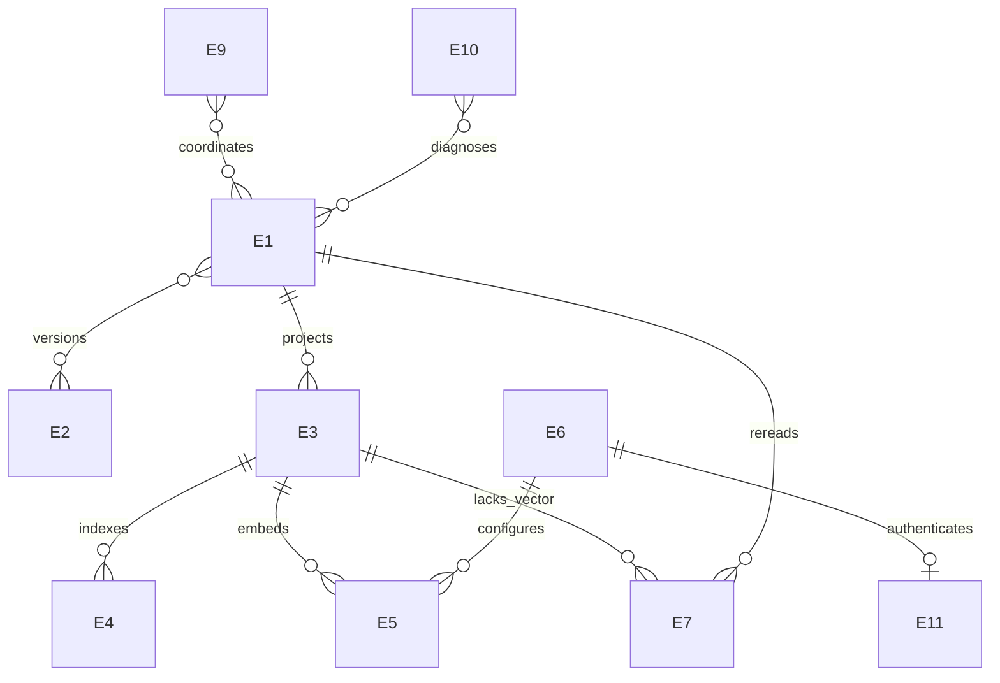

# letopis — логическая модель данных

> **Links:** [concept](concept.md) · [requirements](requirements.md) · [resource-math](resource-math.md) · [contracts](contracts.md) · [decisions](decisions.md)
> **Status:** agreed · **Date:** 2026-10-21 · **Based on:** requirements.md (2026-10-21), resource-math.md (2026-10-21), contracts.md (2026-10-21)
> **Counts:** 10 E · 4 M

## Changes since previous version
2026-10-21: По [D-95](decisions.md#D-95) убраны остатки: E-4 публикуется вместе с E-3 (E-7 выводится запросом и не пишется публикацией); отложенная механика — публикация кэша под index.lock и сброс vectors.db, без записи файлов и очистки reindex. Сущности и объёмы не меняются.
2026-10-20: По [D-95](decisions.md#D-95) производное состояние не хранится: E-12 (состояние реиндексирования) исключена — reindex только полный под index.lock; E-7 — работа embeddings выводится из текстов без вектора, долговечны только попытки (embed_failures в `.letopis/vectors.db`), seq и задания исключены; E-10 — только текущие проблемы, выводимые из files/рёбер/embed_failures/config.json, без истории и errors --clear; E-6 правится как файл; E-3 — рёбра хранятся все, вид элемента выводится, ревизия — счётчик публикаций.
2026-10-20: По [D-93](decisions.md#D-93) агенты правят корпус напрямую: E-8 (запись восстановления) исключена, E-1 пишут агенты, E-2 без снимков отката, E-3 с ID по пути/якорю и рёбрами-тройками, E-10 включает невалидные файлы и висячие ссылки. По [D-94](decisions.md#D-94) E-9 — flock index/embed. Объёмы не меняются.
2026-10-20: По [D-92](decisions.md#D-92) E-5 хранится в `.letopis/vectors.db` по ключу search_hash и переживает удаление кэша; E-7 создаётся только для текстов без вектора. Объёмы не меняются.
2026-10-20: По [D-91](decisions.md#D-91) служебная SQLite — пересоздаваемый кэш. E-3 выводится из корпуса целиком (ID source — адрес, created_at — из ссылок, source без ссылок не хранится); E-6 — файл `.letopis/config.json`; E-8 — файл `.letopis/recovery.json` (позже исключена [D-93](decisions.md#D-93)); E-9 — память worker; E-7/E-10/E-12 живут в кэше. Бюджеты и численные оценки не меняются.
2026-10-20: По [D-90](decisions.md#D-90) существующий errors.active проецируется как details.active без копии в DB details; publication delta включает отложенные внешние изменения, inspect использует общие snapshot metadata узлов/рёбер. Бюджеты и lifecycle не меняются.
2026-10-19: по [D-78](decisions.md#D-78) в существующую конфигурацию добавлен обязательный max_retries (целое ≥ 0), отдельно от provider parameters. Это число дополнительных попыток после первой. Полная замена конфигурации сохраняется; особая операция обновления retry-политики не вводится. Механика уточнена по [D-79](decisions.md#D-79), принятые границы [D-76](decisions.md#D-76)/D-77 сохранены. Новых ресурсных замеров нет.

2026-10-19, после data R2: по [D-73](decisions.md#D-73) добавлена оценка E-10 из A-10/A-11, закрыта последняя развилка sizing. Статус agreed относится к логическому дизайну с явными допущениями; отложенные проверки реализации не названы выполненными.

2026-10-19: модель сверена с ресурсным итогом, контрактами и [D-65](decisions.md#D-65)…[D-72](decisions.md#D-72). Обновлены объёмы, отсутствие начальной конфигурации, смена модели, копии и сроки жизни данных. API-ключ и состояние реиндексирования выделены как уже существующие логические данные, без новых таблиц или команд. Новых продуктовых решений и замеров нет. Физические подробности — в [модели хранения](mechanics/storage-model.md), семантика элементов — в [доменной модели](appendix/domain-model.md).

## 1. Summary

Десять логических групп описывают данные, а не новые таблицы (E-8 исключена [D-93](decisions.md#D-93), E-12 — [D-95](decisions.md#D-95); ID не переиспользуются). Агенты правят корпус напрямую, letopis его только читает. Канонические знания и исторические байты находятся в Markdown/Git, служебная SQLite — пересоздаваемый кэш (D-91): её удаление и reindex восстанавливают всё. Векторы (E-5) лежат в отдельном пересоздаваемом `.letopis/vectors.db` с ключом по search_hash и переживают удаление кэша (D-92). Вне кэша также `.letopis/config.json` (E-6); его identity — SHA-256 канонического JSON (JCS). Масштаб — 100 000 узлов знаний, расчётные 100 000 источников и 500 000 рёбер; бессрочная история Git — главный неограниченный срок жизни. Векторы могут отставать, граф/FTS публикуются согласованно; работа embeddings выводится из текстов без вектора ([D-95](decisions.md#D-95)). Полные RAM, диск, аварийная надёжность и смешанная нагрузка остаются not assessed; наличие чисел и схемы этого не меняет.

## 2. Entity catalog

Volume — целевой масштаб, условная арифметика либо обозначенная неизвестная величина, без новых квот CLI. A-n относятся к [resource-math](resource-math.md#4-assumptions); NFR-4 задаёт 500 000 рёбер и устройство 4 ГБ, [D-35](decisions.md#D-35) — исходную цель 1 ГБ для приложения вместе с локальной моделью.

| ID | Entity | Meaning | Writers (actors) | Volume | Growth | Retention | Storage class | Sensitivity | Needs | Serves |
|---|---|---|---|---|---|---|---|---|---|---|
| E-1 | Канонические документы | Знания, рёбра, ID, created_at и source_snapshot | Агенты напрямую инструментами редактирования; Git | A-1 × A-2: 50 / 200 / 800 МБ фрагментов; A-1 / A-5: около 2 000–10 000 файлов | A-3: 10 / 100 / 1 000 изменений элементов в минуту, не прирост узлов | Текущее состояние; история в E-2 | versioned files | internal | Проверка по файлу; согласованность с E-3/E-4/E-7 при следующем вызове | FR-1, FR-2, FR-3, FR-11, FR-35 |
| E-2 | Git-снимки | Байты корпуса/источников, основания знаний и выданные inspect-снимки | Агенты средствами Git; letopis закрепляет refs выданных снимков и найденных source_snapshot | A-3/A-6/A-7/A-8/A-9 задают условный поток версий; полный объём объектов/refs/источников неизвестен | По используемым/выданным снимкам; год A-7 не срок хранения | Используемые/выданные снимки бессрочно | versioned files | internal | Сохранность OID и адресованных байтов; без истории в SQL | FR-18, FR-19, FR-24, FR-25, FR-34 |
| E-3 | Граф, идентичности и ревизия | Узлы, все объявленные рёбра (тройки), includes, URI, строки, хеши, основание, счётчик ревизии; ID знания — путь или путь#якорь, ID source — адрес; вид (vertex/metavertex) выводится по includes ([D-95](decisions.md#D-95)) | Агенты через документы; letopis при проекции | A-1 + A-4: 200 000 узлов; NFR-4: 500 000 рёбер; размер атрибутов не измерен | Текущий граф; source существует, пока на него есть ссылка | Проекция заменяется целиком; source и его created_at выводятся из ссылок | derived cache (relational projection) | internal | Целостность с E-1/E-4; ID source = адрес, reindex воспроизводит его | FR-4, FR-5, FR-6, FR-17, FR-18, FR-20, FR-23, FR-25, FR-26, FR-35 |
| E-4 | Текстовый индекс | Представление собственного текста vertex/metavertex | letopis по документам агентов | A-1/A-2: до 100 000 знаний, вход 50 / 200 / 800 МБ; размер индекса не равен входу | Замена затронутых элементов; source не текстовый результат | До замены/удаления/перестройки | derived cache (search index) | internal | Одна публикация с E-3; contentless, без полной копии текста | FR-13, FR-21, FR-22, FR-27, FR-28 |
| E-5 | Векторы | Embeddings актуального текста для активной конфигурации | Провайдер по запросу letopis; публикация letopis | A-1/D-41: 100 000 × 768 × 4 = 307,2 МБ полезных компонент при float32 | Только актуальные совместимые векторы, не архив | До изменения поискового текста/модели/удаления | cache (derived, `.letopis/vectors.db`, [D-92](decisions.md#D-92)) | internal | Отставание допустимо; совместимость с E-3/E-6 и актуальный E-7 | FR-22, FR-29, FR-31 |
| E-6 | Конфигурация embeddings | Provider/model/parameters с base_url, без ключа | Агент/разработчик правкой файла ([D-95](decisions.md#D-95)) | 0 или 1 объект; размер фактического JSON, новых лимитов нет | Полная замена без архива | До замены; исходно отсутствует | file `.letopis/config.json` (D-91) | internal | Одинакова для query/document; смена identity сбрасывает E-5/E-7 | FR-22, FR-29, C-6 |
| E-7 | Работа и попытки embeddings | Тексты знаний без вектора (выводятся запросом) и попытки по search_hash с последней ошибкой | letopis: drain резервирует попытку перед вызовом модели; провайдер возвращает результат | Работа — не более A-1: 100 000 текстов; строки попыток — только для неуспешных текстов; без текста | A-3 — поток изменений, не прирост; новый текст — новый search_hash | Попытки — до успеха, смены конфигурации или удаления vectors.db; рестарт не сбрасывает | cache (embed_failures в `.letopis/vectors.db`, [D-95](decisions.md#D-95)) | internal | Поздний результат хранится под прежним search_hash и не представляет новый текст | FR-29, FR-30, FR-32 |
| E-9 | Блокировки | flock на `.letopis/index.lock` (публикация/reindex) и `.letopis/embed.lock` (drain embeddings) с PID держателя | Процессы letopis | 2 блокировки на проект (index, embed) | Жизнь публикации или drain | Снимаются ядром при завершении процесса, не история | kernel lock + lock-файлы ([D-94](decisions.md#D-94)) | internal | Читатели блокировку не держат | FR-32, NFR-2 |
| E-10 | Текущие проблемы | Невалидные файлы, висячие ссылки, includes-циклы, отсутствующие в Git source_snapshot, исчерпанные попытки embeddings, последняя ошибка embedding запроса, невалидный config.json; безопасные code/message/details | letopis при публикации (текст ошибки в files) и при чтении (запросы); не очищается вручную | Не больше числа файлов, рёбер и неуспешных текстов; A-10/A-11 (100 сообщений/сутки × 4000 байт) — верхняя опора без накопления истории | Нет накопления: исправленная проблема исчезает | Пока причина существует | derived from cache (files.error, edges, nodes) and vectors.db (embed_failures, query_error) | internal | Status/check читают одно согласованное состояние; переживают рестарт, после удаления кэша находятся снова ([D-95](decisions.md#D-95)) | FR-5, FR-11, FR-30, FR-32, FR-33 |
| E-11 | API-ключ | OPENAI_API_KEY для выбранного совместимого сервера | Разработчик через окружение процесса CLI (drain наследует) | 1 значение переменной на окружение; длина зависит от сервера | Без локального архива | Окружение/память процесса; передача только нужному поставщику | process memory and environment | secret | Не Markdown, SQLite, ответы или диагностика, [D-67](decisions.md#D-67) | FR-22, C-6 |

Internal означает проектные данные, не отсутствие секретов/персональной информации в тексте. Копии, FTS и embeddings наследуют чувствительность исходных данных. API-ключ явно secret. Требования не вводят ACL, сроки полного стирания или собственное хранилище секретов. Навык FR-36 — поставляемая документация, не новая пользовательская запись.

## 3. Relations

Это связи групп данных, не физические FK/таблицы. E-3 целиком выводится из E-1/E-2, включая source и их created_at (D-91). E-6/E-11 означает использование окружения при запросе, не хранение ключа в конфигурации. E-3/E-4 и E-7 различаются: готовность графа/FTS не означает готовность векторов.

## 4. Lifecycle and copies

| ID | Created by | Changed by | Deleted by / when | Copies | Copy lifetime |
|---|---|---|---|---|---|
| E-1 | Агент записью файла | Агент редактором; внешний Git | Агент удаляет; висячие ссылки видны в check/status | Git E-2; токены/векторы E-4/E-5; текст в M-2/M-3 | Git бессрочно; производные до изменения; буферы до завершения |
| E-2 | Git/letopis при снимке | Байты объектов неизменяемы | Автоматическое истечение удерживаемых снимков не вводится | Файлы, объекты/refs Git; пользовательские копии/backup вне текущей модели | Git бессрочно; резервирование — resilience |
| E-3 | Разбор корпуса | Проверенная правка/перестройка | Знания/рёбра явно; source — с последней ссылкой | Снимки чтения, кэш; backup не нужен | Запрос до завершения; кэш до удаления/перестройки |
| E-4 | Индексирование | Точечная замена вместе с графом | Изменение/удаление/перестройка | Contentless-индекс и прежнее состояние текущих читателей; текста в SQL нет | До смены/конца читателей; постоянного архива индексов нет |
| E-5 | Провайдер возвращает вектор | letopis публикует актуальный результат | Удаление знания, несовместимость текста или смена модели | Буфер M-2, БД; переданный текст/вектор у удалённого поставщика | Локально до замены/конца запроса; удалённо срок неизвестен |
| E-6 | Первая правка файла `.letopis/config.json` | Правка файла целиком | Удаление файла возвращает состояние до настройки | Конфигурация текущего запроса/вычисления | Активная до смены; старая в памяти до завершения пользователей |
| E-7 | Публикация нового search_hash без вектора; первая неуспешная попытка создаёт строку попыток | Резервирование попытки перед вызовом модели | Успех вектора удаляет строку попыток; смена конфигурации или удаление vectors.db | Прочитанный текст в M-2 | До успеха или сброса; исчерпанные попытки сохраняются до сброса |
| E-9 | Публикация или drain | — | Завершение процесса (ядро снимает flock) | Status проверяет занятость и читает PID | Время работы процесса |
| E-10 | Публикация невалидного файла; запрос status/check | Исправление причины убирает проблему | Нет отдельного удаления; истории нет | Status/check вычисляют из одного read view | Пока причина существует; ключи и полные запросы не сохраняются |
| E-11 | Старт с окружением | Окружение процесса CLI; drain наследует окружение запустившего вызова, новый ключ — со следующего запуска drain (допущение X-2) | Завершение процесса; истории ключей нет | Окружение/память клиента, HTTP Authorization поставщику | Локально время процессов/запроса; внешние копии зависят от сервера |

### Что восстанавливается и что требует сохранности

Граф, FTS и векторы производны. **Вся служебная БД — пересоздаваемый кэш**, [D-91](decisions.md#D-91): source и их created_at выводятся из ссылок, конфигурация лежит в `.letopis/config.json`; записи незавершённого сохранения нет, letopis не пишет корпус ([D-93](decisions.md#D-93)). Текущие проблемы выводятся из кэша и vectors.db, попытки embeddings лежат в vectors.db: удаление кэша их не теряет (проблемы находятся снова), удаление vectors.db или смена конфигурации сбрасывают попытки ([D-95](decisions.md#D-95)). Удаление БД = следующий вызов выполняет полный reindex; граф/FTS доступны после публикации, векторы считаются только для текстов без вектора в `.letopis/vectors.db` (D-92).

Source_snapshot канонического Markdown и его проекция обозначают общее подтверждённое основание всех источников знания. Обычный edit его не обновляет. Прежние основания читаются по известным Git-снимкам; отдельной history/source_changes в БД нет. Годовой горизонт A-7 не разрешает удалять старые снимки.

Агент сохраняет знание сам, записью файла. Каждый вызов search/traverse/inspect/check перед ответом публикует валидные изменения файлов в граф/FTS и счётчик ревизии ([D-93](decisions.md#D-93)); невалидный файл сохраняет прежнюю проекцию и текст ошибки в files; рёбра хранятся все, висячие и циклические отсекаются при чтении ([D-95](decisions.md#D-95)). Успех reindex означает граф/FTS, [D-71](decisions.md#D-71); ошибка embeddings не откатывает их. Каждый search/traverse удерживает одно согласованное состояние кэша, новые запросы после публикации видят новое. Многофайловой атомарности правок нет: незавершённая агентом группа видна как висячие ссылки.

### Работа embeddings и смена модели

До конфигурации вычисления не запускаются, граф/FTS работают, config возвращает null. Без waiting_config и модели по умолчанию. Смена `.letopis/config.json` меняет identity (она хранится только в meta vectors.db); следующий вызов одной транзакцией vectors.db (BEGIN IMMEDIATE) повторно сверяет identity, пересоздаёт vec1, очищает векторы и попытки и пишет новую identity, без index.lock/embed.lock; drain сверяет identity перед сохранением вектора. После этого работой становятся все опубликованные тексты. Последняя ошибка embedding запроса — одна строка query_error(at, error) в vectors.db до следующего успешного embedding запроса (D-62); сбой запуска drain — предупреждение ответа, не хранится. Граф/FTS остаются доступны. Архив моделей не добавляется.

Совместимый вектор переиспользуется при неизменившемся поисковом тексте. Несовместимый не представляет новое знание. Вычисление идёт вне транзакции записи; drain перед вызовом перечитывает файл и пропускает текст с изменившимся search_hash; поздний результат сохраняется под прежним search_hash и новый текст не представляет. Попытки переживают рестарт. Status показывает embedding_backlog и embedding_failed отдельно.

### Удаление, провайдер и чувствительность копий

Удаление текущего элемента не стирает Git-историю: её срок бессрочный, конечного срока удаления из всех копий нет. Попытки embeddings не содержат исходный текст; FTS не полная копия Markdown. Текст query и собственный поисковый текст знания временно передаются embedding-провайдеру. Source не становится самостоятельным текстовым результатом; автоматическая загрузка веб-источников не добавляется.

Полностью локальный режим остаётся обязательным. Для явно выбранного удалённого сервера срок его копий/журналов этими контрактами не установлен; политика проверяется отдельно для конкретного сервера. Отправка не разрешает сохранять API-ключ в parameters/логах. Собственные backup, ACL, шифрование, гарантированное удалённое стирание и новые сроки хранения этим документом не вводятся.

## 5. Memory strategy

Корпус не обязан целиком находиться в RAM. A-1/A-2 задают дисковый текст; размер слоя модели [D-41](decisions.md#D-41) не её рабочая память. Все области совместно входят в исходную цель **1 000 000 000 байт вместе с локальным провайдером** на устройстве 4 ГБ, [D-35](decisions.md#D-35), а не получают этот бюджет каждая.

| ID | Region | Contents | Lifetime | Size | Allocation | On exhaustion | Serves / limit |
|---|---|---|---|---|---|---|---|
| M-1 | Поисковое чтение | Снимок, структуры поиска, кандидаты и обход | Search/traverse | A-1/A-4, 500 000 рёбер, параметры/конкуренция запросов; полная RAM неизвестна | Временное владение запросом и кэш хранилища; размеры — mechanics | Ошибка/отмена без выдачи усечённого по времени результата за полный | FR-21, FR-26, NFR-2, NFR-3, NFR-4, NFR-7; [D-35](decisions.md#D-35) |
| M-2 | Embeddings и секрет | Модель, вход/вектор, закреплённая конфигурация; ключ в окружении/памяти | Запрос/вычисление; модель по жизни провайдера | A-2/D-41 влияют на буферы; 238 530 688 байт слоя не RAM; суммарный расход неизвестен | Память провайдера и временные буферы; батч здесь не выбирается | Ошибка знания — диагностика/ретраи; query embedding — FTS; без усечения/дробления | FR-22, FR-29, FR-30, NFR-4, NFR-6; [D-35](decisions.md#D-35) |
| M-3 | Подготовка и индексация | Текст, ссылки и проверка итогового графа | Публикация изменений/check/reindex | A-2/A-8: опорные 5 элементов, не лимит; полный reindex зависит от A-1/A-4 | Временное владение; структуры/алгоритм — mechanics | До фиксации нет частичной публикации; сбой оставляет прежнюю проекцию | FR-6, FR-12, NFR-1, NFR-4; [D-35](decisions.md#D-35) |
| M-4 | Текущее выполнение | Выполняемые вычисления, runtime-конфигурации | Процесс | До 10 клиентов NFR-2; один процесс drain embeddings и одна публикация за раз по flock ([D-94](decisions.md#D-94)); общий RAM ещё не измерен | Текущее выполнение в памяти; долговечные счётчики попыток в E-7 | Рестарт находит работу заново, не обнуляет попытки | FR-30, FR-32, NFR-2, NFR-4; [D-35](decisions.md#D-35) |

Отказ памяти при публикации оставляет прежнее состояние кэша (транзакция SQLite). Принудительное завершение ОС не обещает JSON-ответ. Численные бюджеты областей, новый admission control и политика аллокации здесь не утверждаются; физические проверки — P-2/P-3.

## 6. Storage classes and totals

- Versioned files, E-1/E-2: читаемый источник истины и байты оснований. Текущие фрагменты — 50 / 200 / 800 МБ, без текста источников, Git-объектов/refs и истории.
- Cache (SQLite), E-3/E-10: проекция и текст ошибок файлов, всё пересоздаваемое, [D-91](decisions.md#D-91). SQLite уже выбрана по [D-22](decisions.md#D-22). Source без ссылок не накапливаются; A-4 — профиль, не hard cap.
- Vector store, E-5/E-7: `.letopis/vectors.db` — векторы и попытки по search_hash активной конфигурации, пересоздаваемый, без backup (D-92, [D-95](decisions.md#D-95)).
- Files outside cache, E-6: `.letopis/config.json`; E-9 — flock на lock-файлах ([D-94](decisions.md#D-94)).
- Derived indexes, E-4/E-5: производные представления. 307,2 МБ float32-компонент — не весь vec1 и не RAM; повторно прибавлять их к SQLite с векторами нельзя.
- Memory/environment, E-11/M-n: ключ не попадает ни в кэш, ни в config.json, тексты временно читаются для проверки/вычисления без постоянной SQL-копии.

R-6 — конкретная проба: 200 000 узлов, 500 000 рёбер и 100 000 векторов; файл БД 687,944 МБ, включая свободные страницы. Опорный дисковый набор при ожидаемых 200 МБ Markdown, этой БД и слое модели — около 1,13 ГБ **до** истории, источников, WAL, служебных журналов, обслуживания и backup. Это не общий прогноз и не RAM. Полный годовой диск, суммарная память и длительность очереди остаются неоценёнными. Для диагностики добавлены A-10/A-11: 0,04 / 0,4 / 4 МБ payload в сутки; после [D-95](decisions.md#D-95) история не накапливается, годовая сумма — только верхняя опора, не ожидаемый размер. Фактическая частота/размер проверяются в P-2; новых замеров нет.

## 7. Findings and consequences

→ architecture: назначить владельцев E-1…E-11, включая текущие проблемы и попытки фоновой работы; существующие подсистемы не переоткрываются этим каталогом.

→ mechanics: публикация кэша под index.lock, освобождение flock, сброс vectors.db при смене конфигурации, алгоритмы/буферы; действующий DDL — mechanics/storage-schema.sql (storage-model.md — история).

→ resilience: backup Git/Markdown и `.letopis/config.json` (БД не копируется, [D-91](decisions.md#D-91)), потеря кэша = reindex, питание и политика копий/секретов.

→ roadmap: сохранить P-1/P-2/P-3 и проверки неизвестных объёмов ошибок, источников и годовой истории. Resource-math не становится проверенным от ссылок A-n.

FR-36 — навык поставки. FR-12 (check) использует E-1/M-3 без записи. [D-65](decisions.md#D-65)…[D-71](decisions.md#D-71) отражены без нового API, состояния задания или ослабления требований.

## 8. Risks, assumptions and open questions

**История: интервью data R1:** новых блокирующих продуктовых развилок после сверки нет; **T = 0**, закрыто 0/0, в очереди 0. Source-идентичность, срок Git, failed, очистка ошибок, отсутствие модели и несовместимые векторы уже решены. Отсутствующие измерения не подменяются новыми вопросами/требованиями.

**Data R2:** один фиксированный вопрос G1 о sizing E-10; T=1, закрыт 1/1 по [D-73](decisions.md#D-73), всего принято 1 решение интервью data, в очереди 0. Средние 4000 байт и края 10/1000 — явные расчётные допущения, не продуктовые ограничения.

Открыты прежние проверки: полный размер Git/источников и фактические накладные расходы диагностики, RAM и смешанная нагрузка P-2, физическое восстановление/backup P-3. У произвольного удалённого сервера сроки копий неизвестны. Допущения X-2 о локальной проверке config и новом ключе со следующего запуска drain остаются допущениями, проверяемыми при реализации.

## 9. Consistency check

Модель актуализирована по документам после resource-math/contracts, не по новой реализации. Проверки и независимое ревью — в [отчёте data](checks/data/data-review-2026-10-19.md). После закрытия E-10 логическая clarity gate проверяется отдельно от runtime. Статус **agreed** фиксирует модель с явными sizing-допущениями и отложенными P-2/P-3; объёмы копий/backup и ресурсы реализации не объявляются проверенными. Текущая сверка — [отчёт sizing](checks/resource-math/diagnostics-sizing-2026-10-19.md). Следующий этап — architecture; автоматический переход здесь не выполняется.

## Sources

[Доменная модель](appendix/domain-model.md), [контракты](contracts.md), [карточки границ](contracts/X-1-cli.md), [модель хранения](mechanics/storage-model.md), [ресурсный расчёт](resource-math.md), [решения](decisions.md), особенно [D-7](decisions.md#D-7)…[D-24](decisions.md#D-24)/D-65…[D-72](decisions.md#D-72). Результаты R-3/R-4/R-5/R-6 используются в прежних границах отчётов, без новых сетевых проверок или замеров.
