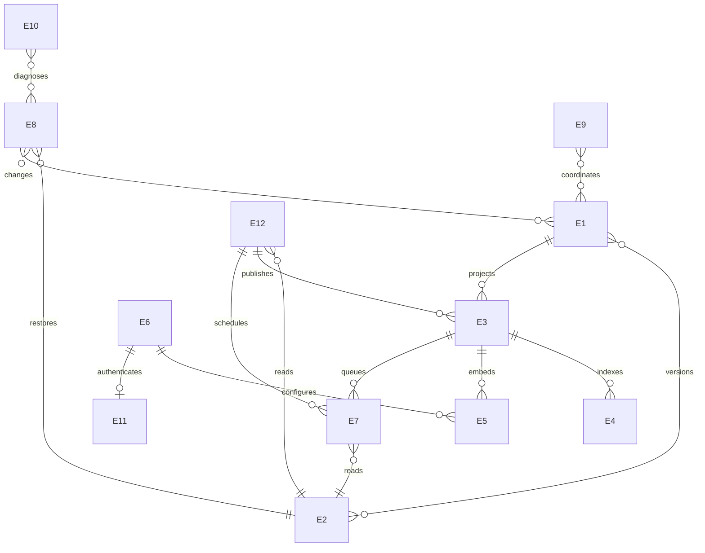

# letopis — логическая модель данных

> **Links:** [concept](concept.md) · [requirements](requirements.md) · [resource-math](resource-math.md) · [contracts](contracts.md) · [decisions](decisions.md)
> **Status:** agreed · **Date:** 2026-10-19 · **Based on:** requirements.md (2026-10-19), resource-math.md (2026-10-19), contracts.md (2026-10-19)
> **Counts:** 12 E · 4 M

## Changes since previous version
2026-10-19: по [D-78](decisions.md#D-78) в существующую конфигурацию добавлен обязательный max_retries (целое ≥ 0), отдельно от provider parameters. Это число дополнительных попыток после первой. Полная замена конфигурации сохраняется; особая операция обновления retry-политики не вводится. Механика уточнена по [D-79](decisions.md#D-79), принятые границы [D-76](decisions.md#D-76)/D-77 сохранены. Новых ресурсных замеров нет.

2026-10-19, после data R2: по [D-73](decisions.md#D-73) добавлена оценка E-10 из A-10/A-11, закрыта последняя развилка sizing. Статус agreed относится к логическому дизайну с явными допущениями; отложенные проверки реализации не названы выполненными.

2026-10-19: модель сверена с ресурсным итогом, контрактами и [D-65](decisions.md#D-65)…[D-72](decisions.md#D-72). Обновлены объёмы, отсутствие начальной конфигурации, смена модели, копии и сроки жизни данных. API-ключ и состояние реиндексирования выделены как уже существующие логические данные, без новых таблиц или команд. Новых продуктовых решений и замеров нет. Физические подробности — в [модели хранения](mechanics/storage-model.md), семантика элементов — в [доменной модели](appendix/domain-model.md).

## 1. Summary

Двенадцать логических групп описывают данные, а не новые таблицы. Канонические знания и исторические байты находятся в Markdown/Git, поисковые структуры производны, а идентичность источников и состояние незавершённой работы требуют сохранной служебной БД. Масштаб — 100 000 узлов знаний, расчётные 100 000 источников и 500 000 рёбер; бессрочная история Git — главный неограниченный срок жизни. Векторы могут отставать, граф/FTS и задания публикуются согласованно. Полные RAM, диск, аварийная надёжность и смешанная нагрузка остаются not assessed; наличие чисел и схемы этого не меняет.

## 2. Entity catalog

Volume — целевой масштаб, условная арифметика либо обозначенная неизвестная величина, без новых квот CLI. A-n относятся к [resource-math](resource-math.md#4-assumptions); NFR-4 задаёт 500 000 рёбер и устройство 4 ГБ, [D-35](decisions.md#D-35) — исходную цель 1 ГБ для приложения вместе с локальной моделью.

| ID | Entity | Meaning | Writers (actors) | Volume | Growth | Retention | Storage class | Sensitivity | Needs | Serves |
|---|---|---|---|---|---|---|---|---|---|---|
| E-1 | Канонические документы | Знания, рёбра, ID, created_at и source_snapshot | Агенты через CLI; внешний Git между правками | A-1 × A-2: 50 / 200 / 800 МБ фрагментов; A-1 / A-5: около 2 000–10 000 файлов | A-3: 10 / 100 / 1 000 изменений элементов в минуту, не прирост узлов | Текущее состояние; история в E-2 | versioned files | internal | Атомарная группа; согласованность с E-3/E-4/E-7 | FR-1, FR-2, FR-3, FR-7, FR-9, FR-10, FR-11, FR-35 |
| E-2 | Git-снимки | Байты корпуса/источников, основания и снимки отката | Агенты средствами Git; letopis при сохранении/выдаче снимка | A-3/A-6/A-7/A-8/A-9 задают условный поток версий; полный объём объектов/refs/источников неизвестен | По используемым/выданным снимкам; год A-7 не срок хранения | Используемые/выданные снимки бессрочно | versioned files | internal | Сохранность OID и адресованных байтов; без истории в SQL | FR-14, FR-18, FR-19, FR-24, FR-25, FR-34 |
| E-3 | Граф, идентичности и ревизия | Узлы, рёбра, includes, URI, строки, хеши, основание, текущая ревизия; идентичность source | Агенты через документы; letopis при регистрации source и проекции | A-1 + A-4: 200 000 узлов; NFR-4: 500 000 рёбер; размер атрибутов не измерен | Текущий граф; известные источники остаются без ссылок | Проекция заменяется; source URI/UUID/created_at бессрочно | relational projection and durable metadata | internal | Целостность с E-1/E-4; reindex не меняет ID source | FR-4, FR-5, FR-6, FR-8, FR-17, FR-18, FR-20, FR-23, FR-25, FR-26, FR-35 |
| E-4 | Текстовый индекс | Представление собственного текста vertex/metavertex | letopis по документам агентов | A-1/A-2: до 100 000 знаний, вход 50 / 200 / 800 МБ; размер индекса не равен входу | Замена затронутых элементов; source не текстовый результат | До замены/удаления/перестройки | derived cache (search index) | internal | Одна публикация с E-3/E-7; contentless, без полной копии текста | FR-13, FR-21, FR-22, FR-27, FR-28 |
| E-5 | Векторы | Embeddings актуального текста для активной конфигурации | Провайдер по запросу letopis; публикация letopis | A-1/D-41: 100 000 × 768 × 4 = 307,2 МБ полезных компонент при float32 | Только актуальные совместимые векторы, не архив | До изменения поискового текста/модели/удаления | derived cache (search index) | internal | Отставание допустимо; совместимость с E-3/E-6 и актуальный E-7 | FR-22, FR-29, FR-31 |
| E-6 | Конфигурация embeddings | Provider/model/parameters с base_url, без ключа | Агент/разработчик через config --set | 0 или 1 объект; размер фактического JSON, новых лимитов нет | Полная замена без архива | До замены; исходно отсутствует | relational | internal | Одинакова для query/document; атомарная смена E-5/E-7 | FR-22, FR-29, C-6 |
| E-7 | Очередь embeddings | Долговечная queued/failed работа узла, seq и попытки | letopis по apply/reindex/config; провайдер возвращает результат | Не более A-1: 100 000 заданий, одно на узел знаний; без текста | A-3 — поток изменений, не прирост очереди; замена по узлу | До обработки/отмены/удаления узла/смены модели; failed не исчезает от рестарта | durable queue | internal | Новый seq на замену; старый результат не удаляет новую работу | FR-13, FR-29, FR-30, FR-31, FR-32 |
| E-8 | Запись восстановления | Хеш исходной правки, прежний снимок и paths | letopis до изменения файлов | A-8: опорные 5 элементов на apply; размер/число одновременных записей неизвестны | Только незавершённое сохранение/откат | До надёжного успеха или полного отката | durable log | internal | До файлов; удаление при финальной фиксации; без копии содержимого и постоянной дедупликации | FR-14, FR-15, FR-16, NFR-1 |
| E-9 | Локи | Сведения о защищённой записи/восстановлении, hash, paths, element_ids | letopis для операций агентов | До 10 агентов по NFR-2; число/размер локов зависят от области правок | Жизнь защищённой фазы | До завершения/восстановления, не история | relational coordination state | internal | Подготовка без длительного лока; не замена base_hash | FR-8, FR-15, FR-32, NFR-2 |
| E-10 | Диагностика | Ошибки операций и активных проблем, безопасные code/message/details | letopis при ошибке; агент очищает завершённые | A-10/A-11: ожидаемые 100 сообщений/сутки × 4000 байт; 36 500 сообщений и 146 МБ за A-7 без очистки | Ожидаемые 0,4 МБ payload/сутки; сценарии 10/1000 сообщений; без гарантированного потолка | Активные сохраняются; завершённые до errors --clear | relational | internal | Общие записи status/errors; переживают очистку E-8 и рестарт | FR-30, FR-32, FR-33 |
| E-11 | API-ключ | OPENAI_API_KEY для выбранного совместимого сервера | Разработчик через окружение рабочего процесса | 1 значение переменной на окружение; длина зависит от сервера | Без локального архива | Окружение/память процесса; передача только нужному поставщику | process memory and environment | secret | Не Markdown, SQLite, ответы или диагностика, [D-67](decisions.md#D-67) | FR-22, C-6 |
| E-12 | Состояние реиндексирования | Снимок, область, состояние и использованные ретраи; текущий прогресс | letopis по reindex/обнаружению изменений и отмене агентом | A-1/A-4: полный корпус либо выборка; объём метаданных и число одновременных работ неизвестны | Запуск/возобновление; подходящие вызовы присоединяются | Активная/возобновляемая работа; постоянный архив успехов не требуется | relational (durable job state; progress in memory) | internal | Тот же снимок и предел ретраев; завершение после E-3/E-4/E-7, не E-5 | FR-27, FR-28, FR-31, FR-32 |

Internal означает проектные данные, не отсутствие секретов/персональной информации в тексте. Копии, FTS и embeddings наследуют чувствительность исходных данных. API-ключ явно secret. Требования не вводят ACL, сроки полного стирания или собственное хранилище секретов. Навык FR-36 — поставляемая документация, не новая пользовательская запись.

## 3. Relations

Это связи групп данных, не физические FK/таблицы. E-3 содержит source-идентичности, не восстанавливаемые из E-1. E-6/E-11 означает использование окружения при запросе, не хранение ключа в конфигурации. E-12 и E-7 различаются: готовность графа/FTS не означает готовность векторов.

## 4. Lifecycle and copies

| ID | Created by | Changed by | Deleted by / when | Copies | Copy lifetime |
|---|---|---|---|---|---|
| E-1 | Агент через create | Агент через edit/delete; внешний Git вне незавершённых CLI-правок/восстановления | Явный delete с исправлением ссылок | Git E-2; токены/векторы E-4/E-5; текст в M-2/M-3 | Git бессрочно; производные до изменения; буферы до завершения |
| E-2 | Git/letopis при снимке | Байты объектов неизменяемы | Автоматическое истечение удерживаемых снимков не вводится | Файлы, объекты/refs Git; пользовательские копии/backup вне текущей модели | Git бессрочно; резервирование — resilience |
| E-3 | Разбор корпуса и регистрация source | Проверенная правка/перестройка | Знания/рёбра явно; source без ссылок остаётся | Снимки чтения, служебная БД; backup не спроектирован | Запрос до завершения; source URI/UUID/created_at бессрочно |
| E-4 | Индексирование | Точечная замена вместе с графом | Изменение/удаление/перестройка | Contentless-индекс и прежнее состояние текущих читателей; текста в SQL нет | До смены/конца читателей; постоянного архива индексов нет |
| E-5 | Провайдер возвращает вектор | letopis публикует актуальный результат | Удаление знания, несовместимость текста или смена модели | Буфер M-2, БД; переданный текст/вектор у удалённого поставщика | Локально до замены/конца запроса; удалённо срок неизвестен |
| E-6 | Первое config --set | Полная замена | Замена прежнего; отдельная команда удаления не введена | Конфигурация текущего запроса/вычисления | Активная до смены; старая в памяти до завершения пользователей |
| E-7 | Apply/reindex/config | Новый seq, ретраи/failed | Успех вместе с записью вектора; отмена, удаление узла, смена модели | Прочитанное задание и текст в M-2 | До обработки/замены; failed сохраняется до предусмотренного удаления |
| E-8 | Перед записью файлов | Восстановление/фиксация | Надёжный успех или полный откат | Прежние байты только в Git E-2; ошибка в E-10 | Журнал краткоживущий; Git и ошибки имеют свои сроки |
| E-9 | Защищённая фаза | Владелец/восстановление | Завершение/аварийное освобождение | Status читает текущие сведения без нового журнала | Время фазы; физическое освобождение — mechanics |
| E-10 | Ошибка/отмена | Устранение причины делает проблему завершённой | Errors --clear только завершённые; активные остаются | Status/errors читают одни записи; backup не определён | До явной очистки; ключи и полные патчи не сохраняются |
| E-11 | Старт с окружением | Новое окружение после обычного рестарта — допущение X-2 | Завершение процесса; истории ключей нет | Окружение/память клиента, HTTP Authorization поставщику | Локально время процессов/запроса; внешние копии зависят от сервера |
| E-12 | Запуск/обнаружение изменений | Выполнение/ретраи/отмена/восстановление | Терминальный исход завершает активную работу; ошибка в E-10 | Status, прогресс в памяти, ссылка на E-2 | Долговечный минимум до возобновления/завершения; точная очистка — mechanics |

### Что восстанавливается и что требует сохранности

Граф, FTS и векторы производны. **Вся БД не является пересоздаваемым кэшем**: source URI/UUID/created_at, конфигурация, незавершённое восстановление и диагностика не воспроизводятся только из текущего Markdown. Reindex сохраняет их; полная потеря БД требует отдельного плана восстановления по уже отмеченным [D-10](decisions.md#D-10)/D-20 ограничениям.

Source_snapshot канонического Markdown и его проекция обозначают общее подтверждённое основание всех источников знания. Обычный edit его не обновляет. Прежние основания читаются по известным Git-снимкам; отдельной history/source_changes в БД нет. Годовой горизонт A-7 не разрешает удалять старые снимки.

Успех apply означает сохранение документов, графа/FTS, ревизии, служебных изменений и очереди. После сбоя поиск/новые записи ждут восстановления. Успех reindex означает граф/FTS и задания, [D-71](decisions.md#D-71); ошибка embeddings не откатывает их. Каждый search/traverse удерживает одно согласованное состояние, новые запросы после публикации видят новое. Журнал и Git сами по себе ещё не доказывают физическую атомарность разных носителей или NFR-1.

### Очередь и смена модели

До конфигурации вычисления не запускаются, граф/FTS работают, config возвращает null. Долговечный путь очереди сохраняется, без нового waiting_config и модели по умолчанию. Config --set атомарно меняет активную конфигурацию, очищает прежние векторы/очередь и создаёт новую работу опубликованных знаний. Граф/FTS остаются доступны. Конфигурация в каждой строке очереди и архив моделей не добавляются.

Совместимый вектор переиспользуется при неизменившемся поисковом тексте. Несовместимый не представляет новое знание. Вычисление идёт вне транзакции записи; публикация проверяет актуальный seq и сохраняет вектор вместе с удалением обработанного задания. Старое вычисление не затрагивает заменившую его работу. Failed и счётчик попыток переживают рестарт. Status.embedding_jobs исключает failed, поэтому ноль активных заданий не доказывает полного векторного покрытия.

### Удаление, провайдер и чувствительность копий

Удаление текущего элемента не стирает Git-историю: её срок бессрочный, конечного срока удаления из всех копий нет. Очередь не содержит исходный текст; FTS не полная копия Markdown. Текст query и собственный поисковый текст знания временно передаются embedding-провайдеру. Source не становится самостоятельным текстовым результатом; автоматическая загрузка веб-источников не добавляется.

Полностью локальный режим остаётся обязательным. Для явно выбранного удалённого сервера срок его копий/журналов этими контрактами не установлен; политика проверяется отдельно для конкретного сервера. Отправка не разрешает сохранять API-ключ в parameters/логах. Собственные backup, ACL, шифрование, гарантированное удалённое стирание и новые сроки хранения этим документом не вводятся.

## 5. Memory strategy

Корпус не обязан целиком находиться в RAM. A-1/A-2 задают дисковый текст; размер слоя модели [D-41](decisions.md#D-41) не её рабочая память. Все области совместно входят в исходную цель **1 000 000 000 байт вместе с локальным провайдером** на устройстве 4 ГБ, [D-35](decisions.md#D-35), а не получают этот бюджет каждая.

| ID | Region | Contents | Lifetime | Size | Allocation | On exhaustion | Serves / limit |
|---|---|---|---|---|---|---|---|
| M-1 | Поисковое чтение | Снимок, структуры поиска, кандидаты и обход | Search/traverse | A-1/A-4, 500 000 рёбер, параметры/конкуренция запросов; полная RAM неизвестна | Временное владение запросом и кэш хранилища; размеры — mechanics | Ошибка/отмена без выдачи усечённого по времени результата за полный | FR-21, FR-26, NFR-2, NFR-3, NFR-4, NFR-7; [D-35](decisions.md#D-35) |
| M-2 | Embeddings и секрет | Модель, вход/вектор, закреплённая конфигурация; ключ в окружении/памяти | Запрос/вычисление; модель по жизни провайдера | A-2/D-41 влияют на буферы; 238 530 688 байт слоя не RAM; суммарный расход неизвестен | Память провайдера и временные буферы; батч здесь не выбирается | Ошибка знания — диагностика/ретраи; query embedding — FTS; без усечения/дробления | FR-22, FR-29, FR-30, NFR-4, NFR-6; [D-35](decisions.md#D-35) |
| M-3 | Подготовка и индексация | Текст, ссылки и проверка итогового графа | Apply/check/reindex | A-2/A-8: опорные 5 элементов, не лимит; полный reindex зависит от A-1/A-4 | Временное владение; структуры/алгоритм — mechanics | До фиксации нет частичной публикации; сбой требует E-8 | FR-6, FR-7, FR-12, FR-14, NFR-1, NFR-4; [D-35](decisions.md#D-35) |
| M-4 | Текущее выполнение | Выполняемые задания, прогресс, владельцы, runtime-конфигурации | Процесс/задание | До 10 клиентов NFR-2; один исполнитель embedding-очереди; одна защищённая фаза по [D-76](decisions.md#D-76); общий RAM ещё не измерен | Текущее выполнение в памяти; долговечные ссылки/счётчики в E-7/E-8/E-12 | Рестарт восстанавливает долговечную работу, не обнуляет ретраи | FR-15, FR-30, FR-32, NFR-2, NFR-4; [D-35](decisions.md#D-35) |

Отказ памяти при сохранении подчиняется общим гарантиям отказа/отката. Принудительное завершение ОС не обещает JSON-ответ. Численные бюджеты областей, новый admission control и политика аллокации здесь не утверждаются; физические проверки — P-2/P-3.

## 6. Storage classes and totals

- Versioned files, E-1/E-2: читаемый источник истины и байты оснований/отката. Текущие фрагменты — 50 / 200 / 800 МБ, без текста источников, Git-объектов/refs и истории.
- Relational metadata, E-3/E-6/E-9/E-10/E-12: ссылки, согласованность и служебное состояние. SQLite уже выбрана по [D-22](decisions.md#D-22), новых продуктов/таблиц нет. Бессрочно известные source могут накапливаться; A-4 — профиль, не hard cap.
- Derived indexes, E-4/E-5: производные представления. 307,2 МБ float32-компонент — не весь vec1 и не RAM; повторно прибавлять их к SQLite с векторами нельзя.
- Queue/log, E-7/E-8: долговечная работа и краткоживущий журнал различаются сроком жизни, даже в одной БД. Очередь ограничена одним заданием на узел; одна защищённая фаза на проект принята по [D-76](decisions.md#D-76).
- Memory/environment, E-11/M-n: ключ не добавляется в backup БД, тексты временно читаются для проверки/вычисления без постоянной SQL-копии.

R-6 — конкретная проба: 200 000 узлов, 500 000 рёбер и 100 000 векторов; файл БД 687,944 МБ, включая свободные страницы. Опорный дисковый набор при ожидаемых 200 МБ Markdown, этой БД и слое модели — около 1,13 ГБ **до** истории, источников, WAL, служебных журналов, обслуживания и backup. Это не общий прогноз и не RAM. Полный годовой диск, суммарная память и длительность очереди остаются неоценёнными. Для диагностики добавлены A-10/A-11: 0,04 / 0,4 / 4 МБ payload в сутки, 14,6 / 146 / 1460 МБ за год без очистки; это не полный файл SQLite или RAM. Фактическая частота/размер проверяются в P-2; новых замеров нет.

## 7. Findings and consequences

→ architecture: назначить владельцев E-1…E-12, включая диагностику и состояние фоновой работы; существующие подсистемы не переоткрываются этим каталогом.

→ mechanics: фиксация файлов/Git/БД, освобождение локов, параллелизм записи, точная очистка завершённого reindex, алгоритмы/буферы; принятый DDL сохранён в mechanics/storage-model.md.

→ resilience: сохранность source-идентичностей, backup БД/Git, полная потеря БД, питание и политика копий/секретов.

→ roadmap: сохранить P-1/P-2/P-3 и проверки неизвестных объёмов ошибок, источников, журнала и годовой истории. Resource-math не становится проверенным от ссылок A-n.

FR-36 — навык поставки. FR-12 использует E-1/M-3 без постоянной записи; FR-16 не требует бессрочного журнала успешных ответов. [D-65](decisions.md#D-65)…[D-71](decisions.md#D-71) отражены без нового API, состояния задания или ослабления требований.

## 8. Risks, assumptions and open questions

**История: интервью data R1:** новых блокирующих продуктовых развилок после сверки нет; **T = 0**, закрыто 0/0, в очереди 0. Source-идентичность, срок Git, failed, очистка ошибок, отсутствие модели и несовместимые векторы уже решены. Отсутствующие измерения не подменяются новыми вопросами/требованиями.

**Data R2:** один фиксированный вопрос G1 о sizing E-10; T=1, закрыт 1/1 по [D-73](decisions.md#D-73), всего принято 1 решение интервью data, в очереди 0. Средние 4000 байт и края 10/1000 — явные расчётные допущения, не продуктовые ограничения.

Открыты прежние проверки: полный размер Git/источников и фактические накладные расходы диагностики, RAM и смешанная нагрузка P-2, физическое восстановление/backup P-3. У произвольного удалённого сервера сроки копий неизвестны. Допущения X-2 о локальной проверке config и обновлении окружения при обычном рестарте остаются допущениями, проверяемыми при реализации.

## 9. Consistency check

Модель актуализирована по документам после resource-math/contracts, не по новой реализации. Проверки и независимое ревью — в [отчёте data](checks/data/data-review-2026-10-19.md). После закрытия E-10 логическая clarity gate проверяется отдельно от runtime. Статус **agreed** фиксирует модель с явными sizing-допущениями и отложенными P-2/P-3; объёмы копий/backup и ресурсы реализации не объявляются проверенными. Текущая сверка — [отчёт sizing](checks/resource-math/diagnostics-sizing-2026-10-19.md). Следующий этап — architecture; автоматический переход здесь не выполняется.

## Sources

[Доменная модель](appendix/domain-model.md), [контракты](contracts.md), [карточки границ](contracts/X-1-cli.md), [модель хранения](mechanics/storage-model.md), [ресурсный расчёт](resource-math.md), [решения](decisions.md), особенно [D-7](decisions.md#D-7)…[D-24](decisions.md#D-24)/D-65…[D-72](decisions.md#D-72). Результаты R-3/R-4/R-5/R-6 используются в прежних границах отчётов, без новых сетевых проверок или замеров.
