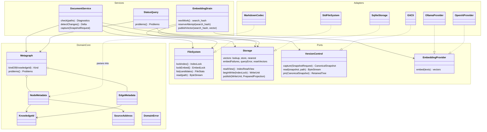

# letopis — механика

> **Links:** [requirements](requirements.md) · [resource-math](resource-math.md) · [contracts](contracts.md) · [data](data.md) · [architecture](architecture.md) · [decisions](decisions.md) · [подробная модель хранения](mechanics/storage-model.md)
> **Status:** agreed · **Date:** 2026-10-21 · **Based on:** requirements.md (2026-10-21), resource-math.md (2026-10-21), contracts.md (2026-10-21), data.md (2026-10-21), architecture.md (2026-10-21)
> **Counts:** 7 MC

## Правка 2026-10-20

2026-10-22 ([D-98](decisions.md#D-98)): §4 — диаграмма типов разделена на слои DomainCore / Services / Ports / Adapters; порты сведены к четырём интерфейсам FileSystem, Storage, VersionControl, EmbeddingProvider. Поведение и контракты I-n не меняются.

2026-10-21 (D-97): MC-2 — кандидаты корпуса из `git ls-files` с учётом `.gitignore`; строка files у каждого Markdown-файла, в том числе без разметки.

2026-10-21 ([D-96](decisions.md#D-96)): назван стек зависимостей. MC-5 — обработанная отмена (поток signal-hook печатает один ответ cancelled и завершает процесс; InterruptHandle не используется); в §5 — синхронный стек без async runtime, `std::fs::File::lock`, `libc::setsid`; версии крейтов и поставка vec1 закреплены в [D-96](decisions.md#D-96).

2026-10-20 ([D-95](decisions.md#D-95)): состояние выводится из данных. Рёбра хранятся без признака активности, висячие ссылки и циклы находит запрос; очередь embeddings — тексты без вектора, drain перечитывает файл и сверяет search_hash, попытки в embed_failures (vectors.db); таблиц заданий, errors и reindex_state нет; reindex только полный под index.lock; config правится как файл; kind выводится. Модели переписаны: 15 изолированных защит.

2026-10-20 ([D-93](decisions.md#D-93), [D-94](decisions.md#D-94)): MC-1 — элементы по пути/якорю и рёбра-тройки; MC-2 переписан: обнаружение изменённых файлов (stat-префильтр + racy-хеш), публикация по файлу под index.lock, без журнала, отката и защищённой фазы; MC-5 — процессы и flock вместо worker/IPC, drain embeddings, отмена по PID. model_commit.py заменён model_publish.py, model_runtime.py переписан; 18 изолированных защит. Таблицы recovery/locks/edges.id удалены из схемы, добавлена files.

2026-10-20 (D-92): векторы вынесены в `.letopis/vectors.db` с ключом search_hash и переживают пересоздание кэша; jobs ставятся только для текстов без вектора; поздний результат хранится под своим текстом, seq защищает только job. model_embedding.py дополнен (21 защита всего).

2026-10-29 ([D-104](decisions.md#D-104)): конфигурация — вложенная `embedding_model`; валидный disabled режим не сбрасывает vectors/meta/embed_failures, использует FTS, даёт нулевые execution-счётчики и скрывает query/attempts проблемы до включения. `init` публикует шаблон атомарно и без замены.

2026-10-20 (D-91): служебная SQLite — пересоздаваемый кэш. Recovery-запись перенесена в файл `.letopis/recovery.json`; точка фиксации правки — его durable удаление, публикация в кэш идёт после неё и догоняется обнаружением revision ≠ canonical tree. Лок — память worker. Конфигурация — `.letopis/config.json` с project.config_identity в кэше. ID source = uri, source без ссылок удаляется. Таблицы recovery/locks/embedding_config удалены из storage-schema.sql; model_commit.py проверяет удаление кэша и догоняющую публикацию (19 защит).
По [D-90](decisions.md#D-90) закрыты A-1…A-3: publication всей outstanding delta с ограниченными rollback paths, details.active сохранённых ошибок и generic edge-aware snapshot metadata. Добавлены три изолированных model guards external_delta/diagnostic_state/edge_inspection; результаты проверяются заново, не считаются runtime proof.

## 1. Summary

Семь механизмов уточняют архитектуру без постоянного процесса, брокера и истории операций ([D-93](decisions.md#D-93), [D-94](decisions.md#D-94)). letopis не пишет корпус: агенты правят файлы, а каждый вызов обнаруживает изменения и публикует их по файлу под flock. Производное состояние не хранится ([D-95](decisions.md#D-95)): висячие ссылки, очередь embeddings и диагностика вычисляются из узлов, рёбер, строк files и vectors.db. Главные риски — гонки публикующих процессов, пропуск изменения stat-префильтром, устаревшие embedding-результаты и единственность drain; для них выполнены три исполняемые модели: нормальные варианты не выявили нарушений, все 15 отдельных отключений защиты обнаружены. Graph/FTS публикуются до ответа, embeddings — независимо; согласованное многофайловое чтение использует Git snapshot. Корректность моделей не означает пройденный power-loss drill, достаточную RAM или секундный поиск; это P-1/P-2/P-3, resource-math — draft/not assessed.

### Фиксированный раунд mechanics R1

| Gap | Решение | Последствие | Состояние |
|---|---|---|---|
| G1 | Одна защищённая фаза сохранения/восстановления на проект (позже заменено [D-93](decisions.md#D-93): записи через CLI нет) | Историческое решение раунда R1 | superseded |
| G2 | [D-77](decisions.md#D-77): согласованное чтение по одному Git-снимку | Обычное live-file чтение не имеет межфайловой гарантии; reader locks нет | closed |
| G3 | [D-78](decisions.md#D-78): max_retries в существующей конфигурации | Четвёртое обязательное поле, целое ≥ 0; провайдеру не отправляется | closed |

Закрыто **3/3 в R1**, всего три пользовательских решения, новых вопросов в очереди **0**. [D-79](decisions.md#D-79) — отдельно отмеченные инженерные starting choices с проверками, не дополнительные пользовательские ответы. Assumed IPC worker заменён [D-94](decisions.md#D-94); [D-75](decisions.md#D-75) заменено [D-95](decisions.md#D-95). Отсутствие продуктовых вопросов не подменяет проверку протоколов. [Intake](checks/mechanics/mechanics-round-1-audit-2026-10-19.md) хранит прежние 0/3, 1/3 и 2/3 как историю интервью.

## 2. Mechanisms

| ID | Part | Mechanism | Kind | Serves | Verified by | Risk |
|---|---|---|---|---|---|---|
| MC-1 | B-2 | Markdown → элементы с ID по пути/якорю, рёбра-тройки, hashes; check | format | FR-3, FR-4, FR-5, FR-6, FR-11, FR-12, FR-35 | review; parser fixtures → roadmap | M |
| MC-2 | B-2, B-3 | Обнаружение изменённых файлов, публикация по файлу под index.lock, reindex | protocol | FR-6, FR-13, FR-27, FR-28, NFR-1, NFR-2 | mechanics/model_publish.py | H |
| MC-3 | B-3 | Работа из данных (тексты без вектора), config-файл и ограниченный бюджет попыток | concurrency | FR-22, FR-29, FR-30, FR-32 | mechanics/model_embedding.py | H |
| MC-4 | B-5 | Основание знания и адресованные bytes | algorithm | FR-17, FR-18, FR-19, FR-20, FR-23, FR-24, FR-34 | review; source fixtures → roadmap | M |
| MC-5 | B-1 | Процессы, flock index/embed, запуск drain и SIGINT | state machine | FR-31, NFR-2, NFR-5, C-1, C-7 | mechanics/model_runtime.py | H |
| MC-6 | B-4 | Закреплённое чтение, ранжирование и обход | algorithm | FR-21, FR-22, FR-23, FR-24, FR-25, FR-26, NFR-3, NFR-7 | review; retrieval P-1/P-2 | M |
| MC-7 | B-2, B-6 | Текущие проблемы из данных и status | algorithm | FR-30, FR-32, FR-33 | mechanics/model_publish.py; review | L |

### MC-1 — элементы и граф

X-4 и его JSON Schema — единственная грамматика разметки ([D-93](decisions.md#D-93)). Кодек находит элементы: файл-элемент (служебный комментарий в первой строке, ID = путь) и раздел-элемент (заголовок с `{#anchor}` и сразу следующий комментарий; ID = путь#якорь; раздел до следующего заголовка того же или более высокого уровня). Примеры внутри code blocks игнорируются. Для каждого элемента — диапазон байтов/строк, hash (SHA-256 точных байтов), метаданные (created_at, source_snapshot). Kind не пишется ([D-95](decisions.md#D-95)): метавершина — элемент с исходящим includes, вершина — остальные знания. Inline links с обязательным `letopis:type=TYPE;path=ADDRESS` создают рёбра (источник, цель, тип); повтор тройки — одно ребро; includes — системный тип.

[D-106](decisions.md#D-106), issue #69: цель берётся только из обязательного
терминального `path`; полный остаток title — адрес без extra decode/trim.
Destination локального `path` нормализуется от каталога документа после одного
percent decode UTF-8 и сравнивается только по файлу, без fragments/existence I/O.
Точные отказы навигации определены [X-4](contracts/X-4-markdown.md); remote
HTTP/HTTPS sources исключены. `LinkPathMismatch` следует invalid-file policy,
в той же SQL publication пишется в `files.error`; check/status дают reason
`link_path_mismatch` и фиксированный безопасный текст. Status не парсит и не
публикует: новая ошибка видна после refresh/reindex, исправление автора очищает
её только при следующей успешной публикации. После upgrade обязателен полный
reindex, затем check; fallback и автоматической миграции нет.

Проверки одного файла: валидные JSON-метаданные, created_at присутствует, якоря уникальны и не вида L<n>-L<n>, нет вложенных элементов, корректные letopis title. Петля (ссылка на себя) — ошибка файла. Нарушение в файле делает файл невалидным: он сохраняет прежнюю проекцию. Все объявленные рёбра хранятся без признака активности ([D-95](decisions.md#D-95)): traverse и фильтры соединяют рёбра с nodes по цели, поэтому ребро к отсутствующей цели невидимо, пока цель не появится, и при её появлении или удалении ничего не пересчитывается. Висячие ссылки (рёбра без цели) и includes-циклы (поиск в глубину по подграфу includes) находят check и status запросом по текущему кэшу (MC-7). Check обновляет производный кэш, затем выполняет файловые проверки по корпусу или путям и эти запросы; авторские Markdown не меняет.

Временное собственное search text строится единым кодеком без служебного комментария и letopis title, с подписями ссылок и собственными code examples. SHA-256 этого представления — search_hash; hash покрывает точные байты элемента. Изменение только адреса ссылки или метаданных не меняет search_hash и не требует нового вектора ([D-92](decisions.md#D-92)). Сдвиг строк меняет координаты, но не ID. Raw текст в SQLite не сохраняется.

**Инвариант:** опубликованная проекция каждого файла — проекция его последней валидной версии; check и публикация используют одни правила; letopis не меняет файлы корпуса.

### MC-2 — обнаружение, публикация по файлу и reindex

Перед каждой командой search/traverse/inspect/check процесс получает кандидатов через локальный index/ignore walk, эквивалентный `git ls-files -z --cached --others --exclude-standard` (файлы `.md`/`.markdown` с учётом `.gitignore`, [D-97](decisions.md#D-97)) и сравнивает их с таблицей files кэша (path, size, mtime_ns, inode, hash). Строка files есть у каждого кандидата, в том числе без разметки letopis (узлов у него нет), поэтому неизменённый файл не перечитывается; кандидат, выпавший из списка, — удаление. Совпавшие size/mtime/inode считаются неизменными, кроме «racy» файлов, у которых записанный mtime не старше одного тика до момента прошлой проверки: такие файлы хешируются всегда (как racy-git). Изменённые, новые и удалённые .md/.markdown файлы образуют дельту. Пустая дельта не требует публикации; routine refresh может обойтись без блокировки только при уже опубликованной revision и отсутствии source roots для retention. Verified refresh/reindex и retention выполняются под index lock. Уточнение [TK-10](../../superpowers/specs/2026-10-22-tk-10-change-detection-design.md), [D-101](decisions.md#D-101): окно racy — консервативная одна секунда (1 000 000 000 нс); регресс часов/неопределённость арифметики требуют хеширования. Повторное хеширование прежних байтов само по себе не меняет checked_at и revision. При новом stat и прежнем hash обновляется только files в unit публикации, без повторного разбора и замены FTS. Git продолжает перечислять удалённые tracked-пути: подтверждённый stat NotFound тоже означает удаление. Стандартное Git-игнорирование при default respect_gitignore:true исключает untracked-кандидатов; tracked-файл остаётся кандидатом при совпадении с Git-ignore правилом. Дополнительные правила `.letopis/ignore` применяются также к tracked-путям (issue #97). Текущая обработка symlink-кандидатов, родителей и нерегулярных файлов уточнена ниже (2026-11-04). Граница окна: timestamp resolution грубее секунды и намеренный возврат старого non-racy mtime этой гарантией не покрываются.

**Уточнение реализации 2026-11-04 (преемник прежней общей symlink-политики MC-2/D-101):** `GitWorktreeListing::worktree_paths_get_by_ignore_mode_and_patterns` перечисляет raw Git-пути без выбора Markdown и декодирования. Application `CandidateSelection` в `service/utils.rs` общ для refresh и inspect: сначала raw extension/private-component filtering, затем no-follow observation final symlink для структурно безопасного пути, затем UTF-8/`RepoPath` validation и deduplication. Final symlinks пропускаются до декодирования; stable nonregular final entries также исключаются документным сценарием. Unsafe parents, replacement и I/O остаются ошибками, а удалённые tracked-пути остаются кандидатами для подтверждения удаления. Raw-пути с пустыми/`.`/`..` компонентами не probe-ятся до прежней лексической валидации. Повторные наблюдения перед публикацией сохраняются. Это распределение ответственности не меняет racy-window и атомарность публикации.

| State | Event | Guard | Next state | Effects |
|---|---|---|---|---|
| idle (initial) | routine refresh | revision уже опубликована, дельта пуста и source snapshots для retention отсутствуют | serving | читать текущий снимок кэша без index.lock |
| idle | routine refresh | revision ещё не опубликована, либо дельта непуста, либо есть source snapshots для retention | waiting | ждать flock на `.letopis/index.lock` |
| idle | verified refresh | — | waiting | ждать flock на `.letopis/index.lock` до обнаружения изменений |
| waiting | lock acquired | — | detecting | повторно вычислить дельту под блокировкой |
| detecting | delta empty | revision уже опубликована | released | проверить и удержать source snapshots в требуемом режиме; отпустить блокировку |
| detecting | initial publication | revision = 0 | publishing | построить полную проекцию, даже при пустой дельте |
| detecting | delta found | revision уже опубликована | publishing | разобрать изменённые файлы, проверить по файлу (MC-1) |
| publishing | commit | одна SQLite unit | released | проекции валидных файлов, files-строки (с ошибкой для невалидных), project.revision+1 |
| publishing | crash / I/O error | unit не зафиксирована | released | SQLite откатывает unit; следующий вызов снова видит дельту |
| released | — | — | serving | отпустить блокировку; запустить drain при текстах без вектора (MC-5) |
| serving (final) | — | — | — | ответ команды |

Повторная проверка под блокировкой обязательна: дельта, найденная до ожидания, могла устареть, и публикация по ней перезаписала бы более новую версию (model_publish.py, guard redetect). Строки files обновляются только в той же unit, что и проекции: иначе откатившаяся публикация больше не была бы обнаружена (guard prefilter). Невалидный файл получает новую строку files с hash текущих байтов, текстом ошибки и прежней проекцией: повторно его не разбирают, пока байты не изменятся. Единая unit: убрать исходящие рёбра изменённых/удалённых элементов, UPSERT nodes с сохранением целочисленного `id` и уникального `uri`, удалить отсутствующие nodes и source без оставшихся ссылок, записать все объявленные рёбра изменённых файлов, заменить FTS изменённых знаний, записать строки files, project.revision+1. Узлы и источники публикуются до рёбер: рёбра адресуют `nodes.id`, а цели, появившиеся позже в той же unit, разрешаются при коммите. Отсутствующая цель хранится в `unresolved_edges`; входящее ребро удалённой цели переносится туда и снова разрешается, когда цель вернётся. Векторы и задания в unit не входят: работу embeddings drain находит сам (MC-3).

Падение процесса в любой точке не оставляет частичной публикации: незафиксированная unit откатывается SQLite, блокировку снимает ядро. Корпус не меняется никогда. Источник истины для «что опубликовано» — строки files в кэше; удаление кэша означает полный reindex.

#### MC-2 — состояния reindex

**Reindex** ([D-95](decisions.md#D-95)) только полный; первичное построение — тот же путь. Процесс берёт index.lock на всё время, последовательно читает все файлы корпуса и строит nodes/edges/FTS/files заново одной unit. Читатели до фиксации видят прежний кэш (SQLite WAL), публикующие процессы ждут блокировку. Выборочного reindex, подготовки вне блокировки, reindex_state и автоматических повторов нет: transient ошибка возвращается командой, повтор — новый вызов. Валидность файлов не повторяется, а записывается в files.error.

| State | Event | Guard | Next state | Effects |
|---|---|---|---|---|
| pending (initial) | start | flock index.lock получен | active | читать файлы, строить кэш в одной unit |
| active | commit | — | published | новый граф/FTS/files, project.revision+1 |
| active | SIGINT / crash / I/O error | до commit | cancelled | unit откатывается, прежний кэш |
| published (final) | late SIGINT | commit состоялся | — | публикация не откатывается |
| cancelled (final) | — | — | — | следующий вызов — новая работа |

**Инварианты:** после фиксации каждая строка files соответствует опубликованной проекции файла; опубликованное состояние никогда не старше версии, которую видел публикующий процесс под блокировкой; одновременно публикует не более одного процесса; невалидный файл не блокирует остальные. Произвольные live-file reads исключены из атомарного наблюдения по [D-77](decisions.md#D-77).

### MC-3 — embeddings: работа из данных и попытки

Конфигурация — вложенная `embedding_model` с enabled/provider/model/parameters/max_retries в `.letopis/config.json` ([D-91](decisions.md#D-91), [D-104](decisions.md#D-104)); её правят агент или пользователь как обычный файл, команда config только показывает её ([D-95](decisions.md#D-95)). Все поля обязательны; max_retries не входит в HTTP-body или search text. Старый плоский файл не принимается и требует ручной миграции. До настройки файла нет, векторов нет. Identity — SHA-256 JCS четырёх настроенных полей; `enabled` и обёртка не входят, поэтому правка пробелов, порядка ключей или переключение enabled сохраняет identity, векторы и попытки. Валидный disabled config сохраняет векторы/попытки, использует FTS и не запускает reset. Векторы source не вычисляются.

**Условный сброс (уточнение TK-27).** Сервис сначала наблюдает сохранённую identity (включая отсутствие) через короткий read view и освобождает его, затем читает и проверяет файл. Отсутствующий, невалидный или нечитаемый config не сбрасывает состояние и оставляет FTS/graph доступными. Для валидной конфигурации storage открывает одну короткую write-транзакцию vectors.db (`BEGIN IMMEDIATE`) и перечитывает текущую identity. Сначала совпадение с желаемой identity сохраняет все векторы и попытки (guard reset_recheck). Иначе несовпадение с наблюдавшейся identity возвращает типизированный конфликт без записи (guard observed_identity). Только при совпадении с наблюдением транзакция пересоздаёт vec1, очищает vector_keys и embed_failures и записывает желаемую identity атомарно; ошибка откатывает весь сброс. Storage не читает config-файл; index.lock/embed.lock не берутся.

При конфликте текущий вызов пропускает embeddings без HTTP: drain завершается с ConfigChanged, search использует FTS-only, traverse продолжает чтение графа. Повторного цикла чтения/сброса нет; следующий вызов наблюдает актуальное состояние. Поэтому P, наблюдавший A или отсутствие до установки B процессом Q, не может стереть буквальный B-вектор и сохранённую попытку. Модель проверяет этот порядок и отдельное отключение observed_identity; [реализационные проверки TK-27](checks/TK-27/report.md) также проверяют повторный reset к уже установленной B, rollback и закреплённый старый read view. Это условная проверка состояния БД, а не атомарность с произвольной внешней правкой файла: новую правку согласует следующий вызов. Намеренная смена identity или удаление vectors.db сбрасывает попытки; предел действует между сбросами, не на весь срок жизни текста.

**Работа** — знания, для search_hash которых в vectors.db нет вектора и попытки не исчерпаны: `nodes.search_hash NOT IN vec.vector_keys AND NOT IN (vec.embed_failures WHERE attempts >= 1+max_retries)`. Отдельной очереди, seq и Git-деревьев публикаций нет: после [D-92](decisions.md#D-92) вектор адресован текстом, и поздний результат для прежнего текста не может представлять новый.

| State | Event | Guard | Next state | Effects |
|---|---|---|---|---|
| missing (initial) | drain выбирает | identity совпадает, текст не пропущен в этом запуске | reading | прочитать текущий файл, построить текст элемента кодеком MC-1 |
| reading | hash текста ≠ search_hash | агент изменил файл после публикации | skipped | пропустить до конца запуска; новый текст опубликует следующий вызов |
| reading | hash совпал | attempts < 1+max_retries | computing | attempts+=1 в embed_failures до HTTP (durable) |
| computing | valid vector | meta.config_identity = захваченной | stored | одна tx vectors.db: INSERT OR IGNORE ключа и вектора, DELETE строки embed_failures |
| computing | valid vector | identity сменилась | missing | результат отброшен; drain завершается |
| computing | error / timeout | бюджет остался | missing | текст ошибки в embed_failures; повтор через assumed 1s |
| computing | error / timeout | бюджет исчерпан | failed | ошибка остаётся в embed_failures, видна в status |
| computing | crash / restart | — | missing | attempts сохранены |
| skipped (final) | — | — | — | — |
| stored (final) | — | — | — | одинаковые тексты делят вектор |
| failed (final) | — | — | — | сбрасывается только сменой config или удалением vectors.db |

Drain (`letopis embed --drain`, MC-5) обрабатывает один текст за раз и повторяет запрос работы после каждого шага, поэтому видит работу, опубликованную во время своего запуска; каждый устаревший текст пропускается не более одного раза за запуск, иначе drain зациклился бы (guard skip_once). Вычисление идёт вне write tx. Сбой после резервирования может потратить попытку без запроса; рестарт не обнуляет attempts. Ошибка подготовки входа, отказ авторизации и неверный вектор используют тот же конечный бюджет. Внешняя модель может получить повторный запрос после потери ответа, exactly-once не обещается. Когда работы нет, drain удаляет векторы и строки embed_failures, на search_hash которых не ссылается ни один узел, и завершается.

Векторы хранятся в `.letopis/vectors.db` ([D-92](decisions.md#D-92)), подключаемом через ATTACH: vector_keys(row_id, search_hash UNIQUE), vec1 vector_index с тем же rowid, meta(config_identity), embed_failures(search_hash PK, attempts, error). Удаление кэша не затрагивает vectors.db: после пересборки работа — только новые тексты. Удаление или повреждение vectors.db — полный пересчёт векторов и попыток без потери знаний. В выдачу попадают только векторы, соединённые с nodes.search_hash текущего read view.

VectorPort принимает конечные float32 одинаковой длины, проверяет размерность/непустоту и запрещает некорректные значения. Native Ollama использует truncate:false, совместимый API проверяет индексы соответствия. Baseline vec1 no-index/cos без training/ANN и лишнего flat rebuild; при config reset vec1 в `.letopis/vectors.db` пересоздаётся транзакционно, чтобы очистить старую размерность. Совместимость schema change/rollback со старым read view — обязательная реализационная проверка R-8/P-2, не доказанная моделью.

### MC-4 — источники и актуальность

Source URI — стабильный нормализованный адрес файла/диапазона и одновременно ID source (D-91), хешируются точные bytes; файл целиком без диапазона. Диапазон строк включителен, от 1; UTF-8 byte offsets и переносы строк не нормализуются. Source-узел существует, пока на него есть external-ссылка: при исчезновении файла он остаётся с hash=NULL (source_not_found), при удалении последней ссылки удаляется в той же публикации. Created_at source = минимальный created_at его текущих ссылок; reindex воспроизводит его без реестра в БД. Содержимое остаётся в Git/рабочем дереве, не в SQL. Загрузка websites в v1 не вводится; допустимый URI не означает сетевой fetch.

Уточнение TK-20 от 2026-10-25: [утверждённая спецификация](../../superpowers/specs/2026-10-25-tk-20-source-identity-design.md).
HTTP/HTTPS — непрозрачные адреса: сохраняются написание, query и fragment, без fetch
и локального чтения; `hash=NULL`, lines отсутствуют, состояние `Unfetched`.
Минимум `created_at` вычисляется по авторским timestamp знаний с эффективными
external-ссылками. Невалидный referrer сохраняет последнюю валидную проекцию.
Текущий SourceReader использует переданный pinned StorageRead, проверяет членство
до I/O и наблюдает live bytes локального файла; не обновляет кэш и не возвращает
source text. Недоступный файл/полный диапазон — SourceNotFound, инфраструктурная
ошибка — typed Result error. Исторические алгоритмы ниже уточнены реализованной границей TK-21.
При upgrade старых URL нужна [явная пересборка производного кэша](../../development.md#tk-20-явная-пересборка-кэша-при-обновлении),
с сохранением Markdown/Git/vectors/config/lock files; CLI reindex пока не реализован.

Продолжение TK-25 (2026-10-26): CLI `reindex` реализован на общем publication path;
[отчёт и пределы проверки](checks/TK-25/report.md). Это не заменяет указанное выше
удаление несовместимого производного кэша при переходе TK-20 и не вводит physical corruption recovery.

Реализованная граница TK-21 (2026-10-25): [I-4/I-7](contracts/I-4-sources.md#реализованная-граница-tk-21--2026-10-25),
[spec](../../superpowers/specs/2026-10-25-tk-21-provenance-design.md),
[проверка](checks/TK-21/report.md). `ProvenanceRequest` передаёт optional basis и
set SourceUri одного знания; `observe_sources` возвращает flags/issues без
Storage/pin/write. `SourceRevisionRequest` сравнивает одну пару с явно запрошенным
tree; JSON filters остаются TK-22. `BasisRetainer` используется refresher под
index.lock до SQL write transaction: доступные основания закрепляются, включая
last-valid проекцию и появившийся позднее tree без новой SQL revision.
Check/search читают metadata и source edges из своего единственного pinned view,
а bytes — через независимые Git/FileSystem collaborators. Check сохраняет полную
проверку графа перед owner selection; Search не меняет rank/limit/provider semantics.
Отсутствие basis не делает файл invalid: `source_changed` + точная check reason.
Отсутствие адреса — `source_not_found`; flags объединяются со stale без дублей.
Правка с прежним полем snapshot сохраняет basis, удаление поля убирает каноническое
основание; Letopis не пишет Markdown и не восстанавливает скрытую историю из БД.
HTTP/HTTPS остаются unknown, source в CLI inspect отложен до TK-24.

Уточнение 2026-10-29 ([D-105](decisions.md#D-105)): ordinary refresh использует root/ref retention, verified incremental refresh полного check и full reindex проверяют closure до SQL. Нулевая дельта не отменяет full audit. Метаданные будущей валидной проекции определяют roots: last-valid invalid owners остаются, валидно заменённые/удалённые roots исключаются. Полный check сравнивает audited revision с revision закреплённого read view и отказывает при несовпадении; публикация после закрепления view безопасна для этого view. Отдельный batch child на pin, потоковый hash blobs и разбор tree bytes заменяют subprocess на каждый объект. Старые TK-21/TK-26 evidence описывают свои captured revisions; новая граница меняет время обнаружения повреждений несвязанных descendants, не атомарность SQL и не сильный контракт pin.

source_snapshot знания пишет агент в метаданные ([D-93](decisions.md#D-93)). При публикации Git-порт проверяет существование и тип tree и закрепляет его ref; отсутствующий или неизвестный снимок — текущая проблема (check наблюдает объявленные source_snapshot через общий сервис) и признак перепроверки, не отказ. Адресованные bytes снимка сравниваются с текущими: неравенство — flag source_changed. Правка без изменения snapshot не обновляет основание; удалённые старые основания доступны по удерживаемым Git-деревьям, history-table нет.

Целевой контракт поиска/обхода: flags вычисляются по индексным метаданным, текущим файлам рабочей копии и Git-объектам по source_snapshot; CanonicalSnapshot используется только inspect ([D-95](decisions.md#D-95)). Несовпадение текущего Markdown/hash/координат с индексом даёт stale; отсутствие адресованного источника — source_not_found; отличие от source_snapshot — source_changed. Один источник/несколько причин не дублируют flags. Пустой flags означает только отсутствие обнаруженной причины. Filters.source_revisions сравнивает адресованные bytes пары source+revision, а не commit OID и не разные external-привязки. Неверный формат/тип Git OID отличается от отсутствующего корректного объекта по X-3. Файл, изменившийся после чтения, требует следующей перепроверки; абсолютная актуальность live bytes на весь срок запроса не обещается.

### MC-5 — процессы, блокировки и отмена

Постоянного процесса нет ([D-94](decisions.md#D-94)). Каждый вызов CLI — отдельный процесс: открывает кэш и подключает `.letopis/vectors.db`, выполняет команду, пишет один JSON и завершается. Координация — две advisory-блокировки ядра (flock) на устойчивых файлах в `.letopis/` (права 0700/0600): index.lock — публикация и reindex (MC-2), embed.lock — drain embeddings. Файлы блокировок не удаляются; владение определяет только ядро и исчезает при завершении процесса, в том числе аварийном. Держатель записывает в файл блокировки свой PID после получения блокировки.

| State | Event | Guard | Next state | Effects |
|---|---|---|---|---|
| command (initial) | finished | есть тексты без вектора (MC-3) | probing | попробовать try-lock embed.lock |
| command | finished | работы нет | exited | — |
| probing | try-lock busy | drain уже работает | exited | ничего не запускать |
| probing | try-lock free | — | spawning | отпустить пробную блокировку; запустить `letopis embed --drain` отсоединённо (`libc::setsid`, fd 0/1/2 → /dev/null) |
| spawning | drain started | — | exited | ответ команды не ждёт drain |
| spawning | spawn failure / crash | — | exited | предупреждение в ответе; работу найдёт следующий вызов |
| exited (final) | — | — | — | процесс завершён |

#### MC-5 — процесс drain

| State | Event | Guard | Next state | Effects |
|---|---|---|---|---|
| drain (initial) | try-lock embed.lock | занято | exited | другой drain уже работает |
| drain | lock acquired | — | draining | записать PID; обрабатывать тексты без вектора (MC-3) |
| draining | работы нет | — | exited | очистка неиспользуемых векторов; ядро снимает блокировку |
| draining | crash | — | exited | ядро снимает блокировку; attempts сохранены в vectors.db |
| exited (final) | — | — | — | блокировка снята ядром |

Гонка двух вызывающих процессов при запуске drain безопасна: лишний drain не получит embed.lock и сразу завершится. Блокировку определяет только ядро: наличие lock-файла или PID в нём ничего не значит (model_runtime.py, guard owner).

**Отмена.** SIGINT отменяет собственный процесс (search, traverse, inspect, check, reindex); незафиксированная транзакция откатывается, частичного результата нет. Отмена обрабатывается (D-96): поток `signal-hook` принимает SIGINT, печатает единственный ответ ok:false/cancelled (once-guard на stdout: если результат уже напечатан, второй JSON не печатается) и завершает процесс с exit 1 в любой точке — SQL-шаг, ожидание flock, локальное чтение Git-объекта, HTTP. Незафиксированная транзакция SQLite откатывается как после сбоя (WAL, доказано TK-2), flock снимает ядро, оставленные git-объекты безвредны и чистятся как после сбоя; зафиксированная публикация остаётся (late SIGINT). InterruptHandle не используется. У отсоединённого drain обработчика нет: сигнал завершает его по умолчанию, ответа нет, attempts в embed_failures сохранены. Обработанный ответ во всех пяти командах, в том числе во время ожидания flock, git и HTTP, и ровно один JSON проверяет TK-29. Отмены чужого процесса по PID нет ([D-95](decisions.md#D-95)); status показывает PID держателя index.lock, и пользователь при необходимости завершает его средствами ОС.

Нет общего execution timeout в 1 секунду, TTL, lifecycle-команд, TCP API, IPC и process registry. Команды letopis не меняют корпус, поэтому потеря ответа безопасна: повтор вызова идемпотентен.

#### MC-5 — результаты TK-4 и передача реализации

2026-10-21: [все выводы и ограничения TK-4](checks/TK-4/findings.md), [отчёт](checks/TK-4/report.md) и [ревью](checks/TK-4/review.md) дополняют исполняемую модель проверкой настоящих процессов и неизменённых TK-2/TK-3 на macOS/Linux ARM64. На каждой ОС PASS: 10 Rust tests, 1 Python interruption test, 7 compiling negative controls; совпадают все 60 входных SHA256. Проверены сериализация десяти publishers, один владелец drain после десяти успешных освобождённых probes, persistent lock после SIGKILL/stale PID, setsid/null fd 0/1/2, rollback до commit и сохранение публикации после commit. Для publish/reindex SIGINT внутри blocking flock подтверждён независимым native observer; pre-flock hook отвергается тем же oracle. Эти PASS относятся к смерти процесса по сигналу по умолчанию и к `libc::flock`; обработанную отмену [D-96](decisions.md#D-96) с ответом cancelled и `File::lock` проверяют TK-29 и TK-11.

Две Important-проблемы стенда исправлены: adopted peer выполняет self-SIGKILL по своему fixture connection, без сигнала по Event PID; mutation runner работает в disposable copies, вложенные команды остаются в его owned group. Это проверки harness, не продуктовый IPC. Третье, Minor, замечание о syscall boundary закрыто указанным наблюдением; второго независимого ревью нет.

TK-11 переносит эти примитивы в CLI без повторного index lock вокруг TK-2 publish; TK-29 проверяет обработанную отмену с ответом cancelled, TK-42 — системные boundary drills. Fairness, общий liveness и concurrent orphan reclamation не доказаны. Работа в окне между последним empty query и exit drain может ждать следующего вызова. Power loss, stat-10k/RAM/latency, real provider и другие платформы сохраняют отдельные gates. G-0 после [TK-6](checks/TK-6/report.md) пройден: continue → TK-7; это допуск к основной разработке в границах узких proofs.

#### MC-5 — результаты TK-6: HTTP и код выхода при отмене

2026-10-21: [TK-6 transport proof](checks/TK-6/report.md) подтвердил выбранный блокирующий ureq/platform TLS и обработанный SIGINT при ожидании HTTP на macOS/Linux ARM64. [Ревью](checks/TK-6/review.md) выявило гонку: один stdout once-guard предотвращал второй JSON, но main мог завершиться с exit 0 после уже напечатанного cancelled. Обычный путь теперь учитывает, выиграл ли он право на вывод; проиграв cancelled, он завершает процесс с exit 1. Сам guard удерживается до окончания write/flush. После уже напечатанного успеха SIGINT допускает exit 1 без второго JSON; до обработки сигнала обычное завершение имеет exit 0.

Чередование проверено детерминированно: HTTP success получен, main удерживается перед выводом, поток сигнала печатает cancelled, затем main освобождается. Compiling mutation, убирающая согласование кода выхода, должна упасть на этом oracle. Gate и флаги относятся только к fixture CLI, не добавляют IPC/config API продукту. Полная интеграция пяти команд, SQL/flock/git и stdout backpressure остаётся TK-29; остановка remote compute не обещается.

### MC-6 — чтение, поиск и обход

Уточнение реализованного search TK-22 (2026-10-25): [отчёт](checks/TK-22/report.md).
Все requested source_revisions проходят preflight после refresh и до readiness,
inference и пустых candidate exits. Source/revision predicates используют metadata,
bindings и basis одного pinned view; каждый candidate наблюдает current flags один
раз, сохраняет их в link, затем только eligible IDs получают channel ranks/fusion/limit.
Filtered query failure и следующий фактический success под той же identity проверены
через bounded HTTP fixture; query_error сохраняется/очищается отдельным guarded
writer. Late provenance errors освобождают owned reader до drop сервиса.
TK-28 UI, пилоты и gates этой проверкой не сертифицируются.

Search/traverse после обнаружения изменений (MC-2) синхронизируют готовую конфигурацию через MC-3 до закрепления read view, затем открывают read-транзакцию ([D-102](decisions.md#D-102), порядок уточнён для TK-12 2026-10-23); BEGIN и первое чтение project.revision закрепляют один read snapshot кэша; vectors.db читается в той же транзакции. Конфигурация берётся из `.letopis/config.json` и принимается, только если её identity совпадает с meta.config_identity, иначе FTS-only. Query embedding вызывается напрямую с этой конфигурацией, без write lock; при ошибке выполняется один FTS-поиск с обычным успешным ответом без предупреждения, а ошибка записывается в единственную строку vec.query_error и видна только в status.problems; успешный query embedding её удаляет ([D-62](decisions.md#D-62)). Read view освобождается при результате/отмене/error.

Фильтры разных полей объединяются И, внутри списков — хотя бы одно совпадение; пустой/отсутствующий список одинаковы. Source и source_revision проверяются на одной привязке. Полный eligible-набор формируется до итогового limit, включая динамическую проверку источников. Source не самостоятельный search text, но доступен inspect/traverse. FTS возвращает все подходящие совпадения, vec1 exact — все доступные подходящие vectors; преждевременный LIMIT перед фильтрами запрещён. Первый baseline допускает полный перебор метаданных и векторов, без необоснованного oversampling.

FTS сортируется по bm25, vector — по cosine distance по `.letopis/vectors.db` с соединением vector_keys.search_hash = nodes.search_hash текущего read view (D-92); read view двух файлов не обязан быть одним снимком: векторы аддитивны и адресованы текстом, поэтому виден либо нет только готовый корректный вектор; ties по ID (лексикографически). При наличии каналов union объединяется score=Σ(1/rank), rank от 1 в каждом канале; отсутствующий ранг даёт 0. Итог score desc, ID asc, затем limit. При отсутствии vectors/config/query embedding только FTS. Значения метрик и вычисленный score внутренние, новый публичный score не добавляется. FTS query строится как литеральные токены в кавычках из строки пользователя, без прямой SQL/FTS-синтаксической интерполяции. Пустая нетокенизируемая строка даёт пустую выдачу, не ошибку SQL. Конкретное качество токенизации/rank проверяется P-1; языковых квот нет.

Traverse — BFS от уникальных ID; все старты проверяются до обхода, неизвестный ID отклоняет вызов. Рёбра к отсутствующей цели пропускаются; посещённые узлы повторно не расширяются, поэтому includes-цикл, о котором сообщает check, не зацикливает обход ([D-95](decisions.md#D-95)). Соседи упорядочены по (тип, ID цели); relations исключает includes, containment оставляет includes, both объединяет. Direction применяется отдельно: outgoing/incoming/both; includes также один шаг глубины. Посещённые ID возвращаются один раз, старты исключены, но расширяются. Depth=0 возвращает пустые элементы/рёбра. Limit ограничивает суммарные vertex/metavertex/source по X-1; edge_limit независимо ограничивает возвращённые фактически пройденные edges, не прекращает поиск элементов. При отсутствии edge_limit edges не включается. Рёбра добавляются только при фактическом рассмотрении перехода в допустимой глубине; альтернативный путь к уже посещённой вершине тоже пройден, но не дублирует элемент. Когда достигнут node limit, новые переходы не выполняются; никакого induced graph всех связей между результатами не строится.

Уточнение TK-23: чистый domain Graph содержит выбранные identities/edges; GraphService выполняет инкрементальный BFS через object-safe GraphRead. FIFO использует компактные discovery IDs; visited/результат/optional edges ограничены starts и лимитами, плюс не более двух страниц по 32 neighbor records. Для incoming ID порядка — достигнутый сосед, тройка сохраняет исходную ориентацию. Strict per-direction keysets используют directional indexes, endpoint joins и filters до LIMIT. Прогретый refresh читает отдельный distinct набор source roots вместо metadata всех nodes. Bindings выбранного знания наблюдаются page→provenance→next page, не собираются целиком. Traversal не вызывает query embedding; readiness остаётся до единственного pin. Первоначальная/изменённая публикация, file/root sets, parsing и JSON не входят в обещание BFS bound. [Evidence, host/Linux native receipts и завершённые reviews](checks/TK-23/report.md).

Inspect пакетно получает у B-2 один Git snapshot текущих файлов для element_ids знаний и source ([D-93](decisions.md#D-93)); рёбра inspect не адресует. I-12 возвращает Map<ElementId, InspectedElement> с path/lines/hash; для знания кодек находит элемент в этом tree, для source берутся адресованные байты. Отсутствующий в текущем tree ID отклоняет всю группу, дубли выдаются один раз. Индексные stale координаты не подставляются. JSON содержит только метаданные/ссылки. Агент, которому нужен согласованный набор содержимого, читает все пути из этого же tree по [D-77](decisions.md#D-77).

### MC-7 — текущие проблемы и status

Диагностика не хранится отдельно ([D-95](decisions.md#D-95)): status и check вычисляют текущие проблемы из данных одного read snapshot. Невалидный файл — files.valid=0 и files.error (path, причина; пишется в той же unit, что и строка files). Висячая ссылка — ребро, цель которого отсутствует в nodes (path источника, цель, тип). Includes-цикл — поиск в глубину по подграфу includes. Исчерпанные попытки embeddings — embed_failures с attempts ≥ 1+max_retries. Невалидный или нечитаемый config.json — проверка при вызове. Валидный disabled config даёт backlog=0/failed=0 и скрывает embed_failures/query_error, не удаляя их; после включения те же настройки снова показывают execution-проблемы. Проблема исчезает вместе с причиной; истории, active/owner, errors --clear и TTL нет, команда errors входит в status. Последняя ошибка query embedding — строка vec.query_error ([D-62](decisions.md#D-62)), пока следующий query embedding не пройдёт успешно. Ошибка запуска drain возвращается в ответе команды как предупреждение и не сохраняется. Текст файла не копируется; ключи окружения и HTTP Authorization никогда не сериализуются.

Status наблюдает последнюю опубликованную ревизию одним read snapshot кэша и vectors.db: project.revision, текущие проблемы, различные текущие knowledge search_hash без usable vector (backlog, исключая failed) и с attempts ≥ 1+max_retries (failed). Shared hashes учитываются один раз; source, осиротевшие vector/failure строки и failures уже покрытых вектором хешей не считаются. При отсутствующей/невалидной конфигурации или несовпадающей закреплённой identity все текущие различные хеши — backlog, failed=0; vec.query_error остаётся видимым независимо от конфигурации. Переполнение и malformed persisted значения дают ошибку.

Status не выполняет refresh, schema bootstrap/repair, сброс vector identity, inference или drain. Отсутствующий кэш/публикация даёт revision:null, нулевые published counts и отсутствие проблем из кэша; config/lock observations сохраняются. Отсутствующие БД и служебный каталог не создаются: для отсутствующей vectors.db при опубликованном кэше используется только ephemeral in-memory schema и все текущие хеши считаются backlog. Существующие недоступные/несовместимые БД дают ошибку. Исправление файла отражается после публикации другой командой; исключение status из общего next-call rebuild/reset явно задано в [X-1](contracts/X-1-cli.md#наблюдение-status).

Занятость index.lock/embed.lock с PID наблюдается try-lock без удержания; атомарности между database snapshot, config, Git observations и блокировками нет. Прогресса reindex нет: reindex держит index.lock, status показывает записанный PID. Параметры A-10/A-11 — расчётный профиль, не квота сообщений.

Status открывает только существующие lock-файлы под закреплённым служебным каталогом, не создаёт их и не вызывает путь владения, записывающий PID. Свободный flock с устаревшим PID не выводится; пробно полученный flock сразу отпускается. Для занятого flock читается ограниченное число байт положительного PID; отсутствие, ошибка чтения или неверный PID дают безопасную ошибку. При смене владельца после проверки занятости может быть прочитан прежний корректный PID: это best-effort наблюдение, а не право послать процессу сигнал.

## 3. Trivial parts

B-6: только проекция текущего состояния через MC-7; собственного долговечного lifecycle/хранилища нет. Остальные части покрыты MC-1…MC-6; отдельные псевдосервисы для каждого порта не вводятся.

## 4. Internal contracts

| Interface | Spec | What the format must guarantee |
|---|---|---|
| I-1, I-3, I-5, I-6 | in-process, X-1 payloads | Внутрипроцессные вызовы без wire-формата ([D-94](decisions.md#D-94)); существующие X-1 payloads |
| I-2 | contracts/I-2-projections.md | PreparedProjection присоединяется к переданной write unit; без вложенного commit и SQL-копии текста |
| I-4, I-7 | contracts/I-4-sources.md | Проверка всех адресованных оснований либо flags/filter по одному snapshot |
| I-8, I-9, I-10 | contracts/I-8-read-view.md | Типы read view и StateParts, consistency и освобождение |
| I-11 | contracts/I-11-diagnostics.md | Текущие проблемы вычисляются из данных; безопасные сообщения без текста файлов и секретов |
| I-12 | contracts/I-12-snapshot.md | Неизменяемый snapshot с текущими метаданными, без чтения partial live files |

Следующая диаграмма сохраняет концептуальные роли исходного дизайна, а не текущие Rust-типы и сигнатуры. Их преемники описаны в [текущей структуре](architecture.md#program-structure) и [карте подсистем](../../subsystem-map.md): `DocumentRefreshService`/`Refresher`, отдельные command services, `GitRepository`, `LocalFileSystem`, `MarkdownParser`/`MarkdownCodec`, `CacheStorage`/`CacheDatabase`, `VectorStorage`/`VectorDatabase`, один `HttpProviders`. Обе базы используют zero-argument closure scopes вместо выдачи transaction handles. `DetachedProcess` исполняет generic process configuration, выбранную composition. Исторические evidence и имена на диаграмме не переименовываются.

Слои ([D-98](decisions.md#D-98), hexagonal [D-24](decisions.md#D-24)): DomainCore — чистые типы и правила метаграфа (ID, метаданные узлов и рёбер, адрес источника, вывод kind, висячие ссылки и includes-циклы), без I/O и без зависимостей от других слоёв; Services — сценарии CLI и drain, зависят только от DomainCore и четырёх портов; Ports — FileSystem, Storage, VersionControl, EmbeddingProvider, объявленные из потребностей Services; Adapters реализуют порты (std fs и `File::lock`; SQLite с FTS5 и vec1; локальная gix без Git subprocess; один HttpProviders с протоколами Ollama и OpenAI) или переводят внешний формат в доменные типы (кодек Markdown, pulldown-cmark). HTTP-клиент `ureq` — деталь адаптеров провайдеров, отдельного порта у него нет. Зависимости направлены только внутрь. Контрактные порты I-2, I-8, I-11, I-12 — операции этих интерфейсов: IndexLock — FileSystem; IndexReadView, ProjectionPort, WriteUnit — Storage; GitSnapshotPort — VersionControl; EmbeddingPort — EmbeddingProvider.

Спецификации общих in-process портов используют Rust-подобные типы и явно определяют транзакционное владение; wire-schema только у процессной границы. [C4 level 4](diagrams/mechanics-types.mmd) показывает важные типы/порты, не производственные классы с выдуманными методами.

## 5. Timing, memory and concurrency rules

- Две блокировки ядра (`std::fs::File::lock`/`try_lock`, [D-96](decisions.md#D-96)): index.lock (публикация/reindex) и embed.lock (drain). DB write unit кэша берётся под index.lock; drain пишет только в vectors.db короткими транзакциями без index.lock. Routine refresh перед query не берёт index.lock только при уже опубликованной revision, пустой дельте и отсутствии source snapshots для retention; иначе ждёт эту блокировку. Verified refresh и reindex берут index.lock независимо от пустой дельты.
- SQLite WAL/FULL, macOS fullfsync и foreign_keys=ON на каждом соединении; vectors.db подключается ATTACH. Каждый процесс открывает свои соединения; пула и долгоживущих соединений нет. Config DDL/vec1 reader coexistence требует P-2/P-3. Длительный reader может увеличить WAL, что учитывается в P-2.
- Синхронный Rust I/O и std threads без async runtime; HTTP к provider — блокирующий `ureq` (D-96). До 10 одновременных процессов — профиль, не скрытый отказ одиннадцатому. Нового admission API, broker или concurrency knobs нет.
- Retry reservation durable; задержка assumed 1s не обещает срок опустошения очереди. Wall-clock Unix seconds используется только для created_at (пишет агент), elapsed/backoff — монотонное время. Отмена: поток SIGINT печатает ответ cancelled и завершает процесс в любой точке, откат — как после сбоя (MC-5).
- Обнаружение изменений на каждом вызове: stat всех файлов корпуса (2 000–10 000 по A-5) и хеш изменённых/racy. Стоимость измеряется в P-2; при превышении бюджета — сначала `git status`-подобный кэш каталогов, не watcher.
- M-1 хранит IDs/ranks/visited и read view, M-2 один временный текст/вектор и конфигурацию; M-3 работает по изменённым файлам, reindex читает файлы последовательно. Модель живёт в provider и не загружается процессами letopis. Суммарные 1 ГБ приложения+модель на 4 ГБ машине остаются целью, не доказанным бюджетом.
- Resource-math: A-1…A-11 и 0 L; новый timeout/квота не выводятся из расчётных средних. Прогретая секунда — оптимизация, результат не обрезается по времени. Allocation failure до commit не меняет данные; SIGKILL не обязан вернуть JSON.

## 6. Executable checks

Три stdlib Python модели, не production-код и не нагрузочные замеры. Каждая предоставляет run(broken=False) → список нарушений; нормальный результат должен быть пуст, broken=True обязан показать нарушение реальной защиты.

| Model | Enumeration / invariant | Broken protection |
|---|---|---|
| mechanics/model_publish.py | Публикация по файлу (невалидный файл, висячая ссылка, includes-цикл из двух файлов); появление цели и исправление файла без пересчёта других файлов; обход с циклом; перестановки двух публикующих процессов и правки агента; падение до/после commit; racy-mtime; закрепление source_snapshot | Выключает: обработку по файлу, запись files.error, пропуск рёбер без цели, список посещённых в обходе, повторное обнаружение под блокировкой, атомарность files-строк, racy-хеширование, закрепление ref |
| mechanics/model_embedding.py | Правка файла после публикации (live hash ≠ search_hash); перестановки чтения, сброса config и публикации вектора; повторный сброс к той же identity и устаревшее наблюдение A/None после установки B; пересборка кэша при сохранённом vectors.db; max_retries=0…3 и crash до/после HTTP | Выключает: сверку search_hash, однократный пропуск, проверку identity в vectors.db, повторную проверку при сбросе, отдельное отклонение устаревшего наблюдения, reuse при пересборке, durable резервирование попытки |
| mechanics/model_runtime.py | Два кандидата на одну блокировку с падением держателя | Выключает владение по ядру (lock-файл вместо flock) |

Модели задают атомарность SQLite commit и семантику flock как предпосылки. Они не доказывают реализации Git, FTS5, vec1 или SSD. Полнота ограничена перечисленными состояниями/двумя competing actors и явно выбранными crash points, не формальная проверка всей системы.

## 7. Reconciliation with earlier steps
2026-10-19: [D-83](decisions.md#D-83) формализует assumed внутренний provider client deadline 60s per attempt, без общего timeout search/reindex/recovery и без новых JSON/config полей. Timeout использует прежний embedding_failed/FTS fallback; redirect/неявные environment proxies отключены, HTTPS certificates проверяются. Реальное cancellation/resource release проверяется DR-5/DR-8, не объявляется пройденным.

Решение о защищённой фазе (позже заменено [D-93](decisions.md#D-93)) закрывало ранее отложенную сериализацию, [D-77](decisions.md#D-77) сужает слишком широкую фразу X-4 о наблюдении файлов до принятой границы, [D-78](decisions.md#D-78) добавляет max_retries в JSON Schema/config/examples и SQL. [D-79](decisions.md#D-79) отмечает assumed точные инженерные правила. В подробной storage-model устранены историческая SQL-history в финальном commit и ожидание vectors при reindex; актуальный counters/DDL уточнён без копирования текстов. [D-69](decisions.md#D-69) whole replacement сохраняется, новый тип сообщения, таблица конфигурации или operation ID не вводятся.

После [D-93](decisions.md#D-93) ID знаний — путь/путь#якорь, рёбра — тройки без ID; таблица files добавлена как часть кэша для обнаружения изменений. Search_hash — один производный хеш для reuse, не текстовый cache. После [D-95](decisions.md#D-95) очереди заданий, таблиц errors и reindex_state нет: состояние выводится из nodes/edges/files и vectors.db. Архитектурные B-1…B-6 и I-1…I-12 сохраняют ID; I-1/I-3/I-5/I-6 — внутрипроцессные вызовы.

## 8. Risks, assumptions and open questions

Продуктовых развилок нет. Assumed choices [D-79](decisions.md#D-79) и механизмы [D-94](decisions.md#D-94) проверяются:

| Risk | Cheapest validation | Boundary |
|---|---|---|
| Падение во время публикации/reindex/сброса config и пересборка кэша | MC-2 model, затем P-3 на macOS/Linux с прерыванием процесса и потерей питания | Модель не равна физическому доказательству NFR-1 |
| Config reset с другой размерностью, старый read view FTS/vec1, interruption | Узкий интеграционный P-2/P-3 на выбранной сборке | Нет неявного fallback на SQLite без расширения |
| Гонка запуска drain, стоимость stat 10 000 файлов, racy-mtime на разных ФС | Model + A-AR1 multi-process probe на APFS/ext4 | Семантика flock и точность mtime отдельно от модели |
| Счётчик attempts и консервативная трата попытки при crash | MC-3 model, fault injection до/после HTTP | Exactly-once provider call не обещается |
| Полный detection scan/exact ranking, model memory и большие JSON/graph reads | P-2 mixed clients/RAM/latency | 1 ГБ и 1s не объявлены пройденными |
| Простой rank/tokenization и usefulness/freshness | P-1/P-2 реальный корпус | Усложнять только после проверенного недостатка |
| Стоимость вычисления проблем и отставания embeddings на 100 000 узлов в status/check | P-2 | Сначала индекс, не хранимые счётчики |

Правки через Git и редакторы — штатный путь ([D-93](decisions.md#D-93)); одновременная правка одного файла двумя агентами остаётся на стороне их инструментов и Git. Проверка root и путей (без symlink-escape) нужна и без продукта ACL.

## 9. Deferred

→ resilience: реестр faults/threats, backup Git/Markdown и `.letopis/config.json` (БД — кэш, [D-91](decisions.md#D-91)), corruption, secrets/permissions, RPO/RTO и эксплуатационная координация Git.

→ roadmap: P-1/P-2/P-3, A-AR1…A-AR5, точные версии крейтов (D-96) в TK, которая их первой добавляет, статическая сборка vec1, FTS/vec1 snapshot/config-reset tests, стоимость обнаружения, прерывание публикации, agent skill с [D-77](decisions.md#D-77). Ресурсные измерения сейчас не запускаются.

## 10. Consistency check

2026-10-20 ([D-95](decisions.md#D-95)): три модели переписаны под производное состояние; нормальные варианты без нарушений, все 15 изолированных отключений защиты обнаружены (check_mechanics_artifacts.py). Схема storage-schema.sql без errors/embedding_jobs/reindex_state проверена загрузкой в SQLite.

2026-10-20 (D-93/D-94): три модели проходят нормальные варианты, все 20 изолированных отключений защиты обнаружены (после сверки 2026-10-20 добавлены incoming и cycle_order) (check_mechanics_artifacts.py); проверки wire-схемы I-1 удалены вместе с IPC. Реализация и P-1/P-2/P-3 не заявляются.

2026-10-19: интервью закрыто 3/3. Независимый reviewer подтвердил исправление шести содержательных замечаний и закрытие логической clarity gate. Три normal-модели проходят, все 14 isolated guard removals обнаруживаются; 69 внутренних schema cases и 97 проверок внешних schema/examples проходят. Mermaid level 4 синтаксически разобран; визуальный рендеринг не выполнялся. Статус agreed относится к проекту механизмов, не реализации. Результаты схем/примеров, моделей (включая broken variants), Mermaid parsing и ревью сохраняются в checks/mechanics/mechanics-checks.json и checks/mechanics/mechanics-review-2026-10-19.md. Не заявляется прохождение реализации или P-1/P-2/P-3.

## Sources

[R-8: первичные примитивы](research/R-8-durability-and-search-primitives.md); [SQLite WAL](https://sqlite.org/wal.html), [isolation](https://sqlite.org/isolation.html), [FTS5](https://www.sqlite.org/fts5.html#contentless_delete_tables), [Vec1](https://www.sqlite.org/vec1doc.html), [Git config](https://git-scm.com/docs/git-config). Документированные возможности не подменяют проверку составного протокола. [R-2](research/R-2-rust-sqlite.md)/[R-6](research/R-6-sqlite-capacity-probe.md) остаются историческими ограниченными пробами; их flat/cos и числа не объявляются новым runtime verdict.

## Уточнение 2026-10-31 — local Git library, issue #67

Discovery и raw object/index/ignore/ref operations выполняет приватная
`GitRepository` через закреплённую gix; один repository/reader/cleanup owner
разделяется collaborators одного invocation. Git CLI остаётся авторским и тестовым
инструментом. Root-only verification, addressed reads, lightweight retain и strong
pin различаются по [X-3](contracts/X-3-git.md); ref не заменяет closure audit.
Inspect сохраняет все marked files и доступные declared local sources, повторно
использует captured marked source blob и делает strong final pin.

Объект сначала записывается в приватный stage, независимо проверяется и fsync-ится;
публикация no-clobber и sync каталогов предшествуют ref. Actual lock owners
хранятся у invocation cleanup. SIGINT закрывает admission/publication, отсоединяет
stage rename-ом перед удалением, освобождает свои locks и оставляет чужих владельцев.
Повторная очистка идемпотентна; ошибка одного stage сохраняет residual owner и не
пропускает остальные ресурсы. Произвольный отказ filesystem может оставить residue;
это не обещание recovery после power loss, не модель всех kernel interleavings и
не гарантия для NFS. Detached drain сохраняет собственный жизненный цикл.

Preflight/check/status наблюдают группы до 256 bindings; historical hashes
кэшируются до 4096 записей только внутри observation operation, затем пересчитываются.
Current-file bytes не кэшируются между наблюдениями search/traverse. Последняя
preflight observation завершается перед retention, retention перед SQL write.
Current-object/delta buffers масштабируются с объектом; caches payload выключены,
между объектами сохраняется не более 4 MiB decode allocation, hash chunk 64 KiB.

## Index CLI — issue #94 (2026-11-05)

The explicit `index` command uses the existing synchronous Refresher publication pipeline. Default incremental publication retains roots, `--verify` audits effective snapshot closures, and `--full` reparses the selected owners and forces a revision bump while auditing closures. Optional JSON `paths` scope candidate observations and cached-owner removals at path-component boundaries; unselected owners remain untouched. Full graph/source-reference accounting and snapshot closure verification remain global. `check.paths` filters findings only. The former `reindex` CLI command is removed; use `index --full`. The index lock and background drain behavior are unchanged.

## Discovery observations — issue #97, 2026-11-06

Default enumeration remains equivalent to `git ls-files -z --cached --others
--exclude-standard`; Disabled mode omits standard exclusions. Additional
root-relative gix Gitignore patterns filter the union, checking ancestor
directories before leaf negation. Markdown/private components and no-follow leaf
observations still run in the application before path decoding.

Each candidate observation owns the exact optional config/ignore buffers. They
are read afresh for locked redetection, compared before preliminary/locked no-op
returns, and compared after prepared changes immediately before SQL commit.
Changed contents/presence abort with documents-changed; typed file failures never
become absence. No timestamp-only policy cache exists. Existing excluded-candidate
rechecks and atomic file/node/edge/FTS/source reconciliation remain in place.
Inspection checks its own captured policy around final strong pin. Subsequent
edits after the last observation remain visible to the next invocation.

A filtered owner is removed as in D-97; incoming references may become findings.
External-source access and retained historical snapshot membership are separate.
Config/status/init/drain do not refresh discovery; all refreshing commands and
index modes share it, with existing index scope semantics. Discovery changes do
not reset retained embedding state. See [acceptance](checks/issue-97/report.md).
## Tree validation reuse — issue #65 (2026-11-06)

The invocation-owned raw Git reader may retain up to 4096 successful tree-body
validation identities, without retaining their payloads. Each addressed read still
reads/decodes and independently verifies the current exact object type and hash
before consulting that metadata. Failed validation is never memoized; overflow
continues normal validation. Full closure audits validate each visited tree body
directly on every audit, independent of addressed-read reuse. Current source
captures and provenance batch/error boundaries are unchanged.

## Pure Markdown reuse during search — issue #65 (2026-11-06)

Search eligibility retains at most the last successful pure Markdown projection
within one invocation, after every binding performs its fresh confined file
capture and hashes the captured bytes. Reuse requires the same repository path
and byte hash; the existing per-node identity/hash/line predicate still runs.
Retention bypasses inputs over 256 KiB, more than 1024 elements or over 256 KiB
of combined path/element-ID content. Edges and search text are released before
retention. These are logical payload/entry budgets, not a total allocator/RSS cap.
Missing, invalid and unmarked observations leave no reusable parse. Source reads,
provenance, filter/error demand order and complete eligible-channel ranking remain
unchanged. The parser computes line coordinates with a monotonic byte/line cursor
after disjoint element bounds are validated, preserving CRLF, Unicode and EOF
coordinates without repeated prefix scans. See the
[search experiment spec](../../superpowers/specs/2026-11-06-search-optimization-design.md).
