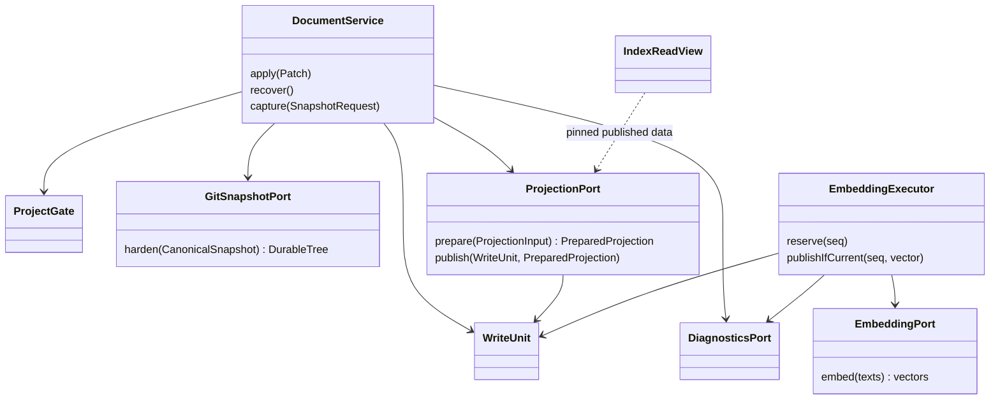

# letopis — механика

> **Links:** [requirements](requirements.md) · [resource-math](resource-math.md) · [contracts](contracts.md) · [data](data.md) · [architecture](architecture.md) · [decisions](decisions.md) · [подробная модель хранения](mechanics/storage-model.md)
> **Status:** agreed · **Date:** 2026-10-20 · **Based on:** requirements.md (2026-10-20), resource-math.md (2026-10-20), contracts.md (2026-10-20), data.md (2026-10-20), architecture.md (2026-10-20)
> **Counts:** 7 MC

## Правка 2026-10-20
По [D-90](decisions.md#D-90) закрыты A-1…A-3: publication всей outstanding delta с ограниченными rollback paths, details.active сохранённых ошибок и generic edge-aware snapshot metadata. Добавлены три изолированных model guards external_delta/diagnostic_state/edge_inspection; результаты проверяются заново, не считаются runtime proof.

## 1. Summary

Семь механизмов уточняют принятую архитектуру без новых процессов, брокера и истории успешных операций. Главные риски — порядок Git/файлы/SQLite, устаревшие embedding-результаты и единственность worker; для них выполнены три исполняемые модели: нормальные варианты не выявили нарушений, все 17 отдельных отключений защиты обнаружены. Graph/FTS и jobs фиксируются синхронно, embeddings независимо; согласованное многофайловое чтение использует Git snapshot. Корректность моделей при явно заданных storage-примитивах не означает пройденный power-loss drill, достаточную RAM или секундный полный поиск. Эти проверки остаются P-1/P-2/P-3, resource-math — draft/not assessed.

### Фиксированный раунд mechanics R1

| Gap | Решение | Последствие | Состояние |
|---|---|---|---|
| G1 | [D-76](decisions.md#D-76): одна защищённая фаза сохранения/восстановления на проект | Подготовка параллельна; окончательные предпосылки проверяются после входа в фазу | closed |
| G2 | [D-77](decisions.md#D-77): согласованное чтение по одному Git-снимку | Обычное live-file чтение не имеет межфайловой гарантии; reader locks нет | closed |
| G3 | [D-78](decisions.md#D-78): max_retries в существующей конфигурации | Четвёртое обязательное поле, целое ≥ 0; провайдеру не отправляется | closed |

Закрыто **3/3 в R1**, всего три пользовательских решения, новых вопросов в очереди **0**. [D-79](decisions.md#D-79) — отдельно отмеченные инженерные starting choices с проверками, не дополнительные пользовательские ответы. Принятые [D-74](decisions.md#D-74)/D-75 остаются assumed. Отсутствие продуктовых вопросов не подменяет проверку протоколов. [Intake](checks/mechanics/mechanics-round-1-audit-2026-10-19.md) хранит прежние 0/3, 1/3 и 2/3 как историю интервью.

## 2. Mechanisms

| ID | Part | Mechanism | Kind | Serves | Verified by | Risk |
|---|---|---|---|---|---|---|
| MC-1 | B-2 | Markdown → итоговый граф, hashes и точечные изменения | format | FR-3, FR-4, FR-5, FR-6, FR-7, FR-8, FR-9, FR-10, FR-11, FR-12, FR-35 | review; parser fixtures → roadmap | M |
| MC-2 | B-2, B-3 | Защищённое сохранение, восстановление и публикация reindex | protocol | FR-13, FR-14, FR-15, FR-16, FR-27, FR-28, NFR-1, NFR-2 | mechanics/model_commit.py | H |
| MC-3 | B-3 | Заменяемая работа, config и ограниченный retry budget | concurrency | FR-22, FR-29, FR-30, FR-31, FR-32 | mechanics/model_embedding.py | H |
| MC-4 | B-5 | Основание знания и адресованные bytes | algorithm | FR-17, FR-18, FR-19, FR-20, FR-23, FR-24, FR-34 | review; source fixtures → roadmap | M |
| MC-5 | B-1 | Единственный worker, IPC и отмена | state machine | FR-15, FR-16, FR-31, NFR-2, NFR-5, C-1 | mechanics/model_runtime.py | H |
| MC-6 | B-4 | Закреплённое чтение, ранжирование и обход | algorithm | FR-21, FR-22, FR-23, FR-24, FR-25, FR-26, NFR-3, NFR-7 | review; retrieval P-1/P-2 | M |
| MC-7 | B-2, B-6 | Диагностика, очистка и status | protocol | FR-30, FR-32, FR-33 | mechanics/model_runtime.py; review | M |

### MC-1 — фрагменты и граф

X-4 и его JSON Schema — единственная грамматика разметки; новый DSL не вводится. Markdown-кодек определяет неперекрывающиеся байтовые диапазоны и позиции строк, игнорируя примеры маркеров внутри code blocks. Вершина/метавершина имеет один непрерывный канонический фрагмент. Inline links с корректным letopis title создают направленные edges; includes остаётся отдельным системным типом. Source URI нормализуется по существующим правилам, source-UUID/created_at при reindex не генерируются заново.

Для apply/check операции разбираются в исходном порядке, временные ID разрешаются общей картой внутри вызова. Исходный JSON по JCS даёт hash правки до подстановки ID/created_at; этот hash не ключ дедупликации. UUIDv4 назначаются при подготовке; check ничего не резервирует. Явный перенос delete+create с тем же UUID проверяется по итоговой группе, без исторического резерва UUID. Удаление последнего представления требует удаления/переназначения всех входящих связей в группе; source без текущих ссылок сохраняет свою строку.

Перед записью и повторно после входа в project gate проверяются base_hash элемента, base_hash файла при append и base_hashes контекста. Ошибка любого precondition отклоняет всю группу. Рабочее представление — текущие канонические документы с overlay всей группы, а не устаревший индекс. Уникальность UUID nodes+edges, существование targets, kind источника includes, отсутствие self-loop/дубликата includes и DAG проверяет один Rust-валидатор. Обход DAG по всем затронутым компонентам либо полный DFS метаданных допустим; текст всего корпуса заново в FTS не индексируется. SQL сохраняет уже согласованные FK/CHECK/UNIQUE без триггеров.

Подготовка правок вычисляет byte-splices только размеченных диапазонов; посторонние байты сохраняются. Сдвиг суффикса и изменение длины файла входят в файловую фазу, при сбое допустимы недописанные байты до восстановления. Обязательного rename/замены файла не выбираем. Новый файл создаётся по свободному пути; пути проверяются от Git-root, без symlink-escape, специальные файлы не принимаются. Перед созданием каталогов журнал уже должен быть надёжным. Удаление элемента не подразумевает автоматическое удаление пустого файла/родительских каталогов.

Индексация перечитывает изменённые файлы и их оставшиеся элементы, чтобы обновить координаты после сдвига строк; поисковый текст/вектор неизменившегося элемента можно переиспользовать. Временное собственное search text строится единым кодеком без маркеров/служебного title, с подписями ссылок и собственными code examples, без загрузки назначений. SHA-256 этого представления хранится в nodes как search_hash; исходный hash по-прежнему покрывает точные bytes всего Markdown-фрагмента. Изменение только адреса ссылки не требует нового вектора при прежней подписи. Никакой raw текст не сохраняется в SQLite.

**Инвариант:** до durable-журнала канонические файлы не меняются; успешный apply допускает только валидный итоговый граф. Check выполняет ту же подготовку и возвращает paths/element_ids, но не пишет файлы, source-реестр, jobs или ID. Изменение одной вершины не означает полный reindex.

### MC-2 — commit, rollback и reindex

Один project gate внутри единственного worker охватывает финальную проверку и файловую фазу, восстановление и снятие согласованного канонического снимка. Читатель Git-снимка после его получения gate не удерживает. Конфигурация и финальная публикация reindex используют тот же порядок координации; вычисление модели никогда не занимает gate. Во всех мутациях порядок: project gate → краткая SQLite write unit, без обратного получения gate внутри DB-транзакции. Search/traverse используют отдельный read view, но после рестарта сначала ждут восстановления.

| State | Event | Guard | Next state | Effects |
|---|---|---|---|---|
| prepared (initial) | enter | project gate свободен | checked | повторно проверить hashes, итоговый граф и sources |
| prepared | cancel / validation failure | ещё нет канонических изменений | rejected | безопасная ошибка |
| checked | harden before snapshot | DurableTree выполнен | journaled | commit recovery(id=1, hash, snapshot, paths) и видимого лока |
| checked | I/O failure / crash | журнал ещё не durable | rejected | канонические файлы не тронуты |
| journaled | apply splices | журнал подтверждён | writing | изменить только разрешённые файлы |
| writing | sync files/directories | все итоговые bytes и новый снимок durable | durable | подготовить общую финальную DB unit |
| writing | error / crash / restart | journal существует | recovering | повторяемый откат по before snapshot |
| journaled | crash / restart | journal существует | recovering | тот же полный откат |
| durable | commit | запись файлов завершена | committed | graph/FTS/source metadata/revision/jobs + удалить recovery/lock атомарно |
| durable | crash / uncertain commit | открыть БД заново | recovering | наличие journal определяет исход |
| recovering | journal отсутствует | SQLite подтверждает финальный исход | committed | результат уже сохранён, replay нет |
| recovering | rollback complete | прежние bytes и каталоги синхронизированы | rolled_back | диагностика + удалить recovery/lock одной DB unit |
| recovering | crash / I/O failure | откат не завершён | recovering | journal остаётся, новые записи/поиск ждут |
| committed (final) | lost reply / cancel | commit состоялся | committed | успех не откатывается; агент inspect |
| rejected (final) | — | — | — | файловая группа не применена |
| rolled_back (final) | — | — | — | прежнее состояние и durable-диагностика |

Физический порядок:

1. Под gate получить/проверить текущий snapshot корпуса и прежде изменяемые paths; before tree содержит целые прежние файлы и отсутствие новых путей. Подготовить неизменяемый after tree из overlay. Оба удерживаются в refs/letopis/snapshots/<tree_oid>. Каждый принимаемый source_snapshot также отдельно закрепляется и harden-ится до успеха, даже если его адресованные bytes совпадают с before/after: его tree может иметь другой состав и не входить в их Git object closure. Любой выдаваемый inspect snapshot закрепляется до ответа. Временная работа не меняет HEAD или пользовательский Git index.
2. `GitSnapshotPort::harden` должен завершить долговечную запись замыкания blob/tree и refs, включая их backing files и directory entries, **до** commit recovery row. Git subprocess получает явные core.fsync=all/core.fsyncMethod=fsync, но сам exit 0 не является доказательством. FilePort обеспечивает необходимые платформенные барьеры, на macOS full flush; недоступность примитива — ошибка, не тихое ослабление. [R-8](research/R-8-durability-and-search-primitives.md).
3. Короткая WAL/FULL транзакция сохраняет единственный recovery(id=1,hash,snapshot,paths JSON) и lock(hash,paths,element_ids). SQLite row не содержит патч/текст. Затем apply_byte_splices/create; file sync и синхронизация изменённых directory entries, включая новые каталоги. Успех write()/close() недостаточен.
4. Область публикации — вся разница captured published revision → after tree, включая ранее не опубликованные внешние изменения, новые/удалённые файлы и зависимые координаты/связи; при отсутствии прежней revision — весь итоговый корпус. Это не расширяет paths канонической записи/отката: они остаются paths исходной правки. Одна финальная SQLite unit: убрать изменяемые/удаляемые исходящие edges, UPSERT nodes с сохранением row_id/source identity, удалить отсутствующие nodes после снятия зависимостей, записать итоговые edges, заменить FTS затронутых знаний, убрать несовместимые vectors, INSERT OR REPLACE jobs с новым seq и attempts=0. Обновить project.revision=after tree и нужные source metadata, удалить recovery/lock. Все адаптеры присоединяются к одной переданной unit; вложенных commit нет.
5. Только подтверждённый durable commit допускает успешный JSON hash/ids. Если COMMIT вернул неопределённый исход, не приступать слепо к откату: открыть SQLite заново, проверить recovery. Запись присутствует — rollback; отсутствует — сохранение завершено. Неопределимый из-за I/O исход блокирует продолжение до восстановления.

Rollback использует paths из доверенного журнала, не парсит повреждённую разметку. Существовавшие файлы полностью восстанавливаются из before tree; новые пути удаляются. Файлы и изменённые directory entries синхронизируются до удаления recovery. Вновь созданные пустые каталоги можно оставить: корпус и bytes восстановлены, отдельный журнал каталогов не вводится. Повторный rollback безопасен после любого прерывания. Успех/откат удаляют запись восстановления; Git-снимки сохраняются бессрочно. Диагностика отката с hash/paths фиксируется до удаления записи в той же DB-транзакции.

**Reindex.** При CLI-обращении обнаружение сравнивает канонические bytes с опубликованным snapshot, включая удалённые/новые размеченные файлы; source-изменения проверяются отдельно. Baseline обходит Markdown и хеширует bytes, а не полагается только на mtime/HEAD, watcher нет. Это обнаружение, не полное повторное индексирование. Свой apply знает delta записи файлов, но delta публикации вычисляет от опубликованной revision до итогового after tree. При обычной правке без внешнего отставания это только затронутые файлы/элементы, не полный reindex. Невалидная внешняя правка оставляет прежний индекс и диагностику; apply может исправить её, валидируя итоговый канонический overlay. Например, внешний невалидный A и валидно изменённый B после repair apply(A) публикуются вместе как A2/B1; rollback восстанавливает только A до состояния перед apply, сохраняя внешние изменения B. Успешная согласованная публикация завершает прежнюю active диагностику reindex.

Одна строка reindex_state(id=1,snapshot,paths,element_ids,attempts,max_retries) хранит текущую область и неизменяемый вход; прогресс/stage в памяти. Селекторы пусты — полный режим. Работа того же tree, покрывающая запрос, разделяется ожидающими CLI; прочие вызовы ожидают освобождения координатора и получают собственную работу, второй durable FIFO не нужен. После рестарта вход тот же; попытка резервируется заранее. Transient DB/I/O retries используют max_retries активной конфигурации, до её появления assumed 3; validation/conflict не повторяются бесконечно. При исчерпании — диагностика, row удаляется, прежний индекс остаётся.

Подготовка идёт вне gate, канонические файлы не меняет. PreparedProjection хранит адреса/search_hash, без Vec всех текстов. В финальной unit FTS-тексты последовательно перечитываются из неизменяемого tree; полный reindex может дольше удерживать writer/gate, это не обещание короткой публикации. Перед единой публикацией снова под gate: актуальный canonical tree должен совпадать с target snapshot, исходная опубликованная revision — с captured base, а конфигурация — с captured config identity; иначе conflict, не старый commit поверх нового apply. Полная пересборка сохраняет source UUID/created_at и конфигурацию; совместимые vectors переиспользуются, jobs переставляются только там, где нужны. Выборочный режим расширяется зависимыми связями/координатами; при смешении с ещё неиндексированными внешними изменениями включается весь обнаруженный delta, чтобы project.revision не обещал несуществующую проекцию. Reindex row удаляется в той же транзакции публикации graph/FTS/jobs/source metadata/revision. Векторов CLI не ждёт.

До commit отмена оставляет прежний индекс, удаляет reindex row и сохраняет диагностику; после commit публикация не отменяется. SIGINT явного reindex, включая присоединённый вызов, отменяет связанную общую перестройку; остальные её waiters получают cancelled по принятому X-1. Reindex --cancel делает то же. Независимые search/traverse и несвязанные задания не отменяются. Сбой после commit не восстанавливает старую работу из удалённой строки.

**Инварианты:** journal absent + успех ⇒ файлы/graph/FTS одного after snapshot; journal present ⇒ следующий обслуживаемый read/write ждёт полного rollback; старый reindex не заменяет новую revision. Произвольные live-file reads исключены из атомарного наблюдения по [D-77](decisions.md#D-77). Внешний Git взаимно исключён с сохранением/восстановлением по C-8; .git/index.lock сам по себе не считается универсальным обеспечением этой договорённости.

#### MC-2 — состояния reindex

| State | Event | Guard | Next state | Effects |
|---|---|---|---|---|
| pending (initial) | reserve/start | снимок закреплён, бюджет есть | active | durable attempts+=1; читать прежний target |
| pending | cancel / exhausted | до публикации | cancelled | завершить работу, диагностика |
| active | publish | canonical target, base revision и config identity совпадают | published | graph/FTS/jobs и DELETE reindex_state одной unit |
| active | transient failure / crash / restart | бюджет остался | pending | тот же snapshot и durable attempts |
| active | validation/conflict/exhausted | прежний индекс сохраняется | failed | durable owner=reindex diagnostic, удалить job row |
| active | SIGINT / cancel | до commit | cancelled | все связанные waiters cancelled, прежний индекс |
| published (final) | late SIGINT / lost reply | commit состоялся | published | не откатывать публикацию |
| failed (final) | — | — | — | active причина находима в errors.owner до исправления |
| cancelled (final) | — | — | — | явный следующий вызов — новая работа |

### MC-3 — embeddings, seq и попытки

Конфигурация — один provider/model/parameters/max_retries. Все поля обязательны; max_retries не входит в HTTP-body или search text. До настройки row отсутствует, config → null, вычислений нет. Любой config --set выполняет прежнюю полную замену: активная строка, очистка прежних vectors/queue и новые jobs для всех опубликованных знаний одной DB unit. Специального retry-only обновления не добавляется. Векторы source не вычисляются. Старый query держит прежнюю конфигурацию и SQLite snapshot до завершения.

Очередь: seq INTEGER PRIMARY KEY AUTOINCREMENT; node_id TEXT UNIQUE REFERENCES nodes(id) ON DELETE CASCADE; uri/snapshot TEXT NOT NULL; state IN (queued,failed); attempts INTEGER NOT NULL DEFAULT 0 CHECK(attempts>=0). Это одна строка на знание. Внутреннее имя attempts заменяет прежний эскиз retries, не добавляет второй счётчик. Снимок и uri определяют вход; raw текст в очередь не попадает. INSERT OR REPLACE не сбрасывает sqlite_sequence; исчезновение старого seq — окончательная отмена права старого вычисления публиковаться.

| State | Event | Guard | Next state | Effects |
|---|---|---|---|---|
| queued (initial) | reserve attempt | seq актуален, attempts < 1+max_retries | computing | в короткой DB unit attempts+=1; read config/input и release DB |
| queued | exhausted after restart | attempts >= 1+max_retries | failed | durable error и state=failed |
| computing | valid result | тот же seq ещё queued | removed | vector + DELETE WHERE seq одной write unit |
| computing | error / timeout | seq актуален, бюджет остался | queued | диагностика; один retry через assumed 1s |
| computing | error / timeout | бюджет исчерпан | failed | state и диагностика в одной unit |
| computing | crash / restart | строка сохранилась | queued | computing в памяти исчезает, attempts сохраняется |
| computing | replace / delete / cancel | старый seq удалён | removed | поздний результат не меняет новую работу |
| queued | replace / delete / cancel | удаляется исходный seq | removed | новая строка имеет другой seq; cancel сохраняет ошибку |
| failed (final) | — | новая работа — другая строка | — | не исполняется; restart не сбрасывает |
| removed (final) | — | — | — | архив done не создаётся |

Один executor обрабатывает один текст за раз. Перед HTTP attempt резервируется надёжно, затем текст читается из Git snapshot и преобразуется единым кодеком, вычисление вне write tx. Сбой после reservation может потратить попытку без запроса; иначе без дополнительного durable состояния нельзя строго ограничить повторы при рестартах. Failed recovery на исчерпанном attempts не отправляет ещё один запрос. Ошибка подготовки входа, отказ авторизации и неверный вектор используют тот же конечный бюджет; отдельного permanent-error каталога не вводим. Внешняя модель может получить повторный запрос после потери ответа, exactly-once вычисление не обещается.

Перед публикацией write unit заново читает строку по исходному seq: отсутствует — отбросить результат, не удалять новую строку по node_id. Удаление узла каскадно убирает job. Изменившийся search text снимает старый vector в той же транзакции и заменяет job. При прежнем search_hash и неизменной конфигурации существующий vector сохраняется; ещё выполняющаяся работа может оставаться по старому immutable snapshot того же текста. Поэтому проверка не требует равенства job.snapshot и project.revision. Новый seq при model switch защищает от старого результата даже при тех же bytes текста.

VectorPort принимает конечные float32 одинаковой длины, проверяет размерность/непустоту и запрещает некорректные значения. Native Ollama использует truncate:false, совместимый API проверяет индексы соответствия. Baseline vec1 no-index/cos без training/ANN и лишнего flat rebuild; при config reset virtual table пересоздаётся транзакционно, чтобы очистить старую размерность. Совместимость schema change/rollback со старым read view — обязательная реализационная проверка R-8/P-2, не доказанная моделью.

### MC-4 — источники и актуальность

Source URI — стабильный нормализованный адрес файла/диапазона, хешируются точные bytes; файл целиком без диапазона. Диапазон строк включителен, от 1; UTF-8 byte offsets и переносы строк не нормализуются. Source-узлы остаются при исчезновении файла и отсутствии ссылок, hash=NULL для недоступного источника. Содержимое остаётся в Git/рабочем дереве, не в SQL. Загрузка websites в v1 не вводится; допустимый URI не означает сетевой fetch.

Для create с external и edit при добавлении/замене источника нужен один source_snapshot всех итоговых привязок. Git-порт проверяет существование и тип tree; затем адресованные bytes из подтверждаемого снимка сравниваются с каноническим согласованным входом правки. Неравенство — conflict всей группы; новый недоступный источник — validation_failed. Edit без snapshot не обновляет основание; удалённые старые основания доступны по удерживаемым Git-деревьям, history-table нет.

В поиске/обходе flags вычисляются по индексным метаданным, текущему согласованному снимку проверки и источникам. Несовпадение текущего Markdown/hash/координат с индексом даёт stale; отсутствие адресованного источника — source_not_found; отличие от source_snapshot — source_changed. Один источник/несколько причин не дублируют flags. Пустой flags означает только отсутствие обнаруженной причины. Filters.source_revisions сравнивает адресованные bytes пары source+revision, а не commit OID и не разные external-привязки. Неверный формат/тип Git OID отличается от отсутствующего корректного объекта по X-3. Файл, изменившийся после снятия снимка проверки, требует следующей перепроверки; абсолютная актуальность live bytes на весь срок запроса не обещается.

### MC-5 — bootstrap и IPC

Идентичность endpoint — SHA-256 канонического Git-root и текущего UID. Runtime-каталог пользователя с правами 0700, socket 0600 и коротким basename не зависит от длины root. Это служебные файлы, не канонические документы. Kernel advisory lock на устойчивом lock-файле удерживается worker весь срок жизни. Файл не удаляется при освобождении; исчезает владение lock. Разные проекты имеют разные lock/socket; UID не публичный ACL продукта.

| State | Event | Guard | Next state | Effects |
|---|---|---|---|---|
| disconnected (initial) | connect | endpoint отвечает | connected | сверить protocol/root handshake |
| disconnected | endpoint absent / refused | — | starting | запустить worker candidate |
| starting | kernel lock acquired | нет живого владельца | recovering | только владелец удаляет stale socket и bind |
| starting | lock busy | другой кандидат победил | disconnected | ждать готовности, повторить connect без replay команды |
| recovering | recovery complete | устойчивое состояние | connected | обслуживать команды |
| recovering | crash / failure | — | disconnected | kernel освобождает lock, durable journal остаётся |
| connected | command complete | один JSON-ответ | closed | освободить соединение/свой read view |
| connected | SIGINT / disconnect | команда read-only | closed | отменить только свой запрос |
| connected | disconnect during apply | исход может быть неизвестен | closed | worker завершает commit/rollback; автоматического resend нет |
| closed (final) | — | — | — | следующий CLI — новый вызов |

Начальный connect не может удалить endpoint живого владельца. Под lock worker делает recover до запуска executor и обслуживания поиска/записи. Процесс candidate, не получивший lock, не bind-ит и не пишет служебную БД. Restart может повторить только безопасное подключение, не уже отправленную мутацию.

Один Unix stream обслуживает один вызов. NDJSON request содержит command и input; command включает согласованный вариант флага apply --check/config --set и т.п. Эта обёртка только внутри IPC, внешний stdin не меняется. После request допустим только один cancel frame; worker пишет единственный JSON response, соответствующий X-1, и закрывает stream. Внутренний handshake содержит protocol=1 и root, предотвращая попадание запроса в другой проект. ID request не нужен при одном вызове на соединение; уведомления о прогрессе не стримятся, status остаётся отдельной командой.

Нет общего execution timeout в 1 секунду или автоматического retry мутации. Локальные busy/connect попытки не отправляют команду повторно. Нет TTL daemon, lifecycle-команд, нового TCP API или process registry. Потеря ответа apply ведёт к inspect, даже если отправитель считает прежний hash знакомым.

### MC-6 — чтение, поиск и обход

Search/traverse получают отдельное SQLite-соединение, BEGIN и первое чтение revision/config закрепляют один read snapshot. Query embedding вызывается напрямую с этой конфигурацией, без очереди документов и без write lock; при ошибке один FTS-поиск и diagnostics. Read view освобождается при результате/отмене/error. Запись диагностики выполняется после закрытия read view отдельной storage unit либо через отдельного writer; нельзя пытаться повысить тот же read snapshot до writer.

Фильтры разных полей объединяются И, внутри списков — хотя бы одно совпадение; пустой/отсутствующий список одинаковы. Source и source_revision проверяются на одной привязке. Полный eligible-набор формируется до итогового limit, включая динамическую проверку источников. Source не самостоятельный search text, но доступен inspect/traverse. FTS возвращает все подходящие совпадения, vec1 exact — все доступные подходящие vectors; преждевременный LIMIT перед фильтрами запрещён. Первый baseline допускает полный перебор метаданных и векторов, без необоснованного oversampling.

FTS сортируется по bm25, vector — по cosine distance; ties по UUID. При наличии каналов union объединяется score=Σ(1/rank), rank от 1 в каждом канале; отсутствующий ранг даёт 0. Итог score desc, UUID asc, затем limit. При отсутствии vectors/config/query embedding только FTS. Значения метрик и вычисленный score внутренние, новый публичный score не добавляется. FTS query строится как литеральные токены в кавычках из строки пользователя, без прямой SQL/FTS-синтаксической интерполяции. Пустая нетокенизируемая строка даёт пустую выдачу, не ошибку SQL. Конкретное качество токенизации/rank проверяется P-1; языковых квот нет.

Traverse — BFS от уникальных ID; все старты проверяются до обхода, неизвестный ID отклоняет вызов. Соседи упорядочены по edge UUID; relations исключает includes, containment оставляет includes, both объединяет. Direction применяется отдельно: outgoing/incoming/both; includes также один шаг глубины. Посещённые ID возвращаются один раз, старты исключены, но расширяются. Depth=0 возвращает пустые элементы/рёбра. Limit ограничивает суммарные vertex/metavertex/source по X-1; edge_limit независимо ограничивает возвращённые фактически пройденные edges, не прекращает поиск элементов. При отсутствии edge_limit edges не включается. Рёбра добавляются только при фактическом рассмотрении перехода в допустимой глубине; альтернативный путь к уже посещённой вершине тоже пройден, но не дублирует элемент. Когда достигнут node limit, новые переходы не выполняются; никакого induced graph всех связей между результатами не строится.

Inspect пакетно получает у B-2 один текущий канонический Git snapshot под gate для generic element_ids: вершины/метавершины, рёбра и явно запрошенные source без входящих ссылок. I-12 возвращает Map<Uuid, InspectedElement> с общими path/lines/hash/file_hash, не только NodeMetadata. Для ребра кодек находит ссылку в каноническом источнике этого tree, вычисляет её независимый JCS-хеш и диапазон строк самой ссылки; SQL hash/lines не используются. Отсутствующий в текущем tree ID отклоняет всю группу, дубли выдаются один раз. Индексные stale координаты не подставляются вместо текущих; file_hash вычисляется один раз на уникальный файл в пределах вызова, постоянного кэша нет. JSON содержит только метаданные/ссылки. Агент, которому нужен согласованный набор содержимого, читает все пути из этого же tree по [D-77](decisions.md#D-77); обычные live reads не получают такой гарантии.

### MC-7 — диагностика и состояние

Хранение E-10 одно, [D-75](decisions.md#D-75): error row имеет внутренний row_id, безопасные code/message/details JSON, active INTEGER CHECK(0,1), owner TEXT для active причины. ID/owner не выходят в CLI. В каждом сохранённом сообщении status/errors/errors --clear поле details.active обязательно и равно errors.active (JSON boolean). Оно добавляется в копию details при проекции, не дублируется в хранимом details. Непосредственный Failure.error не требует lifecycle-метки: он не является записью истории. Owner — reindex либо embedding:<uuid>; это внутренняя принадлежность причины, не ID операции. Active owner сохраняется после удаления terminal reindex row; успешная публикация исправленного графа завершает его. Новый retry переводит прежнюю active ошибку своего owner в completed и добавляет новую active одной unit, не удаляя историю сообщений. Успех/замена/удаление embedding job завершает его owner; failed сохраняет active. Ссылки error_id в jobs/reindex_state не нужны, отдельного реестра владельцев нет. Авторы B-3/B-4/B-5 задают смысл active, B-2 предоставляет storage unit, B-6 только читает. Хеш правки и paths достаточно для rollback diagnostics, element_ids и полный патч не копируются. Ключи окружения/HTTP Authorization никогда не сериализуются.

Вставка ошибки и финальное изменение её причины, если в той же БД, выполняются одной unit. Rollback завершён: синхронизировать прежние файлы, INSERT завершённой ошибки, DELETE recovery/lock и COMMIT. Crash до этого оставляет журнал и повторный recover; после этого ошибка сохраняется. Errors --clear делает DELETE WHERE active=0 одной короткой write tx и возвращает оставшиеся строки; status/errors читают, не удаляют. Конкурентная новая вставка после clear не теряется. Нет агрегации, TTL, бессрочного replay-cache или автоматического удаления старых сообщений.

Status собирает один SQLite read snapshot (revision, queued count, locks, errors) и соответствующий доступный runtime progress, без атомарного обещания между CPU progress и disk rows. completed — процент текущего этапа, null при неизвестном знаменателе; после смены этапа отсчёт новый. Embedding_jobs = COUNT WHERE state=queued, включая runtime вычисление/ожидание повтора, failed исключены. Active reindex после рестарта восстанавливается по durable row, вычисляемая embedding-работа — по queued. Завершённая ошибка остаётся до clear, active не очищается. Status/errors возвращают обе группы с details.active: failed embedding имеет true, сообщение после успешного исправления — false. Ошибки query embedding также сохраняются и видны с false, не выдаются за failed фоновое задание; queued count по-прежнему исключает failed. Параметры A-10/A-11 — расчётный профиль, не квота сообщений.

## 3. Trivial parts

B-6: только проекция текущего состояния через MC-7; собственного долговечного lifecycle/хранилища нет. Остальные части покрыты MC-1…MC-6; отдельные псевдосервисы для каждого порта не вводятся.

## 4. Internal contracts

| Interface | Spec | What the format must guarantee |
|---|---|---|
| I-1, I-3, I-5, I-6 | contracts/I-1-worker.yaml | Один вызов/stream, существующие X-1 payloads, handshake и request-local cancel, no automatic mutation replay |
| I-2 | contracts/I-2-projections.md | PreparedProjection присоединяется к переданной write unit; без вложенного commit и SQL-копии текста |
| I-4, I-7 | contracts/I-4-sources.md | Проверка всех адресованных оснований либо flags/filter по одному snapshot |
| I-8, I-9, I-10 | contracts/I-8-read-view.md | Типы read view и StateParts, consistency и освобождение |
| I-11 | contracts/I-11-diagnostics.md | Безопасная диагностика, owner-defined active, append/clear без потери активной ошибки |
| I-12 | contracts/I-12-snapshot.md | Неизменяемый snapshot с текущими метаданными, без чтения partial live files |

Спецификации общих in-process портов используют Rust-подобные типы и явно определяют транзакционное владение; wire-schema только у процессной границы. [C4 level 4](diagrams/mechanics-types.mmd) показывает важные типы/порты, не производственные классы с выдуманными методами.

## 5. Timing, memory and concurrency rules

- Один process lifetime kernel lock и один project gate; DB write unit берётся после gate там, где нужен, embedding publisher работает только через короткую DB unit и gate не запрашивает. Callback из DB-порта в координатор запрещён. Query не держит gate во время модели/обхода.
- SQLite WAL/FULL, macOS fullfsync и foreign_keys=ON на каждом соединении; один owner writer connection, отдельное соединение на активный search/traverse. Не фиксируется произвольный большой connection pool. Config DDL/vec1 reader coexistence требует P-2/P-3. WAL checkpoint не выполняется с ожиданием всех читателей внутри файловой фазы; длительный reader может увеличить WAL, что учитывается в P-2.
- Базовый синхронный Rust I/O и std threads без выбора async runtime: reader/worker на IPC-вызов, единый embedding executor, один reindex coordinator. Число до 10 клиентов — профиль, не скрытый отказ одиннадцатому. Нового admission API, broker или concurrency knobs нет.
- Retry reservation durable; задержка assumed 1s не обещает срок опустошения очереди. Wall-clock Unix seconds используется только для created_at, elapsed/backoff — монотонное время. Отмена проверяется между файловыми шагами/SQL-итерациями; после начала файловой записи apply заканчивает commit либо rollback, разрыв сокета не оставляет journal без владельца.
- M-1 хранит IDs/ranks/visited и pinned read view, M-2 один временный текст/вектор и конфигурацию; M-3 работает по изменённым файлам, reindex читает файлы последовательно и удерживает графовые метаданные, а не все тексты. M-4 содержит состояние активных вызовов. Корпус, embeddings и модель не загружаются заново на каждого агента. Нет новых текстовых кешей. Суммарные 1 ГБ приложения+модель на 4 ГБ машине остаются целью, не распределённым/доказанным бюджетом.
- Resource-math: A-1…A-11 и 0 L; новый timeout/квота не выводятся из расчётных средних. 100k знаний/100k source/500k edges ограничивают рабочую проверку P-2; exact baseline/полный detection scan могут быть медленными. Прогретая секунда — оптимизация, результат не обрезается по времени. Allocation failure до записи не меняет данные, после journal ведёт к rollback/restart; SIGKILL не обязан вернуть JSON.

## 6. Executable checks

Три stdlib Python модели, не production-код и не нагрузочные замеры. Каждая предоставляет run(broken=False) → список нарушений; нормальный результат должен быть пуст, broken=True обязан показать нарушение реальной защиты.

| Model | Enumeration / invariant | Broken protection |
|---|---|---|
| mechanics/model_commit.py | Crash на границах before/journal/частичных byte edits/flush/DB commit, повторный rollback; save interleavings с hashes/includes; late reindex. Нет journal — complete committed state, есть journal — полный откат | Выключает сериализацию check→publish и условие устаревшей публикации; отдельно проверяет раннее удаление журнала |
| mechanics/model_embedding.py | Перестановки compute/replace/config/cancel/publish, CAS по seq; max_retries=0…3 и crash после reservation. Совместимый вектор не уничтожает новую работу, число calls ≤ 1+max_retries | Убирает seq check и durable reservation |
| mechanics/model_runtime.py | Конкурирующие startup candidates, crash/release/rebind; request cancellation; error append/clear и rollback-error commit | Убирает kernel-owner gate/stale-unlink guard и active predicate |

Модели задают атомарность SQLite commit и корректные durable/barrier операции как предпосылки. Они не доказывают реализации Git, FTS5, vec1 или SSD. Полнота ограничена перечисленными состояниями/двумя competing actors и явно выбранными crash points, не формальная проверка всей системы.

## 7. Reconciliation with earlier steps
2026-10-19: [D-83](decisions.md#D-83) формализует assumed внутренний provider client deadline 60s per attempt, без общего timeout search/reindex/recovery и без новых JSON/config полей. Timeout использует прежний embedding_failed/FTS fallback; redirect/неявные environment proxies отключены, HTTPS certificates проверяются. Реальное cancellation/resource release проверяется DR-5/DR-8, не объявляется пройденным.

[D-76](decisions.md#D-76) закрывает ранее отложенную сериализацию, [D-77](decisions.md#D-77) сужает слишком широкую фразу X-4 о наблюдении файлов до принятой границы, [D-78](decisions.md#D-78) добавляет max_retries в JSON Schema/config/examples и SQL. [D-79](decisions.md#D-79) отмечает assumed точные инженерные правила. В подробной storage-model устранены историческая SQL-history в финальном commit и ожидание vectors при reindex; актуальный counters/DDL уточнён без копирования текстов. [D-69](decisions.md#D-69) whole replacement сохраняется, новый тип сообщения, таблица конфигурации или operation ID не вводятся.

Nodes/edges/row_id/created_at/source_snapshot и source-идентичности сохраняют прежнюю модель. Search_hash — один производный хеш для уже согласованного reuse, не новый текстовый cache. Восстановление использует singleton id=1 при принятом одном protected save; hash не становится execution ID. Долговечные минимумы reindex/diagnostics используют уже выделенные E-12/E-10. Архитектурные B-1…B-6 и I-1…I-12 не меняются.

## 8. Risks, assumptions and open questions

Продуктовых развилок R1 нет. Assumed choices [D-74](decisions.md#D-74)/D-75/D-79 проверяются:

| Risk | Cheapest validation | Boundary |
|---|---|---|
| Durability Git/file/directory/SQLite и source registry после полной потери БД | MC-2 model затем P-3 на macOS/Linux, missing/corrupt object/SQL I/O | Модель не равна физическому доказательству NFR-1 |
| Config reset с другой размерностью, старый read view FTS/vec1, interruption | Узкий интеграционный P-2/P-3 на выбранной сборке | Нет неявного fallback на SQLite без расширения |
| Singleton, stale socket, длинный root, SIGINT/lost response | Model + A-AR1 multi-process probe | Kernel locking и filesystem support отдельно от моделируемой owner переменной |
| Счётчик attempts и консервативная трата попытки при crash | MC-3 model, fault injection до/после HTTP | Exactly-once provider call не обещается |
| Полный detection scan/exact ranking, model memory и большие JSON/graph reads | P-2 mixed clients/RAM/latency | 1 ГБ и 1s не объявлены пройденными |
| Простой rank/tokenization и usefulness/freshness | P-1/P-2 реальный корпус | Усложнять только после проверенного недостатка |
| Diagnostics clear vs append/recovery | MC-7 model + A-AR2 restart/storage fault | Нет TTL/агрегации или auto-clear |

Внешний Git соблюдает принятую взаимную координацию C-8; перехват произвольного git checkout другим процессом или редактирования в обход CLI не выдаётся за обеспеченную OS-защиту. Проверка root/socket/путей нужна и без продукта ACL.

## 9. Deferred

→ resilience: реестр faults/threats, backup БД+Git, потеря source-идентичностей, corruption, secrets/permissions, RPO/RTO и эксплуатационная координация Git.

→ roadmap: P-1/P-2/P-3, A-AR1…A-AR5, версия parser/crates и extension build, FTS/vec1 snapshot/config-reset tests, реальный flush/power-loss, agent skill с [D-77](decisions.md#D-77). Ресурсные измерения сейчас не запускаются.

## 10. Consistency check

2026-10-19: интервью закрыто 3/3. Независимый reviewer подтвердил исправление шести содержательных замечаний и закрытие логической clarity gate. Три normal-модели проходят, все 14 isolated guard removals обнаруживаются; 69 внутренних schema cases и 97 проверок внешних schema/examples проходят. Mermaid level 4 синтаксически разобран; визуальный рендеринг не выполнялся. Статус agreed относится к проекту механизмов, не реализации. Результаты схем/примеров, моделей (включая broken variants), Mermaid parsing и ревью сохраняются в checks/mechanics/mechanics-checks.json и checks/mechanics/mechanics-review-2026-10-19.md. Не заявляется прохождение реализации или P-1/P-2/P-3.

## Sources

[R-8: первичные примитивы](research/R-8-durability-and-search-primitives.md); [SQLite WAL](https://sqlite.org/wal.html), [isolation](https://sqlite.org/isolation.html), [FTS5](https://www.sqlite.org/fts5.html#contentless_delete_tables), [Vec1](https://www.sqlite.org/vec1doc.html), [Git config](https://git-scm.com/docs/git-config). Документированные возможности не подменяют проверку составного протокола. [R-2](research/R-2-rust-sqlite.md)/[R-6](research/R-6-sqlite-capacity-probe.md) остаются историческими ограниченными пробами; их flat/cos и числа не объявляются новым runtime verdict.
